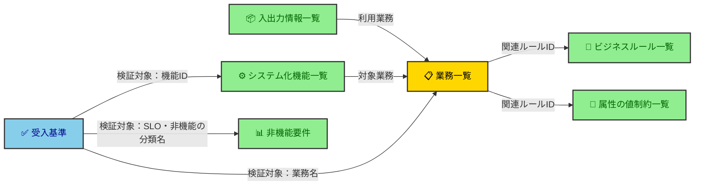

# 要件定義書の構成

良い要件定義書とは何かという**立場**は [requirements-doc-policy.md](../../docs/policy/requirements-doc-policy.md) が定める。ここでは、それを踏まえた**構成の書き方（How）**だけを定める。

## 対象読者

AIエージェントが、要件定義書（`docs/requirements.md` と `docs/requirements-detail.md`）とその別紙を書く・レビューし、含める項目・どの項目をどちらのファイルに置くか・列の定義・ID体系・詳細トグルの記法・どの項目をどの順に書くか（記載段階）・仕分け台帳の列・別紙の書き方に迷ったとき。

## 表は幅で潰さない（記法）

立場は requirements-doc-policy.md「表は幅で潰さない」が定める。ここでは記法だけを定める。

### 詳細トグルの記法

記法は Rule document-writing-for-humans.md「トグルの記法」に従う。要件定義書はそこに次を上乗せする。

- `summary` は `ID 名前`。`ID` を持たない表では行の識別語（項目名・用語名）を書く。表には `ID`（または識別語）が残るので、読み手はそこから詳細を引ける。
- 詳細は表と同じ `ID` 順に並べる。

トグルは GitHub 等での閲覧を前提とする。要件定義書を PDF・印刷で渡す必要が生じたら、`<details>` を `<details open>` へ一括置換して全開で出力する。

### 詳細トグルは2種類ある

どの行に詳細を作るかは、次のどちらの型かで決まる。**「長くなりそうか」を書き手に判定させない**——refined-engineer-judgment-principles の「判断軸は『既定値＋反転条件』で与える」のとおり、内心の評価を条件にしたゲートは働かないからである。だから型ごとに、既定値と、それが反転する外形的な条件を決める。

| 型         | 中身                                           | どの行に付くか                                                 | 例                             |
| ---------- | ---------------------------------------------- | -------------------------------------------------------------- | ------------------------------ |
| **本文型** | 表から外した必須項目。下表が表ごとに名指しする | その表の**全行**（例外なし）                                   | ビジネスルール一覧のルール本文 |
| **補足型** | 列に書けない根拠・補足                         | 既定は付けない。**列の記述だけでは読み取れない**行にだけ付ける | 属性の値制約一覧の値制約の根拠 |

1行に両方あるなら、1つのトグルにまとめる。

### どの表のどの項目を詳細へ出すか

- **業務一覧**：`区分の理由`
- **ビジネスルール一覧**：ルール本文
- **属性の値制約一覧**：なし（補足型だけを置く）
- **入出力情報一覧**：`内容`・`取扱量`・`頻度`・`利用目的`
- **システム化機能一覧**：`優先度の理由`
- **機能仕様**：`適用ルール`・`事後条件`・`主要な例外`

ここに無い表は本文型を持たない（列が少なく各セルも短いため）。補足型はどの表にも置いてよい。

**追跡列は本文型に選ばない。**「相互参照（トレーサビリティ）」が名指しする追跡列——業務一覧の `関連ルールID`、入出力情報一覧の `利用業務`、システム化機能一覧の `対象業務`、受入基準の `検証対象`——は、上の名指しから外す。表を索引として引くとき、どの業務・どのルールに紐づくかが表の上で完結している必要があるためである。

**属性の値制約一覧だけは列を外さない。** この表の各列は制約値そのもの（桁・形式・取りうる値）で短い。加えて1列1項目に割り当てておくと、書き手が全項目を1つずつ埋めることを強いられる（該当しなければ `なし` と書く）。1つのセルに畳むと、この強制が消えて考えなかった項目が自由文に埋もれる。

## 要件定義書の構成（必須項目と記述基準）

要件定義書（PRD）に含める項目と、各項目をどちらのファイルに置き、何を書くかを定める。`/elicit-requirements` はこの構成に従って要件定義書の2つのファイルを書き、レビューはこの構成を基準に検証する。**構成の唯一の正典はこの節**であり、他の文書で再列挙しない。

版数・作成者・承認ステータスは本文に持たない。git 履歴と Issue で追跡する（documentation-policy：進捗・経過・状態は本文に書かない）。

各項目には区分を付す。

| 区分     | 意味                                                                 | 該当しないとき                     |
| -------- | -------------------------------------------------------------------- | ---------------------------------- |
| 必須     | 常に書く                                                             | —                                  |
| 条件付き | ある事実があるときだけ必須（例：外部連携があればエコシステムマップ） | 「該当なし・理由：〇〇」と明記する |
| 任意     | 書くかを書き手が判断する                                             | 書かなくてよい                     |

**条件付きの項目は、その項目の記載段階（項目一覧の `記載段階` 列。サブ項目は同じ列がそのサブ項目に示す段階）で、判定の入力になる表を書き終えてから該当有無を判定する。** 判定に使う入力——どの表のどの列を見るか——は各項目の節に書く。書き手の主観（重要そうか）で決めてはならない。入力の表を書き上げた時点で満足し、条件付きを黙って落とすからである。

### 2つのファイルと対象読者

要件定義書は、読み手の違う2つのファイルに分ける（立場は requirements-doc-policy.md「要件定義書は読み手別の2ファイルに分ける」）。「要件定義書」は2つを合わせたものを指し、1つだけを指すときはファイル名で呼ぶ。どの項目をどちらに置くかは、次の「項目一覧」の `置くファイル` 列が決める。

各ファイルの `#` 見出しの直後に、想定シーンの形の対象読者の一文を置く。重点を示す一覧や NOTE は足さない（❌ 対象読者の一文の後に `> [!NOTE]` で「顧客は概要から受入基準までを重点的に読む」と足す）。文面は次のとおりで、スケルトン（`docs/` の2ファイル）と手本（`samples/docs/` の同名の2ファイル）の冒頭に、そのまま載せる。`requirements-detail.md` の見出しの骨組みは、スケルトンが同じ形で持つ。

`docs/requirements.md`：

```markdown
# 要件定義書

顧客がこのシステムに何が求められているかを確認して合意するとき、関係者が全体像を掴みたいときに参照する。重点的に読むのはこのファイルで、設計・実装向けの詳細は `requirements-detail.md` にある。
```

`docs/requirements-detail.md`：

```markdown
# 要件定義書（詳細）

設計者・実装者（AI を含む）が、入出力情報・属性の値制約・機能の振る舞いを正確に引きたいときに参照する。顧客も合意のために確認するが、重点的に読むのは `requirements.md` である。

## 業務要件の詳細

### 属性の値制約一覧

### 入出力情報一覧

## 機能要件の詳細

### 機能仕様（ユースケース記述）

### 機能×入出力×ルール図

### 機能ごとのアクティビティ図

### 状態遷移
```

- 業務要件・機能要件のサブ項目は、`置くファイル` 列が示すファイルに `###` で置く。`requirements.md` では `## 業務要件`・`## 機能要件` の下、`requirements-detail.md` では上の `## 業務要件の詳細`・`## 機能要件の詳細` の下である
- 別のファイルにある ID を指すときも、ID を文字で書く（`F-01 の事後条件`・`AC-38` など。リンクにしない）。ID だけで辿れ、リンクにすると書く手間が増えるためである

### 項目一覧

| 項目                     | 区分                                                   | 記載段階                                                                                                                   | 置くファイル                                                                                                                                               | 何を書くか                                                                                                                                                                                                                                                                                                                                                                                                  |
| ------------------------ | ------------------------------------------------------ | -------------------------------------------------------------------------------------------------------------------------- | ---------------------------------------------------------------------------------------------------------------------------------------------------------- | ----------------------------------------------------------------------------------------------------------------------------------------------------------------------------------------------------------------------------------------------------------------------------------------------------------------------------------------------------------------------------------------------------------- |
| 概要                     | 必須                                                   | 1                                                                                                                          | `requirements.md`                                                                                                                                          | 何を作るのかを1文1行で、改行して3行以内に言い切る（1段落にまとめない）。なぜ作るのかは「目的」「解決する課題」に書く                                                                                                                                                                                                                                                                                        |
| 目的                     | 必須                                                   | 1                                                                                                                          | `requirements.md`                                                                                                                                          | 達成したいことを一文で言い切る。最重要。一文に「〜と〜」が並ぶなら目的が割れているサイン——分割を疑う                                                                                                                                                                                                                                                                                                        |
| 背景・入力元             | 必須                                                   | 1                                                                                                                          | `requirements.md`                                                                                                                                          | もとにした RFC 等への参照（何を根拠にしたか）                                                                                                                                                                                                                                                                                                                                                               |
| 用語定義                 | 必須                                                   | 1                                                                                                                          | `requirements.md`                                                                                                                                          | 要件定義書固有の用語だけ定義する。全社共通語は用語集（[../../docs/project-context/glossary.md](../../docs/project-context/glossary.md)）へリンクする（DRY）。文書で使う固有の名詞（ER 図の箱名・属性名・入出力情報の名前）は、用語定義か入出力情報一覧のどちらかで定義する。社内やこの業務でだけ使う略語は、略称ごと用語定義に載せる。業界や外部の仕様で一般の意味のまま使う略語（SLO・API など）は載せない |
| ターゲットユーザー       | 必須                                                   | 1                                                                                                                          | `requirements.md`                                                                                                                                          | 開発対象を使う人を役割（職種・立場）で列挙し、役割ごとに何のために使うかを添える                                                                                                                                                                                                                                                                                                                            |
| ステークホルダー／関係者 | 必須                                                   | 1                                                                                                                          | `requirements.md`                                                                                                                                          | 意思決定者・承認者・利用部門など。「使う人」と「決める人・責任を負う人」を区別する                                                                                                                                                                                                                                                                                                                          |
| エコシステムマップ       | 条件付き：外部アクター・外部システムとの授受があるとき | 2                                                                                                                          | `requirements.md`                                                                                                                                          | 開発対象を黒箱として置き、外部との関係と授受を1枚で俯瞰する概念図 → [詳細](#エコシステムマップ)                                                                                                                                                                                                                                                                                                             |
| 解決する課題             | 必須                                                   | 1                                                                                                                          | `requirements.md`                                                                                                                                          | 「誰の」「どんな困りごと」を解くのか。具体的に書く                                                                                                                                                                                                                                                                                                                                                          |
| 業務要件                 | 必須                                                   | 2（業務一覧 → 属性の値制約一覧の値の種類の表 → 入出力情報一覧）、3（ビジネスルール一覧 → 属性の値制約一覧 → 業務フロー図） | `requirements.md`（業務一覧・ビジネスルール一覧・業務フロー図）、`requirements-detail.md`（属性の値制約一覧・入出力情報一覧）                              | 開発対象が支える業務を、システムに依存しない What として構造化する → [詳細](#業務要件)                                                                                                                                                                                                                                                                                                                      |
| 機能要件                 | 必須                                                   | 4（システム化機能一覧 → 機能仕様 → アクター×機能図）、5（機能×入出力×ルール図・機能ごとのアクティビティ図 → 状態遷移）     | `requirements.md`（システム化機能一覧・アクター×機能図）、`requirements-detail.md`（機能仕様・機能×入出力×ルール図・機能ごとのアクティビティ図・状態遷移） | システムが担う機能と、その振る舞い → [詳細](#機能要件)                                                                                                                                                                                                                                                                                                                                                      |
| 非機能要件               | 必須                                                   | 6                                                                                                                          | `requirements.md`                                                                                                                                          | 品質特性ごとの要求を What として書き、観測可能なものを指標にする → [詳細](#非機能要件)                                                                                                                                                                                                                                                                                                                      |
| 優先順位                 | 必須                                                   | 7                                                                                                                          | `requirements.md`                                                                                                                                          | 各要件に優先度と、その理由を付ける → [詳細](#優先順位)                                                                                                                                                                                                                                                                                                                                                      |
| 制約と前提               | 必須                                                   | 1                                                                                                                          | `requirements.md`                                                                                                                                          | 列は `制約内容` / `判定`（`真の制約` / `見直し可能` / `保留`）/ `判定理由`。制約を再判定した理由はここに書く。`保留` の判定理由には追跡するチケット番号を添える。製品名・方式（How）も書いてよい（policy「制約と前提の行には当てない」）                                                                                                                                                                    |
| スコープ外（Non-Goals）  | 必須                                                   | 1                                                                                                                          | `requirements.md`                                                                                                                                          | やらないことを、区分付きで列挙する → [詳細](#スコープ外non-goals)                                                                                                                                                                                                                                                                                                                                           |
| 受入基準                 | 必須                                                   | 7                                                                                                                          | `requirements.md`                                                                                                                                          | 要件が満たせたと判断できる観測可能な条件 → [詳細](#受入基準)                                                                                                                                                                                                                                                                                                                                                |
| リスクと対応             | 必須                                                   | 7                                                                                                                          | `requirements.md`                                                                                                                                          | 想定されるリスクと緩和策 → [詳細](#リスクと対応)                                                                                                                                                                                                                                                                                                                                                            |

全項目に共通するルール：

- 図は Mermaid か draw.io で作る。どの項目に図が要るかは各項目の区分に従う。
  - AI が描く図は `/design-doc-mermaid` の Mermaid にする（自前で Mermaid を書き起こさない）。
  - 人間が描いた draw.io の図は、`.drawio.svg` で `docs/requirements-img/` に置き、本文に画像として埋め込む（``）。書き出しでは、図の XML を含めて圧縮を切り、背景色を指定する。XML が圧縮されていると AI レビューが図の中身を読めず、背景が透過のままだとダークテーマの GitHub で線が背景に溶けるためである。
  - AI が `.drawio.svg` を直してよいのは、ラベルの文字の置き換えだけである。XML（`content` 属性の中）と表示用の SVG の `text` の両方を書き換え、両方に新しい文字列があり、古い文字列が残っていないことを grep で確かめる。片方だけを直すと、AI が読む XML と人間が見る図が食い違う。図形の追加・削除・配置の変更と、折り返しで文字列が分かれていて1か所ずつ置き換えられないラベルは、人間に回す。XML だけでは表示用の SVG を描き直せず、Mermaid に描き直すと人間が draw.io を選んだ決定を覆すためである。
- 対話の経緯は本文に持ち込まない。要件そのものに紐づく根拠——制約を再判定した理由など——だけを「制約と前提」の判定理由に残す。
- チケット番号は、GitHub Issue なら `#123`、ほかのチケット管理ツールなら `[キー](URL)` で書く。要件 ID（`F-03`・`BR-08`）と見分けるためである。どこに書いてよいか、いつ消すかは requirements-doc-policy.md「未決事項は節を置かず、チケットで追う」が定め、書き方と決着は次の「未決の行のチケット番号」が定める。仕分け台帳も同じ書き方を使う。
- 1つの語には1つの意味だけを持たせる。用語・入出力情報の名前・区分値・動詞のどれでも、同じ語を別々の物や別の主体の行為に使わない。読み手が別の物を同じ物と読み違えたまま設計に進むためである。例：❌ `通知メール`（本システムが受信者に送るメール）と `配信結果の通知`（配信サービスが本システムに返す知らせ）→ ✅ `メール` と `配信結果の通知`。❌ 本システムが依頼を `受け付けた` と、配信サービスがメールを `受け付けた` → ✅ 配信サービスの側は `引き受けた`。`残高・履歴` と `残高照会要求` のように、同じ語が同じ物を指すなら当たらない。どうしても同じ語を使うなら、用語定義に2つの違いを書く。
- 表の名前の列は、全行を造語として名付ける。対象の列は、用語定義の `用語`、ターゲットユーザーの役割名、業務一覧の `大分類`・`中分類`・`小分類`、ビジネスルール一覧の `ルール名`、属性の値制約一覧の `属性名`、入出力情報一覧の `情報名` と `内容` の表の `属性名`、システム化機能一覧の `機能名`、SLI の `指標` である。名前は表の外（ルールの本文・機能仕様・受入基準）で単独で読まれる。日常語の組み合わせは造語に見えず、造語の命名基準が当たらないので、造語かどうかを書き手に判定させず全行に当てる。当てる規則は次のとおり。写し元は Rule `document-writing.md`「造語の名前は、コードの変数名と同じ基準で付ける」で、レビューの L1 がその Rule を読まないので、ここに書き写す。
  - 何についての語かを名前に入れる。❌ `登録の記録` → ✅ `抑止リストの登録履歴`
  - それだけでは何も指さない語（記録・情報・機能・基盤・処理・対応・管理・データ・内容・語・項目・もの・要素）を、名前の最後の語にしない。機能名と業務一覧の分類名には当てない（末尾の語が行為を名指しし、前の語が対象を言う：`失効処理`・`ポイント管理`）
  - 略さない。業務や外部の仕様で既に使われている略語（SLO・API など）は当たらない
  - 要件定義書（2つのファイルを通して）のほかの名前と同じ語が入っていて区別がつかないなら、一方を付け直す

  写し元にある「作ったその編集で、一行の定義を足す」は、名前の列の行に当てない。名前の列の行は、その表自体が定義になる（定義の置き場は用語定義の行が定める）。

- 名付けたら、名前だけを読んで何を指すか言えるかを確かめる。属性名は何の値か、情報名は何の情報か、機能名は何をする機能か、ルール名は何についての決まりか、それ以外は誰・何を指すか。言えなければ、属する物の名前（入出力情報・業務・用語定義の語）を前に付ける。❌ `測った値` → ✅ `体温の測定値`。❌ `確認日時` → ✅ `失効処理結果の確認日時`。✅ `送料`・`SLIの実測値`（このままで何の値か言える）

### 未決の行のチケット番号

- この節の「セル」は、表のセルと、詳細トグルに出した項目（ビジネスルールの本文、入出力情報一覧の `内容` など）を指す。`#123` は、上の「全項目に共通するルール」の書き方に従って読み替える
- 値が無いセルは `未確定（#123）`、案があるセルは `値（#123）` と書く
- 決着したら、セルを値に置き換えて番号を消す。チケットのタスクに「値を要件定義書に反映し、番号を消す」を入れ、そのチケットは値を反映した PR で閉じる（GitHub Issue はその PR の `Closes` で閉じる。ほかのチケット管理ツールは、PR のマージ後にそのツールで閉じる）
- チケット番号の無い `未確定` は違反とする
- `--stage`（`/requirements-review` を記載段階の途中で当てるモード）で、列の値の縛り（例：`ウィンドウ型` 列は `ローリング` / `固定カレンダー` の2値）と NG サインを当てないのは、チケット番号を添えた `未確定（#123）` のセルだけである。値が無いので、当てると必ず違反になるためである
- `値（#123）` のセルは、`（#123）` を除いた値にすべての規定を当てる。顧客に確認する値が判定を通っていないと、合意の後に凍結判定で落ちて確認をやり直すことになり、`#` を足すだけで判定を逃れられるためである。例：`適切に計算する（#97）` は、`適切に計算する` が抽象語の NG サインに当たるので違反になる
- 凍結判定の例：BR-01 の本文に `未確定（#45）` が残っていれば凍結しない。SLO の `目標値` の `未確定（#50）` と、制約と前提の `保留` 行の判定理由の `#51` は残ってよい

### 記載段階

要件定義書は一括で書かず、次の記載段階の順に、1段階ずつ Issue に区切って書く（立場は requirements-doc-policy.md「一括でなく段階的に書く」）。各項目がどの段階に属するかは項目一覧の `記載段階` 列が持ち、ここでは再列挙しない。

| 段階 | 名前               | 何を固めるか                                                                                                                                                                                                                                                     |
| ---- | ------------------ | ---------------------------------------------------------------------------------------------------------------------------------------------------------------------------------------------------------------------------------------------------------------- |
| 1    | スコープと台帳     | 作る範囲を縛る項目と、入力資料の全数仕分け（[仕分け台帳](#仕分け台帳)）                                                                                                                                                                                          |
| 2    | 業務要件①          | 業務要件のうちこの段階のサブ項目を書き、この段階に属する他の項目はそのあとに書く                                                                                                                                                                                 |
| 3    | 業務要件②          | 業務要件のうちこの段階のサブ項目                                                                                                                                                                                                                                 |
| 4    | 機能要件①          | 機能要件のうちこの段階のサブ項目                                                                                                                                                                                                                                 |
| 5    | 機能要件②          | 機能要件のうちこの段階のサブ項目                                                                                                                                                                                                                                 |
| 6    | 非機能要件         | 項目カタログの全分類の節と、SLI・SLO・SLA                                                                                                                                                                                                                        |
| 7    | 前段階から導く項目 | 1〜6の表を入力にして導く項目                                                                                                                                                                                                                                     |
| 8    | 凍結判定           | 書く項目は無い。2つのファイルをまとめて、凍結してよいかを判定する。台帳に `未決` とチケット番号が残っているか、本体に requirements-doc-policy.md「未決事項は節を置かず、チケットで追う」が凍結後も残してよいとする箇所以外のチケット番号が残っていれば凍結しない |

`記載段階` 列の → は書く順であり、各ファイルの中の並びは項目一覧の行の並びと各節（機能要件の「サブ項目は次の順に並べる」など）に従う。段階の区切りと → の書く順は、後の段階が前の段階の出力を入力にできるように決めている。

- 制約と前提・スコープ外を1に置くのは、入力資料だけから書けて判定まで済むからである。後段階からは参照と Won't 行が増えるだけで、判定は変わらない。
- 業務要件と機能要件をそれぞれ2段階に割るのは、1段階の書き出しの PR を、pr-review-policy.md「PRは小さく保つほどレビュー品質が上がる」の「大」に当たらない大きさに収めるためである。割る境目はサブ項目の境目に置く。
- 入出力情報一覧を2に置くのは、属性の値制約一覧の行とビジネスルールの不在判定を、その `内容` から導くからである。値の種類の表（`0以上の整数`・`日時` などの既定を決める表。[属性の値制約一覧](#属性の値制約一覧)の冒頭に置く）を入出力情報一覧より先に書くのは、`内容` の表が値の種類を引くからである。
- エコシステムマップを2の末尾に置くのは、該当の判定が入出力情報一覧の列を見るからである。

各段階の書き先は、項目一覧の `置くファイル` 列に従う。1つの段階の変更は、2つのファイルにまたがってよい。

#### 後段階から前段階へ足してよいもの

次は前段階の節への追記・修正として許す。

- ID の参照
- スコープ外への Won't 行
- 用語定義の行
- 未決の行の値の置き換えと番号の削除（[未決の行のチケット番号](#未決の行のチケット番号)）
- 別紙の参照（[別紙](#別紙)）
- 入出力情報一覧の `内容` の表の `値の種類か AC-ID` の、値の種類から AC-ID への置き換え（記載段階3で値制約の表に行を立てた属性）
- 後段階の機能仕様の `入力`・`出力` から生じる入出力情報一覧の行（例外時の出力の行を含む。登録の規定は「機能仕様（ユースケース記述）」節）と、その行から生じる値制約の表の行・値の種類の表の語・ビジネスルール一覧の多重度の行・エコシステムマップの授受

前段階で下した判定——制約と前提の `判定`・スコープ外の区分・業務一覧の `システム化区分`・条件付き項目の該当判定（足した行でエコシステムマップが「該当なし」から該当に変わる場合を含む）——を変えるときは、追記で済ませず、前段階の Issue を開き直して直す。追記と書き換えを分けるのは、前段階に確定点を置くためである。

この開き直しは、顧客レビューの指摘には当てない。顧客レビューは全記載段階が閉じた後なので、判定や区分を変える指摘も、`/quick-issue` で Issue にして PR で直す（立場は requirements-doc-policy.md「凍結判定の後に顧客レビューと真の凍結を置く」）。

#### 前段階から後段階へ書いてよいもの

- **後段階が埋める列**は、前段階では空欄のまま残し、7で埋める。7の項目が持つ値を前段階の表に置いたもので、優先度を列に持たせた表（システム化機能一覧・業務一覧）の `優先度` 列と、その理由（システム化機能一覧では `優先度の理由` の詳細トグル）がこれに当たる。
- 前段階で見つかったリスクは、7の節（リスクと対応）に行を足してよい。
- それ以外は、その段階の項目の節だけを書く。

#### 仕分け台帳

入力資料の各記述をどう仕分け、要件定義書のどこへ振ったかを書く表である。入力資料の代わりではなく、**入力資料と要件定義書を突き合わせる中間表**として使う。

- 置き場は `docs/project-context/requirements-triage.md`。要件定義書の本体に置かないのは、入力資料との突き合わせ用の表で、要件そのものではないためである。
- `未決` は、仕分けそのものが決まらないときだけ使う。仕分けが決まり、値だけが未決なら `採用` とし、本体の行にチケット番号を添える（「未決の行のチケット番号」）。例：入力資料「付与率は別途相談」は、付与率のルールを作ると決まっているので `採用` とし、BR-01 の本文に `未確定（#45）` を書く。「ポイントの譲渡もできるとよい」は、作るか見送るかが決まらないので `未決` とする。
- 別紙にだけ置く記述は作らない。仮案の元になった記述も、その案で満たしたい What を要件にして `採用` とする（例：入力資料「会員画面は一覧と詳細の2画面にしてほしい」→ 本体の F-03 ポイント照会に「会員が残高と履歴を照会できる」を書き、2画面の案は別紙に置く）。
- 1で全数を仕分ける。要件 ID は2以降で採番されるので、1では `行き先` に振り先の項目（項目一覧の項目名）を書き、ID は採番した段階で書き足す（後段階から前段階へ足してよい「ID の参照」）。
- 凍結後も残す（「言ったはず」の照合と網羅性チェックの入力になる）。
- 列：`ID`（`TR-01` 形式）/ `入力資料の記述` / `仕分け` / `行き先`。

| `仕分け`   | 意味                                         | `行き先` に書くもの                                                                                                                                              |
| ---------- | -------------------------------------------- | ---------------------------------------------------------------------------------------------------------------------------------------------------------------- |
| `採用`     | 要件として取り込んだ                         | 要件 ID。ID を持たない行は項目名と行の識別語（例：`制約と前提：〇〇`）。その記述を別紙にも置いたら `別紙：<別紙名>` を添える（例：`F-03、別紙：会員画面の仮案`） |
| `延期候補` | スコープ外の延期候補にした                   | `スコープ外：` に続けて、スコープ外の表の `項目` 列の値（例：`スコープ外：〇〇`）                                                                                |
| `非対応`   | スコープ外の非対応にした                     | `延期候補` と同じ                                                                                                                                                |
| `未決`     | 仕分けそのものが決まらない（凍結前だけ許す） | 凍結前に潰すチケットの番号                                                                                                                                       |

### 相互参照（トレーサビリティ）

要件定義書のどの表にも課す横断ルールである。

- 各表を孤立させない。ただし**独立した相互参照表は作らず、各表に追跡列を持たせて担保する**。列で追えるものを別表に再掲すると二重管理になるため。
- 追跡列：業務一覧に「関連ルールID」、入出力情報一覧に「利用業務」、システム化機能一覧に「対象業務（または業務維持／基盤）」、受入基準に「検証対象」。
- これにより要件から後工程（Issue・テスト・データモデル）まで一貫してたどれる。



### エコシステムマップ

開発対象を1つの黒箱として中央に置き、取り巻く外部アクター（ユーザー・関係組織・外部サービス）との関係と授受（データ・価値）を1枚で俯瞰する。スコープ境界の明確化・影響範囲のモレ防止・非エンジニアとの共通言語を担う。

**該当の判定**：入出力情報一覧の `送り手` / `受け手` 列を1行ずつ見る。開発対象システム以外の名前が1つでもあれば該当する。

- **黒箱を守る** — 外部との関係だけを描く。内部構造・製品名・技術名は描かない（描き始めたら How なので設計側の責務）。
- **凡例を必ず添える**
  - ノードの色等で「開発範囲（内）／外部（外）」を示し、スコープ境界を可視化する。
  - 線種（実線・点線）を使うなら意味を定義する（使わないなら統一する）。
  - 凡例は図の直下に Note（テキスト）で添える（Mermaid に凡例構文がないため）。図中に `subgraph 凡例` を置く方式でもよいが、本文 Note を既定とする。draw.io の図は、図中に凡例を描いてよい。
- **粒度は関係レベルで止める** — 「誰と誰が何をやり取りするか」まで。プロセス→データストアへ分解しない（DFD 化すると非エンジニア可読性が崩れる）。
- **属性は持たせない** — ターゲットユーザー／ステークホルダーの各リストが持つ属性とは重複させず、マップは関係と境界だけを持つ（同じ事実を二重管理しない）。

### 業務要件

- 必須：業務一覧、ビジネスルール一覧、属性の値制約一覧、入出力情報一覧
- 任意：業務フロー図

全サブ項目に共通する線引きは **How に降りないこと**。業務用語で書き、画面・テーブル・処理方式・製品名は書かない（それらは設計側の責務）。

#### 業務一覧

- 支える業務を大分類／中分類／小分類で洗い出す。
- 列：`大分類` / `中分類` / `小分類` / `概要` / `システム化区分`（システム化／手動／一部）/ `関連ルールID`。**`区分の理由` は列に持たず、詳細トグルに書く**（「表は幅で潰さない」）。
- 手動業務も残す。どこまでをシステム化し、どれを手動で残すかがスコープ境界を定義するため。
- 理由（なぜシステム化するか／なぜ手動で残すか）は、スコープの線引きが妥当かを後から検証する根拠になる（documentation-policy「なぜを書く」）。
- 粒度は「人がやること」。画面一覧に化けさせない。

#### ビジネスルール一覧

- 業務が従う判断・計算・定義のルールを、ID を振って列挙する。
- 列：`ID`（`BR-01` 形式）/ `ルール名` / `タイプ` / `関連ルール`。
- **ルール本文は表に置かない。** 表は索引として ID・名前・タイプ・関連だけを持ち、本文は1ルール1つの詳細トグル（`<summary>BR-01 付与率</summary>`）に書く（「表は幅で潰さない」）。トグルは表の直後に、表と同じ ID 順で並べる。
- **属性の値制約はこの表に書かない。** 入出力情報一覧の `内容` の表の値の種類と、[属性の値制約一覧](#属性の値制約一覧)が持つ。
- タイプは `行動`（人の行動を義務・禁止・条件づける）と `定義づけ`（分類方法・計算式を定める）に限る。
- タイプごとに、**ルール本文へ**書く項目が決まっている。下の項目が1つでも欠けていたら未完成とする。

`行動` の必須項目：

- **主体**：誰（またはどのシステム）の行動を縛るか
- **条件**：どんな場合に効くか
- **義務／禁止と対象行為**：何をしなければならない／してはならないか

`定義づけ` の必須項目（種類ごとに決まる）：

- **計算式**：式・端数処理・境界値（具体値まで）
- **分類・区分**：取りうる値の一覧／多重度（0個を許すか・上限は1つか複数か）／排他か重複可か
- **関係（AがBを持つ）**：多重度を両方向で（1対1／1対多／多対多）

- 具体値まで書くのは、そのままテスト・バリデーションの種になるため。
- **該当しない必須項目も省かず書き切る**（条件が無いなら「常に」、端数処理が生じないなら「なし」）。省くと、書き忘れたのか該当しないのかを読み手が区別できない。
- **多重度は、書かなくても文が成立してしまうので必ず名指しで確認する。** 「店舗は分類を持つ」は一読すると通ってしまうが、1つだけか複数かで作るものもテストも変わる。
- **関係（多重度）を定める `定義づけ` のルールは、詳細トグルの先頭に ER 図（Mermaid の erDiagram か draw.io）で関係と多重度を描く。** 文章だけだと、読み手が1対多か多対多かを文から組み立て直すことになり、読み違えが設計に流れるため。文章の本文は消さず、同じ事実を図と文章で重ねる。
  - 描くのは、業務用語の箱と関係の線だけ。属性・キーは描かない（属性は入出力情報一覧の `内容` の表と属性の値制約一覧が持ち、テーブル定義に降りるため）。
  - **図の直下に、その図で使った記号の凡例を `**凡例：**` の1行で添える。** 記号は、縦線2本＝ちょうど1件／丸と縦線＝0件か1件／丸と三つ又＝0件以上／縦線と三つ又＝1件以上。
- 違反したときの扱い（拒否・エラー返却・保留）はここに書かない。機能仕様の「主要な例外」が持つ（二重管理しない）。

**あるべきルールの不在の判定**：書かれたルールの不備と違い、**ルールが無いことは読んでも目に入らない**。書き手の「重要そうか」に任せず、[入出力情報一覧](#入出力情報一覧) の `内容` から次を1つずつ拾い、対応するルールを引く。無ければ違反。

| `内容` から拾うもの       | 引くルール                   | 引く先                           |
| ------------------------- | ---------------------------- | -------------------------------- |
| 属性                      | その属性の値の種類か、値制約 | `内容` の表の `値の種類か AC-ID` |
| 1件が別の情報を何件含むか | その関係の多重度             | ビジネスルール一覧               |

**`内容` の表の空のセルは「まだ検討していない」と読む。** 必須・任意も値の種類も必ず決まるので、空のまま残る理由が無い。

#### 属性の値制約一覧

節の冒頭に値の種類の表を置き、その後に、値の種類で言い切れない属性の値制約を書く表（以下、値制約の表）を置く。

**値の種類の表**：値の種類（`0以上の整数`・`日時` など）ごとに、`取りうる値`・`桁`・`形式` の既定を決める。列は `値の種類` / `取りうる値` / `桁` / `形式`。初期の一覧は次のとおりで、業務・外部に合わせて書き換えてよい。文書で使う語だけを載せる。値の種類の表に載せてよいのは、属性名や業務に依存しない種類だけである。特定の業務・外部が決める値（例：社内 IdP の利用者ID）は、複数の属性に出ても値の種類の表に載せず、値制約の表に行を立てる。

| 値の種類      | 取りうる値  | 桁             | 形式                         |
| ------------- | ----------- | -------------- | ---------------------------- |
| `0以上の整数` | 0以上の整数 | なし           | 半角数字のみ                 |
| `1以上の整数` | 1以上の整数 | なし           | 半角数字のみ                 |
| `日時`        | 日時        | 秒まで固定14桁 | `YYYY-MM-DDThh:mm:ss`（JST） |
| `日付`        | 日付        | 8桁            | `YYYY-MM-DD`（JST）          |
| `文字列`      | 文字列      | なし           | なし                         |

値の種類の表を Rule でなく要件定義書に置くのは、顧客と設計者が既定を文書から読み、顧客のレビューで合意するためである。Rule にしか無いと、凍結の後にテンプレートの同期で Rule が変わり、凍結した文書の意味も黙って変わる。

**行を立てる条件**：入出力情報一覧の `内容` の表に出る属性のうち、`取りうる値`・`桁`・`形式` のどれかが値の種類の既定と1字でも違う属性にだけ、値制約の表に1行を立てる。既定どおりの属性は、`内容` の表に値の種類を書いて済ませる。

- ✅ 行を立てる：`失効予告の最も早い失効日`。`桁`・`形式` は `日付` の既定と同じだが、`取りうる値` が「対象ロットの有効期限日の翌日のうち、最も早い日」で違う
- ✅ 値の種類で済ませる：`失効したロット数`。3項目とも `0以上の整数` の既定と同じなので、`内容` の表に `0以上の整数` と書く

あわせて次を守る。

- 同じ属性が複数の入出力情報に出ても、行は1つにする。値の決まりは属性ごとに1つで、入出力情報ごとに違うのは必須・任意だけだからである。
- どの `内容` の表からも AC-ID で引かれない行は立てない。入出力情報一覧との対応を両方向で確かめられるようにするためである。
- **`取りうる値` に属性名の言い換えを書かない。** ほかの決まりと並べて書くときも書かない（❌ 発生日時（履歴）の `履歴が発生した時点の日時`。❌ 確認した失効処理の実行日の `確認した失効処理を実行した日。失効処理結果の確認日時の日付以前`）。何の値かは属性名が言う。言い換えを書けば既定と違う行に見せかけて行を残せるので、書くことを禁じる。
- 条件を「既定と1字でも違うか」という外形で決めるのは、「この属性に決まりはあるか」を書き手に評価させると判定が甘くなるからである。

値の種類で済む属性に行を立てないのは、値の種類しか書けない行が積み上がり、読む価値のある決まりが定型の行に埋もれるからである。行を立てない属性でも、次の3つは入出力情報一覧の `内容` の表が保つ。

- 値の決まりが無いまま設計へ流れるのを防ぐ → 全属性の `値の種類か AC-ID` を必ず埋めさせる
- 全項目を1つずつ埋めさせる → 値の種類が3項目の既定を持つので、値の種類を選べば3項目すべてに答えたことになる
- 多重度を書き落とさせない → `内容` の表の `必須・任意` に、属性が値を持つ物の1件を書かせる

値制約の表の書き方：

- 列：`ID`（`AC-01` 形式）/ `属性名` / `取りうる値` / `桁` / `形式` / `関連ルール`。必須・任意と多重度は、入出力情報一覧の `内容` の表が持つ。
- **必須項目を1列ずつに割り当てる。** 1つのセルに畳むと、空欄＝書き忘れが自由文に埋もれて誰も検知できない。
- **該当しない列にも「なし」と書く**（桁の概念が無い区分値なら `なし`）。空欄にすると書き忘れと区別できない。
- ID は `AC-` 接頭辞で振り、ビジネスルール一覧の `BR-` と体系を分ける。表をまたいで採番を突き合わせずに済み、参照側は ID だけでどちらの表を引くか分かる。機能仕様の `適用ルール`・業務一覧の `関連ルールID` は、どちらの体系の ID も引ける。
- 業務・外部が課す制約だけを書く。カラム幅などの実装都合は書かない（設計側の責務）。
- 違反したときの扱いは書かない（ビジネスルール一覧と同じく、機能仕様の「主要な例外」が持つ）。
- **列に書けない補足は、値制約の表の直後の詳細トグルに書く。表に列を足してはならない。** 中身は根拠（なぜその値なのか）に限らない——他の属性との関係、外部仕様の引き写しであることなど、列の記述だけでは読み取れないことを書いてよい。補足型なので全属性には要らない（「表は幅で潰さない」）。

補足に場所を用意するのは、**用意しないと既存の列へ押し込まれる**からである。`取りうる値` に「〜だからこの上限にした」と理由が混ざると、列が横に伸びて表が読めなくなる。

なぜビジネスルール一覧と分けるか：この表の行は、属性ごとに `取りうる値`・`桁`・`形式` を埋める定型の形をとり、属性が増えるたびに増える。判断・計算のルールと同居させると、人が読むべきルールが定型の行に埋もれる。形と増え方の違う2つを1つの表に置かない。

#### 入出力情報一覧

- 業務が扱う情報を列挙する。列：`ID`（`IO-01` 形式）/ `情報名` / `入出力区分` / `送り手` / `受け手` / `利用業務`。`備考` は置かない——汎用の欄は追記を呼び込むから。書くべきことは各列か詳細トグルが持つ。
- **`内容`・`取扱量`・`頻度`・`利用目的` は列に持たず、1情報1つの詳細トグルに書く**（「表は幅で潰さない」）。この4項目は情報1件あたりの記述量が最も膨らみ、列に置くと表が縦に潰れる。
- 入出力区分は開発対象システムを主語に判定する（システムが受け取る＝入力、システムが出す＝出力）。
- **送り手・受け手を必ず明記する**。区分だけでは主体が読み取れないため。
- `ID` は受入基準・機能仕様から参照する（トレーサビリティ）。
- 情報名は**業務用語**に留め、テーブル・カラム・物理名に降りない。
- **`内容` は属性名まで列挙する。**「購入情報」のような括りで止めない。ここが属性の唯一の入り口なので、粗く書くとビジネスルールの不在を誰も検知できなくなる。詳細トグルに置くので、属性が増えても表は潰れない。
- **`内容` は詳細トグルの先頭に、1属性1行の表で書く。** 列は `属性名` / `必須・任意` / `値の種類か AC-ID`。表にするのは、書き漏れを空のセルとして見せるためである。
  - `必須・任意` は入出力情報1件に対して書く（`必須`・`任意`・`<条件>なら必須`。例：`付与/利用結果の区分が拒否以外なら必須`）。属性が入出力情報1件ではなく、その中の別の物（例：履歴）の1件ごとに値を持つなら、`履歴1件につき必須` のようにその物の1件を書く。多重度は書かなくても文が成立してしまうためである。属性の値制約一覧に書かないのは、同じ属性でも入出力情報ごとに違いうるからである。
  - `値の種類か AC-ID` は、記載段階2で値の種類の表にある語を書き、記載段階3で値制約の表に行を立てた属性を、その AC-ID に置き換える。記載段階2で当たる語が無い属性（区分値など）には `文字列` を書く。
- 属性の値制約（桁・型・取りうる値等）はカラム仕様として書かない。値の種類の既定どおりなら `内容` の表の値の種類で済ませ、既定と違えば値制約の表へ回す。情報どうしの関係（1件が別の情報を何件含むか等）はビジネスルール一覧の `定義づけ` へ回し、多重度まで書く。
- 取扱量・頻度は数値で書く（「顧客の『要望』を『測定可能な前提条件』に翻訳して明記する」）。例外は、発生が事象に従属して読めないもの（承認待ちの滞留の通知・利用者の任意操作 等）だけで、このときは数値の代わりに発生契機（例：`滞留時のみ`・`随時`）を書く。
- **例外は項目ごとに適用する。** 読める項目は数値で書き、読めない項目だけ発生契機にする（例：利用者の任意操作は件数が読めるので取扱量は数値、周期は読めないので頻度は `随時`）。両方をまとめて例外にすると、読める情報まで落として要件の測定可能性を下げる。
- 業務の周期が無いスケジューラ起動の機能が授受する行の `頻度` には、実行間隔ではなく、満たす締切・鮮度の目標を書く（例：`発生から5分以内に反映`）。実行間隔は処理のやり方（requirements-doc-policy.md「処理のやり方は決めず、満たすべき結果を書く」）だからである。
- 外部システムとの授受は、送り手／受け手にその相手を記すに留める。関係・境界はエコシステムマップが持つ（二重管理しない）。
- **（可視化・推奨）** システム視点の IPO 図（入力→システム→出力）を添え、IO-ID で表と対応づける。表だけでは情報の流れが掴みにくいため。図＝流れ・表＝授受の相手・詳細トグル＝中身で分担し、エコシステムマップ（全体の関係・境界を放射状に描く）とは切り口を変えて同じ矢印を二重管理しない。

#### 業務フロー図

- 業務一覧だけでは流れが掴みにくいときに描く。
- 業務の流れ（誰が・何を判断し・次に何をするか）をアクター視点で描く。
- **システム内部の処理フロー／コンポーネント間シーケンスは描かない**（描いたら How）。

### 機能要件

**機能要件は表と図の両方で書く**（理由は requirements-doc-policy.md「メンテナンス性より理解しやすさを優先する」）。この決まりは機能要件にだけ効き、非機能要件は表だけでよい。

表と図は役割を分ける。**表＝各機能の属性を正確に引く／図＝機能どうし・アクターとの関係を一目で掴む。** 同じ事実が両方に載ってよい（「メンテナンス性より理解しやすさを優先する」）。

サブ項目は次の順に並べる。**「誰が何をできるか」を、機能ごとの詳細より先に見せる**ためである。

1. システム化機能一覧（必須）
2. アクター×機能図（必須）
3. 機能仕様（ユースケース記述）（必須）
4. 機能×入出力×ルール図（必須）
5. 機能ごとのアクティビティ図（条件付き：結果が分かれる分岐が2つ以上ある機能か、業務上のやり取りが繰り返される・並行する機能があるとき）
6. 状態遷移（条件付き：対象エンティティにライフサイクルがあるとき）

上の順は、ファイルごとにその中で当てる。

#### システム化機能一覧

- システムが担う機能（capability）を列挙する。
- 列：`機能ID` / `機能名` / `対象業務` / `優先度`。**`優先度の理由`（「優先順位」節）は列に持たず、詳細トグルに書く**（「表は幅で潰さない」）。
- `機能ID` は機能仕様・受入基準から参照される識別子なので、他の列で代用しない。
- ユーザーが直接使う機能に加え、**直接は使わないが業務維持に必要な基盤機能（データ連携など）も含める**。
- 各機能は、業務一覧のどの業務のためかを紐づける。
- 業務に1対1で紐づかない基盤機能は「業務維持／基盤」とし、対応する非機能要件の項目とセットにする。
- 基盤機能が1つも無いときは、表の上に「基盤機能は立てない・理由：〇〇」と書く。理由には、業務に1対1で紐づかない機能が無いわけを書く。
- 機能名は capability に留め、製品名・実現方式は書かない（What/How の切り分け）。

**監視・バックアップは、既定では非機能要件にだけ書き、機能に立てない。** 故障に備える監視・バックアップには非機能要件に置き場があり、機能にも立てると同じ事実を2か所に持つ（requirements-doc-policy.md「それでも許さない重複」）。

- 書く先は、防ぐ事象を扱う分類にする。故障・連携断の検知は C. 運用・保守性／監視の要求、漏えいなど攻撃の検知は E. セキュリティ／インシデント対応の要求、復旧に備えた保全は C. 運用・保守性／バックアップの要求。
- 機能にするのは、見張る事象が、システムが正規に受け付けた操作・データの結果として起きるときだけ（例：手動調整の承認待ちの滞留、正規の権限を持つ人による手動調整の濫用。不正アクセスによる水増しは E）。
- 確かめる問いは「非機能要件が防ぐ事象（故障・遅延・攻撃の成功・容量切れ・データの消失など）が一切起きないとしても、その事象は起きるか？」。「起きる」なら機能にする。
- `対象業務` が `業務維持／基盤` の監視・バックアップの機能は違反である。
- 次の2つは、機能にする理由にならない。
  - 「検知できなければ業務に大きな損害が出る」：故障の影響の大きさは、非機能要件の目標値（SLO・RTO・RPO）で表す
  - 見張る対象の業務名を `対象業務` に書けること：故障を見張る監視は、どの業務の名前でも書けてしまう

#### アクター×機能図

**誰が何をできるか**を1枚で示す。機能仕様の表もアクター列を持つが、機能ごとに縦に並ぶので「このアクターは何ができるのか」を引けない。読み手が最初に知りたいのはそこなので、機能ごとの詳細に入る前にこの図を置く。

- アクターを外側、機能をシステム境界の内側に置き、線で結ぶ。
- **起動アクターと受益アクターを線種で区別する**。起動＝システムに要求を出す主体、受益＝結果を受け取る主体。区別しないと、外部システム（POS・EC）だけがアクターに見え、その裏にいる人間（会員など）が図から消える。
- 凡例を図の直下に Note で添える（線種の意味・システム境界の色）。draw.io の図は、図中の凡例でもよい。
- 機能は ID と機能名で書く（`F-01 ポイント付与`）。振る舞いは書かない（表が持つ）。

#### 機能仕様（ユースケース記述）

- **システム化機能一覧の全機能について**、UI に依存しない振る舞いを書く。
- 重要な一部だけを抜き出さない。抜き出す基準は主観的でモレを生むため。機能ごとに変わるのは「アクティビティ図を添えるか否か」だけ。
- 列：`機能ID` / `アクター` / `トリガー`（ユーザー・他システム・スケジューラ）/ `入力` / `出力`。**`適用ルール`（その機能が従うビジネスルール）・`事後条件`・`主要な例外` は列に持たず、1機能1つの詳細トグルに書く**（「表は幅で潰さない」）。
- **「何を達成するか」を論理レベルで書き、画面・操作手順・帳票レイアウトは書かない**（How）。
- `主要な例外` には、例外が起きたときに残す結果を書き、処理のやり方（requirements-doc-policy.md「処理のやり方は決めず、満たすべき結果を書く」）は書かない（例：❌ 失敗したら1日1回再送する → ✅ 失効日の前日までに届かなければ、未達として記録する）。
- 業務の周期が無いスケジューラ起動の `トリガー` は「スケジューラ」とだけ書く。
- 入力／出力の中身は入出力情報一覧、判断／計算はビジネスルール一覧を ID で参照する。**`入力`・`出力` 列に書けるのは入出力情報一覧に実在する ID だけ**。
- 画面のないシステム（バッチ・API）も同じ型で書ける（アクター＝スケジューラ／他システム、出力＝ファイル／レスポンス）。
- **表（＋詳細トグル）で書く**。機能一覧との対応・ID 参照を担うため、機能ごとに1行・1トグルを立てる。

#### 機能×入出力×ルール図

**何が入り、どのルールに従い、何が出るか**を1枚で示す。機能仕様は入力・適用ルール・出力を ID の羅列で持つため、ID を目で追わないと繋がりが見えない。その参照の網を図にする。

- 左＝入力（IO-ID）、中央＝機能（F-ID、`適用ルール` の ID を併記）、右＝出力（IO-ID）の3列に置く。
- 例外時の出力（承認待ちの滞留の通知など）も線を引く。機能仕様の「主要な例外」と対応させる。
- 入出力情報一覧の IPO 図とは切り口が違う（IPO 図＝システム全体の入出力、この図＝機能ごとの入出力とルール）。重なってよい。

#### 機能ごとのアクティビティ図

**該当の判定**：機能仕様を書き終えたら、「主要な例外」を1機能ずつ見て要否を判定する。

- 描く：結果が分かれる分岐が2つ以上ある。または、アクター・外部システムとの業務上のやり取りが繰り返される・並行する（例：差し戻しと再申請）
- 描かない：例外が1つだけ（正常系と例外の2分岐）
- 処理のやり方（requirements-doc-policy.md「処理のやり方は決めず、満たすべき結果を書く」）は、描く条件に数えない

例外が1つだけなら「主要な例外」の文章で書き切れる。一直線の処理を箱に並べても、文章以上のことは分からない。逆に分岐が2つ以上あると、文章ではどの条件でどこへ進むか・どこへ戻るかが書けない。

- **描くのは、結果が分かれる判定と、その先の結果まで**。判定には、従うルール・値制約の ID を添える。処理のやり方は箱にも線にもしない。
- **図は1機能1つの詳細トグルに畳む**（`summary` は `F-01（ポイント付与）— 受付判定と付与` のように機能 ID と図の主題）。記法は「詳細トグルの記法」に従う。機能ごとの分岐は、その機能を追う読み手だけが要る詳細だからである。開いたまま全機能分を並べると、機能要件の他の記述が図に埋もれ、全体像を掴めなくなる。

#### 図に共通するルール

- **システム内部の構造に降りない**。描くのはアクター・機能・入出力・業務ルールという論理レベルまでで、コンポーネント・モジュール・テーブルは描かない（How）。
- シーケンス図を使う場合も論理アクター間に留める。

#### 状態遷移

**該当の判定**：機能仕様の `事後条件` を1機能ずつ見て、同じ対象（注文・会員など）の状態が2つ以上の機能で変わっているかを見る。変わっていれば、その対象にライフサイクルがあるので該当する。

- 状態と遷移条件を書く（例：注文＝受付→発送→完了）。

### 非機能要件

- 品質特性ごとの要求を What として書く。
- **[非機能要件の項目カタログ](../../docs/reference/non-functional-requirement-items.md)が挙げる分類を、IPA「非機能要求グレード」をたたき台にすべて項目（節）として立てる。要求が無い分類は「該当なし・理由：〇〇」と明記する（黙って省かない）。** 非機能の抜けは本番で最も高くつくためである。
- RPO/RTO・セキュリティ要件など、指標（SLI）にしないものもここに含める。
- 観測可能なサービスレベルは、SLI → SLO → SLA の順に指標化する。
- 全項目を最初から具体化しない。グレードを議論のたたき台に段階的に決める。埋まらない項目も黙って落とさず、チケットで追う（requirements-doc-policy.md「未決事項は節を置かず、チケットで追う」）。

#### SLI（指標）

要件定義段階では**計算式とそのソースだけ**を決める（目標値＝SLO はここでは決めない）。SLI の範囲（ユーザー視点の指標に限り、CPU・キュー長等の内部指標を含めない理由）は requirements-doc-policy.md「要件で決めることと計装に回すこと」を参照。次の表の形で列挙する。

| 指標       | 計算式                                                                 | ソース                           |
| ---------- | ---------------------------------------------------------------------- | -------------------------------- |
| 可用性     | (エラーを返さなかった正常なリクエスト数) ÷ (全リクエスト数) × 100（%） | 例：ロードバランサのアクセスログ |
| レイテンシ | リクエスト処理時間の 95パーセンタイル値（ms）                          | 例：アプリメトリクス             |

カウントベースかタイムベースか（成功リクエスト数÷全数 か 正常時間÷全時間 か）は指標の意味を変えるので、計算式の一部として要件で確定する。

#### SLO（目標値＋評価期間）

- 列：`対象SLI` / `目標値` / `評価期間` / `ウィンドウ型`。
- 各 SLI に対する目標を**可能な限り定量化して決める**。
- 要件段階で顧客が目標値を握れないときは保留してよい（ポリシーが認める、凍結後も未確定のまま残してよい唯一の例外。requirements-doc-policy.md「未決事項は節を置かず、チケットで追う」）。保留するときは、その行の `目標値`・`評価期間`・`ウィンドウ型` にチケット番号を添え（書き方は「未決の行のチケット番号」）、値はチケットで決める。
- 決めるときは**必ず評価期間（コンプライアンスウィンドウ）とセットにする**。目標値だけでは「何を分母にした値か」が未定義になるため。
- 評価期間は〈長さ〉と〈ウィンドウ型〉の両方を確定する（例：可用性 99.9% 以上／直近30日ローリング、レイテンシ p95 < 300ms／暦月）。型はエラーバジェットの挙動と SLA・請求の期間整合を変えるので、実装ではなく要件で決める。`ウィンドウ型` 列に書けるのは `ローリング` / `固定カレンダー` のどちらかだけである（チケット番号を添えた `未確定` のセルを除く）。

#### SLA（合意）

利用者との合意事項と、SLO 未達時の対応を書く。合意対象がなければ「なし」と明記する。

要件定義で扱うことと計装（実装）に回すことの境界は requirements-doc-policy.md「要件で決めることと計装に回すこと」を参照。

### 優先順位

- 機能・業務・非機能の各要件に、重要度／価値で優先度を付ける（例：MoSCoW＝Must / Should / Could / Won't、または 高／中／低）。
- **各優先度には理由を必ず添える**（価値・リスク・依存のどれに基づくか）。理由なき優先度はスコープ交渉の武器にならない（documentation-policy「なぜを書く」）。
- 優先度はスコープの取捨と段階リリースの根拠になる（BABOK `prioritized`）。
- 優先度は要件 ID 単位で付け、機能一覧・業務一覧の各行に列として持たせてもよい。
- **列に持たせた場合、優先順位セクションでは行ごとの優先度を再掲せず、優先度を分けた判断基準と全体方針だけを書く**（二重管理を避ける）。
- **いつリリースするか（時期・スケジュール）は書かない**。見積・契約の領域（「変動リスクのある『実現コスト』や『技術予測』は書かない」）。

### スコープ外（Non-Goals）

- 項目・除外理由に加え、**区分**（`延期候補` ／ `非対応`）を列に持たせる。
- 延期候補は次期以降の候補という位置づけに留め、時期・スケジュールを示唆する表現（「次回以降のリリースに回す」等）は書かない（「変動リスクのある『実現コスト』や『技術予測』は書かない」）。
- 機能一覧の Won't 注記はこの表への参照に留め、対象外の詳細情報はこの表に一本化する（二重管理しない）。

### 受入基準

- 要件が満たせたと判断できる観測可能な条件を書く。
- **機能一覧の Must・Should 機能を漏れなくカバーする**（機能仕様が全機能を扱うのと同じ理由——重要そうな一部だけを抜き出す基準は主観的でモレを生む）。
- **機能仕様の事後条件・非機能要件の SLO 目標値を再掲しない**。それらで判定できる基準は ID で参照する（二重管理しない）。
- `検証対象` に書ける値は、機能ID・業務名・SLO・非機能の分類名に限る。業務は ID を振らず**業務名**で参照する（業務一覧は大分類／中分類／小分類で識別するので、ID を足すと識別子が二重になる）。

### リスクと対応

- 想定されるリスクと緩和策を書く。列は `リスク` / `対応`。
- 要件の実現が、自分たちだけでは完了の可否・時期を決められない相手の予定・成果物に依存するなら、その依存をリスクの行にする。当たるかは、次の場所を1つずつ当たって決める。
  - **エコシステムマップの外部ノード**：その相手の予定・成果物が遅れると、要件が実現できなくなる
  - **ステークホルダー／関係者**：開発チーム外の関係者が、成果物の提供・承認を担っている
- 依存のリスクの行は、`リスク` 列の文を依存先の名前で始める（例：`顧客（店舗別 Excel 台帳の保有者）の移行元データの提供が遅れ、D. 移行性を満たせない`）。requirements-doc-policy.md の証跡の軸「顧客側に負担を置く」が、この主語で行を見分けるためである。
- 決まってはいるが脅威になりうる事柄を扱う。まだ決まっていないこと（未決事項）はここに書かず、チケットで追う。
- 課金・収益・ランキングなど利害に直結するデータを扱う機能では、それを悪用する動機を持つアクターの観点（誰が・なぜ悪用するか）を必ず検討する。

## 別紙

本体に入れない仮決めを置く、凍結しない別ファイルである。何を置いてよいか・なぜ凍結しないかという立場は requirements-doc-policy.md「本体に入れない仮決めは別紙に置く」が定める。ここでは書き方だけを定める。

### 置き場

- 置き場は `docs/requirements-appendix/<別紙のファイル名>.md`。1ファイルに1つの主題を置き、ファイル名は主題を表す英小文字のケバブケースにする（例：`member-screen-draft.md`）
- 別紙はすべて Markdown にする。外部の資料の原本（PDF・画像・表計算など）は同じディレクトリに置き、Markdown の別紙からリンクする。原本の形式のままでは、下の冒頭を書けないからである

### 本体からの参照

- 書式は `別紙：[<別紙名>](requirements-appendix/<別紙のファイル名>.md)を参照` の1行。`<別紙名>` は別紙の `#` 見出しと同じにする（例：`別紙：[会員画面の仮案](requirements-appendix/member-screen-draft.md)を参照`）
- 置く場所は、冒頭の `対象` に挙げた要件ごとに、その要件の中身を書く表の行の詳細トグルの末尾（機能 ID なら機能仕様、ルール ID ならビジネスルール一覧、属性なら値制約の表。行を立てない属性は、その属性が出る入出力情報のうち ID がいちばん小さいものの詳細トグル）。行があるファイルの中のトグルに置く。トグルが無ければ補足型のトグルを立てる。ID を持たない項目なら、その項目の節の末尾に置く
- 別紙の中身を本体に写さない。本体の行には、拘束力のある What だけを書く
  - ❌ `別紙：[会員画面の仮案](requirements-appendix/member-screen-draft.md)を参照。一覧と詳細の2画面とする`
  - ✅ 参照は1行だけにし、会員が照会できる情報などの What は、表の行かトグルの本文に書く

### 冒頭の書き方

`#` 見出しの直後に、次の3行を置く。冒頭より後が別紙の本文である。読み手が別紙だけを開いても、どの要件の別紙で、縛らないことが分かるようにするためである。

```markdown
# 会員画面の仮案

- 種類：設計で決まる詳細の仮案
- 対象：F-03 ポイント照会
- 拘束力：無い。要件は要件定義書の本体が定める
```

- `種類` には、requirements-doc-policy.md「本体に入れない仮決めは別紙に置く」が挙げる種類の名前をそのまま書く
- `対象` には、本体で参照している要件 ID と名前を書く。ID の無い項目は項目名と行の識別語を書く
- 外部の資料は、4行目に `- 原本：[<原本のファイル名>](<原本のファイル名>)（<作った人・組織>）` を足す

### 書く記載段階

- **設計で決まる詳細の仮案**：それを指す項目の記載段階で書く
- **外部の資料**：記載段階1で置く。`/elicit-requirements` は記載段階2以降で入力資料を読み直さないので、指す項目の段階では原本を読めないからである。本体からの参照と冒頭の `対象` は、指す項目を書く記載段階で足す

### 設計で確定したときの書き換え

設計で別紙の内容が確定したら、別紙の本文を消し、冒頭の `拘束力` を `- 拘束力：無い。設計で確定し、正は [<正にしたファイルの名前>](<そのパス>) にある` に書き換える。ファイルは消さない（理由は requirements-doc-policy.md「本体に入れない仮決めは別紙に置く」）。

外部の資料の原本は消さない。設計が正にしたのは自分たちの扱い方で、外部が作った資料そのものではないからである。
