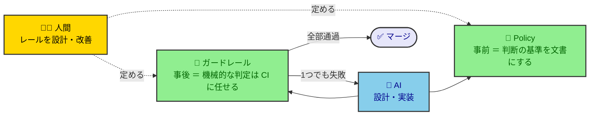
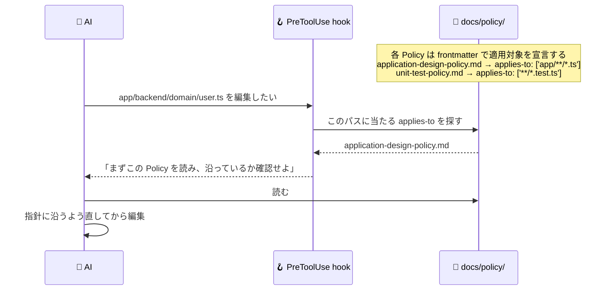

# ポリシー駆動開発テンプレート

AI が主体で開発を進めるためのリポジトリテンプレート。人間は成果物を1つずつ検品する代わりに、AI が走る**レール**を設計・改善する。レビューは無くならず、機械が合否を出せない帯に絞られる（Human-on-the-Loop）。

読むのは、**このテンプレートを自分のプロジェクトの土台にするか判断したい人 / AI が、思想とレールの仕組みを最初に掴みたいとき**。

## 2本のレール

AI は確率論的で、同じ指示でも出力が揺れる。その揺れを、**事前**に判断の基準を文書にする Policy と、**事後**に機械的な判定を CI に任せるガードレールの2本で受け止める。どちらもスピードを犠牲にせず品質を担保するための仕組みである。



レールが充実するほど、人間が見なければならない範囲が狭くなる。レールが覆えるのは機械が合否を出せることだけで、意図と合っているかは覆えない——だから人間のレビューは消えず、そこへ集中する。

## Policy — 判断の基準を文書にする

判断が割れる事柄に「私たちの立場」を先に決めておく。AI はそれを読んで自分で決めるので、人間に確認が飛んでこない。
Policy を確実に読ませるため、hook で強制する仕組みを作っている。



適用対象を Policy 自身が持つので、Policy を増やしても hook 側は変更しなくてよい。判断の種類ごとにどんな Policy があるかは [docs/policy-hub.md](docs/policy-hub.md) に一覧がある。

## ガードレール — 機械的な判定は CI に任せる

機械的に判断できることは、AI に任せず CI に判定させる。AI の成果物はすべて関門を通り、**1つでも落ちたらマージ不可**——人間の検品を待たず AI へ差し戻して再挑戦させる。AI が確率論的だからこそ、関門は同じ入力に必ず同じ判定を返す決定論的なチェックで固める。

| 関門                        | 何を止めるか                                                                          | 定義の場所                                                                                             |
| --------------------------- | ------------------------------------------------------------------------------------- | ------------------------------------------------------------------------------------------------------ |
| 静的解析（ESLint / 型検査） | 書き方の逸脱（`any`・import 順序・未使用変数・await 忘れ・型エラー など）             | `eslint.config.mjs`・各 `tsconfig.json`                                                                |
| コードメトリクス            | 複雑さ（循環的/認知的複雑度・関数の行数・引数の数・ネストの深さ）                     | しきい値は `.claude/rules/typescript.md`、適用は `eslint.config.mjs`                                   |
| アーキテクチャテスト        | 構造の腐り（レイヤー依存の向き・循環依存・凝集度）                                    | `samples/app/backend/test/`                                                                            |
| 不要物・脆弱性              | 増えっぱなし（未使用の export・ファイル・依存、脆弱性のある依存）                     | `knip.jsonc`・`scripts/ci/audit-dependencies.mjs`                                                      |
| テスト                      | 振る舞いの退行（単体テスト・CDK snapshot ＋ synth・dev 環境での結合テスト）           | 各ワークスペースの `*.test.ts`・`samples/infra/test/`                                                  |
| CLAUDE.md 文字数検査        | 毎セッション消費する文脈の肥大（CLAUDE.md と `@` import 先の合計文字数が上限超過）    | 上限は `docs/policy/policy-driven-development-policy.md`、判定は `scripts/ci/check-claude-md-size.mjs` |
| Rule 文字数検査             | 対象ファイルを読むたびに消費する文脈の肥大（`.claude/rules/*.md` の文字数が上限超過） | 上限は `docs/policy/policy-driven-development-policy.md`、判定は `scripts/ci/check-rule-size.mjs`      |
| workflow 検査               | workflow の事故（Action のタグ固定・既定の権限・`run:` への式の直接埋め込み）         | 判定は `scripts/ci/check-workflow-pins-and-permissions.mjs`                                            |

### コーディング規約・技術ルール

言語・フレームワーク別のルールは `.claude/rules/` 配下にあり、対象ファイルを読むと自動ロードされる。新規ファイルにはまだ Read が発生しないので、その場合は `.claude/hooks/policy-loader.mjs` が該当ルールを指し示す。`docs/policy/**`・`docs/` 直下のハブなど名指しのパスに効かせたい Rule は、front-matter `hook.applies-to` で宣言すると、対象ファイルの有無にかかわらず編集時に policy-loader.mjs が指し示す。

## 使い方

```bash
npm install          # 依存を導入（git hooks も設定される）
npm run check:static # 静的解析（ESLint・knip・型検査）
npm run format       # フォーマット
```

このテンプレートを使う手順:

1. 前提を整える。`npm install` で依存を入れ、`gh auth login` で GitHub にログインし、リポジトリのルートで Claude Code を起動する
2. Claude Code で `/setup` を実行する。ラベル・リポジトリ設定・ボード・認証・`docs/project-context/` の3ファイル・テンプレートの ADR の削除までを進め、立ち上げの PR を作る。人間の手作業が要るところは案内され、済まなければ Issue になる。途中で止まっても、流し直せば続きから進む
3. 以降は Claude Code に Issue 番号を渡すだけでよい。AI が Issue に書かれた開発フロー（設計書更新 → 実装 → レビュー → CI）を読み取り、対応するスラッシュコマンドを順に自分で実行する。各ステップの説明は [docs/guide/development-flow.md](docs/guide/development-flow.md) にある
4. テンプレート側の更新を取り込むときは `./scripts/sync-template.sh` を実行する（使い方は `./scripts/sync-template.sh --help`）

## 変更してはならないパス

以下はハーネスで利用しており、リネーム・移動すると `.claude/hooks`・`.claude/skills`・CI・静的解析設定が壊れるパス。中身の編集や配下への新規ファイル追加は自由。

### docs/ 配下

- **`docs/policy-hub.md`**：CLAUDE.md・ほぼ全スキルが起点として直接参照
- **`docs/policy/`（ディレクトリ＋各ファイル名）**：`.claude/hooks/policy-loader.mjs` がこのパスを直接読み込み、front-matter `applies-to` で自動アタッチする。個々のファイル名も多数のスキルから SSOT として直接参照される
- **`docs/design-hub.md`**：CLAUDE.md・design/to-plan/cdk-imp スキル・plan-reviewer-agent 等が起点として直接参照
- **`docs/design/`（ディレクトリ名）**：`design-doc-policy.md` の `applies-to` が参照。中の個別設計書は自由に追加・更新可
- **`docs/runbook/`（ディレクトリ名）**：`runbook-policy.md` の `applies-to` が参照。中の個別手順書は自由に追加・更新可
- **`docs/adr/`, `docs/adr/adr-template.md`, `docs/adr/adr-index.md`**：create-adr/decide-tech-stack スキル・`.githooks/pre-commit`・`scripts/generate-adr-index.mjs` がファイル名までハードコード参照。一覧表は各 ADR の frontmatter から `npm run gen:adr-index` で生成する（手編集しない）
- **`docs/reference/non-functional-requirement-items.md`**：to-plan・elicit-requirements・quick-issue 等が SSOT として直接参照
- **`docs/reference/test-terms.md`**：`policy-hub.md` の一覧、`test-strategy-policy.md`・`unit-test-policy.md` がテストダブル定義の SSOT として直接参照
- **`docs/reference/docs-directory-definitions.md`**：`documentation-policy.md` と doc-review スキルの観点一覧（`references/review-criteria.md`）が、docs/ 配下の置き場所の SSOT として直接参照
- **`docs/guide/`（ディレクトリ名）**：`documentation-policy-for-humans.md` の `applies-to`、doc-review スキルの種別判定（`references/doc-types.md`）、`issue-policy.md` の「標準のルート（フェーズ）」の振り分けが参照。配下の個別ガイドは、下の3本を除いて自由に追加・改名可
- **`docs/guide/development-flow.md`**：CLAUDE.md・to-plan スキルが直接参照
- **`docs/guide/new-development-guide.md`**：decide-tech-stack・issue-regroup スキルが直接参照
- **`docs/guide/code-review-guide.md`**：code-review スキルが直接参照
- **`docs/project-context/project-claude.md`**：CLAUDE.md が `@` import で直接読み込む。ここに書いた内容が毎セッション読まれる
- **`docs/project-context/glossary.md`**：to-plan・elicit-requirements・quick-issue 等が SSOT として直接参照
- **`docs/project-context/issue-destinations.md`**：`/link-root-issue` が、分解元の親が無い Issue のルート Issue と振り分け条件を読む。ファイルが無いと紐付けは報告だけで終わる
- **`docs/project-context/core-parts.md`**：`adr-policy.md` が ADR を作るかの判定の目安として直接参照。ファイルが無くても判定はできる
- **`docs/requirements.md`**：`requirements-doc-policy.md` の `applies-to`、elicit-requirements/decide-tech-stack/requirements-review スキルの既定パス
- **`docs/project-context/requirements-triage.md`**：要件定義書の仕分け台帳。要件定義書 Rule の本体が置き場として名指しし、スタブ（`.claude/rules/requirements-doc.md`）の `paths` がこのパスで Rule を読ませる

### トップレベル

- **`infra/`**：CI（`pipeline.yml` の `ci-cdk`・`cdk-diff`、`deploy-dev.yml`、`dev-destroy.yml`）の変更検知・working-directory、`eslint.config.mjs` のファイル glob、`cdk-design-policy.md` の `applies-to`、cdk-review スキルが直接ハードコード
- **`app/`, `app/backend/`, `app/frontend/`**：同様に CI（`ci-app`）・eslint に加え `application-design-policy.md`/`application-logging-policy.md`（`app/**`）、`frontend-design-policy.md`（`app/frontend/**`）が `applies-to` でハードコード
- **`samples/`（＋配下の2ワークスペース）**：`knip.jsonc` の workspace キー、`eslint.config.mjs` の glob、`package.json` の `check:static`、`scripts/ci/audit-dependencies.mjs` の監査対象、`pipeline.yml` の `ci-common`、各 policy の `applies-to` が直接ハードコード
- **`eslint-rules/`**：`eslint.config.mjs` が直接 import、`knip.jsonc` の `project` glob が参照
- **`scripts/`（ディレクトリ＋各ファイル名）**：`package.json` の scripts がファイル名まで直接実行し、CI（`pipeline.yml`）と `.claude/hooks/` がそれを経由・相対 import する。中の個別スクリプトは自由に追加可
- **`scripts/ci/`（ディレクトリ名）**：CI のワークフローが実行するスクリプトの置き場。`pr-review-policy.md` が `cicd`（人間レビュー対象）の対象パスとして、`pr-ai-triage.yml` がそのラベルを付けるパスとして直接参照する

`infra/`・`app/` は**場所（ディレクトリ名）だけ**固定で、中身は自由に書いてよい。

**この2つは現在空である。** 参照実装は [`samples/`](samples/README.md) にあり、そこから写して実装を始める。空の間は CI の `ci-app`・`ci-cdk`・`cdk-diff` がスキップされ続け（`deploy-dev.yml` も発火しない）、最初のファイルを置いた瞬間に動き出す。ポリシーの `applies-to` と `eslint.config.mjs` の glob も同じ扱いで、対象が無くても先に書いておく（[policy-driven-development-policy](docs/policy/policy-driven-development-policy.md)）。

### ルート静的解析ゲート設定

- **`eslint.config.mjs`**：ESLint ルール定義・自作ルール import 元。CI もこれを実行
- **`tsconfig.json`（ルート）**：ルートの型検査設定
- **`.prettierrc.js`, `.prettierignore`**：フォーマッタ設定
- **`knip.jsonc`**：未使用コード検出の workspace 定義
- **`package.json`（ルート）**：`scripts`・devDependencies。CI がスクリプト名を直接実行

### ファイル名でポリシーが発火するもの

以下のポリシーは `applies-to` にファイル名のキーワードを含む。**キーワードを外れた名前を付けると、ポリシーが無言で適用されない。** 新規ファイルを作るときは、この表の名前に合わせる。

| ファイル名に含める語                            | 発火するポリシー                                           | 対象                                       |
| ----------------------------------------------- | ---------------------------------------------------------- | ------------------------------------------ |
| `infra` / `iac`（`docs/design/` 配下の `.md`）  | `iac-infra-design-doc-policy`・Rule `iac-infra-design-doc` | インフラ設計書・IaC 設計書                 |
| `monitoring` / `Monitoring` / `alarm` / `Alarm` | `monitoring-policy`                                        | 監視・アラームを定義する `.ts`             |
| `table` / `Table`                               | `database-design-policy`                                   | テーブル定義を扱う `.ts`                   |
| `config` / `parameter`                          | `configuration-policy`                                     | 構成値を扱う `.ts`・`config/` 配下・`.env` |

なお `.claude/`・`.github/` はこのセクションの対象外（ハーネス本体として別枠で扱う）。
