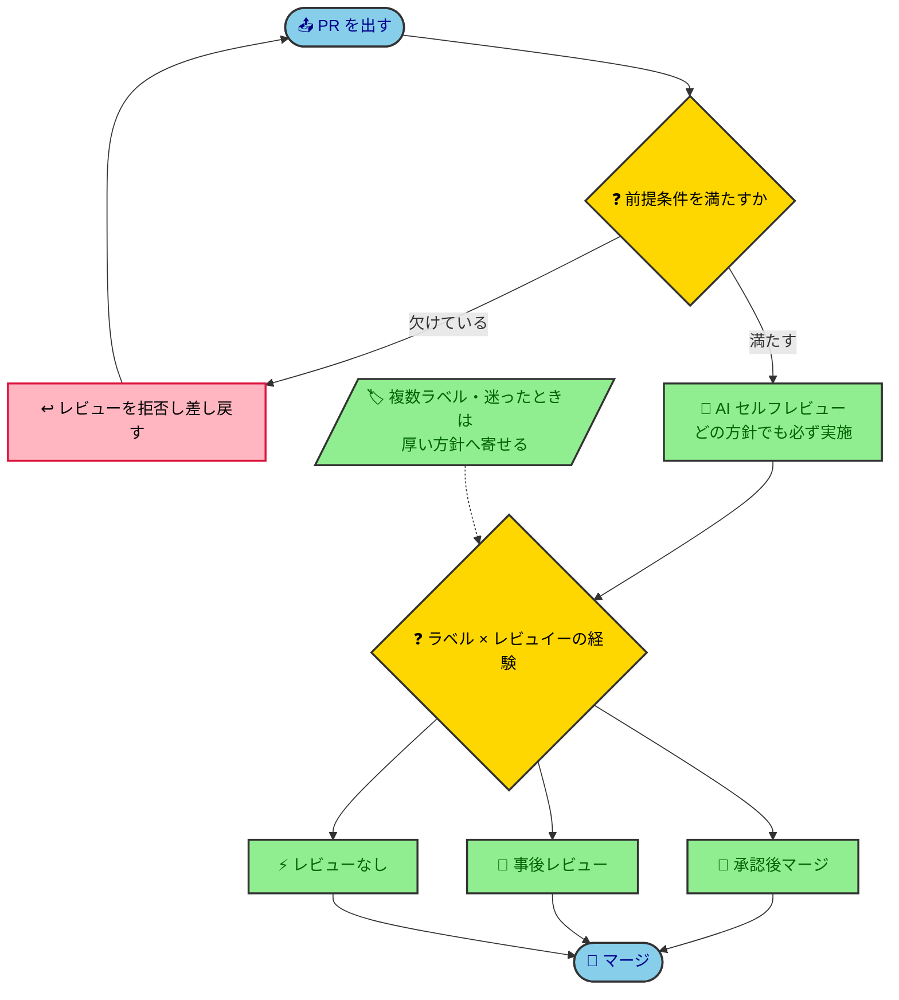

# PRレビューポリシー

AIエージェントが、PRを出す・レビューするときに、コメントの書き方・マージ判断・PRのサイズ感について迷ったとき、また Issue を起票・分割するときに、見込み行数で割るかを決めるために参照する指針。レビューで**何に目を向けるか（観点）**——インターフェース・コメント・名前の適切さ——は [code-review-guide](../guide/code-review-guide.md) の「Part B：レビューの観点」を参照。

> [!IMPORTANT]
> **TL;DR**
>
> - PRを出す側は「CIの全成功」「小さいサイズ（原則200行以内）」を満たす。満たさないPRはレビュワーが拒否できる。
> - Issue は着手前に、見込み行数で割る。200行以上は割ることを検討し（WANT）、300行以上は割らない例外を除いて必ず割る（MUST）。400行は最終防衛ラインである。
> - レビューコメントは `MUST` / `WANT` / `FYI` のラベルで意図を明確にする。`MUST` のみがマージをブロックする。
> - 変更の種類とレビュイーの経験でレビュー方針を使い分ける。すべてのPRにAIセルフレビューを実施する。

## PRを出す側が満たすべきレビューの前提条件

レビューはレビュワーの時間という有限な資源を消費する。前提が崩れたPRをレビューさせることは、その資源を本来不要な確認に浪費させる。レビュワーが本質的な指摘に集中できるよう、PRを出す側は次を必ず満たす。

- **CIの全成功**：静的解析・テストがpassしていることはレビューの最低条件。レビュワーに機械が検出できる不備を確認させない
- **PRを小さく保つ**：詳細は[PRは小さく保つほどレビュー品質が上がる](#prは小さく保つほどレビュー品質が上がる)を参照

PR本文は前提条件に含めない。なぜ変えたかはコミットメッセージか Issue に残り、レビュワーはそこから辿れるためである。人間が push したときは、マージで Issue を閉じたいときなど本文が要るときだけ付ける。

> [!IMPORTANT]
> **（AI・必須）** 上記が満たされていないPRは、レビュワーがレビューを拒否し、前提を満たしてからの再依頼を求めることができる。前提を欠いたPRを無理にレビューするより、整えてもらう方がレビュー品質と全体のスループットの双方を守れるためである。

---

## レビューコメントにはラベルをつけて意図とマージへの影響を明確にする

コメントの冒頭に以下のラベルをつける。ラベルなしのコメントは **LGTM** 扱いとする。

| ラベル | 意味                         | マージへの影響                                               |
| ------ | ---------------------------- | ------------------------------------------------------------ |
| `MUST` | 必ず修正が必要               | ブロック                                                     |
| `WANT` | 修正を推奨するが必須ではない | ブロックしない（未対応でマージするなら理由を一言残すと親切） |
| `FYI`  | 参考情報・知識共有           | ブロックしない                                               |
| `LGTM` | 承認・問題なし               | —                                                            |

### `MUST` はこのままマージすると問題が生じる指摘に使う

バグ・セキュリティリスク・仕様違反など。対応完了まで Approve しない。

```
MUST: このクエリはN+1が発生します。eagerロードを使ってください。
```

### `WANT` は対応すればより良くなる提案に使う

設計の改善・可読性の向上・パフォーマンスの最適化など。対応するかどうかはレビュイーの判断に委ねる。

```
WANT: この条件分岐はStrategy Patternにすると拡張しやすくなりそうです。
```

### `FYI` はアクション不要の知識共有に使う

知っておくと役立つ情報・代替手段の紹介・背景の補足など。積極的に使ってチームの知識を広げる。

```
FYI: PostgreSQLではこのケースにGINインデックスが有効なことがあります。
FYI: 同様の処理が ○○ モジュールにも存在します。
```

### `LGTM` はコード全体に問題がない場合に使う

称賛を添えると場の雰囲気がよくなる。

```
LGTM! エラーハンドリングが丁寧で読みやすいです。
```

## 変更の性質に応じてレビュー方針を使い分ける

### 一律のレビュープロセスはレビュー待ちでスループットを落とす

PRレビューは開発のボトルネックになりやすい。レビュー待ちによってスループットが下がる問題を避けるため、すべてのPRに同じレビュープロセスを課すのではなく、変更の性質に応じてレビュー方針を使い分ける。

一方で、レビューには品質保証以外に知識共有や教育的側面もある。そのため、方針上は自己マージが許容されるPRであっても、必要と判断した場合はレビューを依頼できる余地を残す。

### 人間のレビュー方針によらず、すべてのPRでAIセルフレビューを実施する

方針の使い分けは「人間がいつ見るか」の話であり、機械的に見つかる不備を見逃してよいという意味ではない。それはどの方針でもAIが先に潰す。人間のレビューまで待つより、検証を手前の工程に寄せる方が手戻りが小さいからである（「シフトレフト——検証を前倒しする」[refined-engineer-judgment-principles](refined-engineer-judgment-principles.md)）。

### レビュー方針は3つから選ぶ

- **承認後マージ**：レビュワーの承認を得てからマージ
- **事後レビュー**：自己マージ後、レビュワーに非同期レビューを依頼
- **レビューなし**：自己マージ

レビューの厚さは「レビューなし ＜ 事後レビュー ＜ 承認後マージ」の順である。

### PRラベルと変更の種類

ラベルは複数付与されることもある

| ラベル     | 変更の種類                 | 備考                                                       |
| ---------- | -------------------------- | ---------------------------------------------------------- |
| `feature`  | 新機能・機能変更           | 振る舞いの変更を含む場合はすべてfeatureをつける            |
| `cicd`     | CI/CD変更                  | 対象は `.github/`・`scripts/ci/`・静的解析の設定           |
| `bug`      | バグ修正                   |                                                            |
| `refactor` | リファクタリング           | 振る舞いの変更を含まない純粋な構造の変更                   |
| `chore`    | 設定変更・依存関係更新など |                                                            |
| `docs`     | ドキュメント変更           |                                                            |
| `policy`   | 判断基準の変更             | 対象は `docs/policy/**`・`docs/policy-hub.md`・`CLAUDE.md` |

### ラベルとレビュイーの経験でレビュー方針を決める

| ラベル                                                 | ジュニア                               | ジュニア以外                           | 理由                                                       |
| ------------------------------------------------------ | -------------------------------------- | -------------------------------------- | ---------------------------------------------------------- |
| `feature` を含み、`app/`・`infra/` の振る舞いを変える  | 承認後マージ                           | 事後レビュー（必要なら承認後マージ）   | プロダクトの振る舞いの変更は常に人間がレビューするべき     |
| `policy`                                               | 承認後マージ                           | 事後レビュー（必要なら承認後マージ）   | 判断基準が壊れると以後のすべての判断が静かに歪むため       |
| `cicd`                                                 | 承認後マージ                           | 事後レビュー（必要なら承認後マージ）   | セキュリティ上リスクが大きいため人間がレビューするべき     |
| `app/`・`infra/` のバグを直す `bug`                    | 承認後マージ                           | 事後レビュー                           | 修正が正しく問題を解消しているか人間が確認するべき         |
| それ以外のコードの `feature`・`bug`（`scripts/` など） | レビューなし                           | レビューなし                           | 開発用のコードはバイブコーディングで対応する範囲とするため |
| `chore`・`docs`                                        | 事後レビュー                           | レビューなし                           | 振る舞いに影響せずリスクが低いため                         |
| それ以外（`refactor` 等）                              | レビューなし（必要なら厚い方へ寄せる） | レビューなし（必要なら厚い方へ寄せる） | 開発スピードを優先するため                                 |

複数のラベルが付いたPRは、最も厚いレビュー方針を採る。迷ったときも、より厚いレビュー方針を選ぶ。

人間のレビューが要る PR には `needs-human-review` を付ける。付けるのは、上の表でジュニア以外の列が「事後レビュー」か「承認後マージ」になる PR である。



---

## PRは小さく保つほどレビュー品質が上がる

小さいPRを高速にマージすることを基本方針とする。PRのサイズが大きくなるほどレビューの認知負荷が上がり、見落としが増える。

なお「〜200行」という目安は、書籍『Googleのソフトウェアエンジニアリング』にある「ほとんどのケースでPRは200行以内にすべき」という記述を出典としている。

| 規模 | 差分行数の目安 | 対応                                |
| ---- | -------------- | ----------------------------------- |
| 小   | 〜200行        | 理想的なサイズ                      |
| 中   | 200〜400行     | 許容範囲                            |
| 大   | 400行以上      | issueをさらに分割できないか検討する |

差分行数は追加・削除の合計を指す。自動生成ファイル・ロックファイルなど機械的な変更は除外して判断してよい。

「大」以上のPRは、レビュワーの判断でレビューを拒否し、分割を差し戻すことができる。大きなPRを無理にレビューするより、適切な粒度に分割してもらう方が、レビュー品質と全体のスループットの双方を守れるためである。

ただし、分割が常に最善とは限らない。無理に切り離すと、各PRが単体では検証できず、かえってレビューしづらくなることがある。大きいまま出してよいのは、次の「見積もりで割る線」の割らない例外に当たるときと、単体で検証できる片に割れず、人間が大きいまま出すと決めたときだけである。

## 見積もりで割る線

PRが大きくなってからでは、分割は手戻りになる。そこで Issue を起票・分割するときに、実装の見込み行数を見積もり、次の線で割る。見込み行数は、規模表と同じ数え方（追加・削除の合計。機械的な変更は除く）で、コードに加えてテストと文書（設計書・README など）の変更も数える。

| 線             | 見込み行数 | 対応                                                                                 |
| -------------- | ---------- | ------------------------------------------------------------------------------------ |
| WANT           | 200行以上  | 自然に割れるなら割る                                                                 |
| MUST           | 300行以上  | 割らない例外を除き、必ず割る。単体で検証できる片に割れなければ、人間が割り方を決める |
| 最終防衛ライン | 400行以上  | 規模表の「大」。PRの時点で `pr-check` が NG を出す                                   |

見積もりは外れる（見込み330行の Issue が、最初の push で457行になった）。MUST を400行より手前に置くのは、外れる分の余白を取るためである。

**MUST の線以上で割らなくてよいのは、次の2つの例外だけである。**

- **機械的な一括変更**：同じ置換・移動・改名を多数の箇所に当てる変更。1箇所ずつ読む必要が無く、割っても読む量が減らない
- **開発の道具の初回の立ち上げ**：テスト基盤・CI とデプロイ経路・静的解析を、初めて入れる変更。利用者から見た経路を持たず、初回は変更が多くなる（`/to-issues` の縦スライス規則の例外と同じ）

「密に関連している」「分けると文脈が切れる」は、例外にならない。「どうしても割らない方がよいとき」のような条件は、AI が理由を作文すれば満たせてしまう。だから既定を「割る」にし、外れる条件を名前で挙げる。例外に当たって割らないときは、当たった例外の名前と根拠を Issue のコメントに残す。後から、外れた見積もりを数えられるようにするためである。
