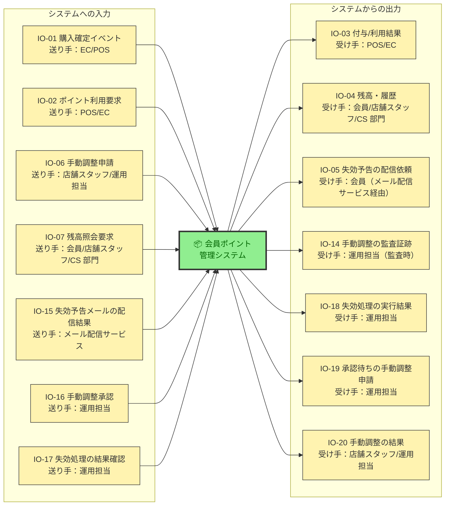
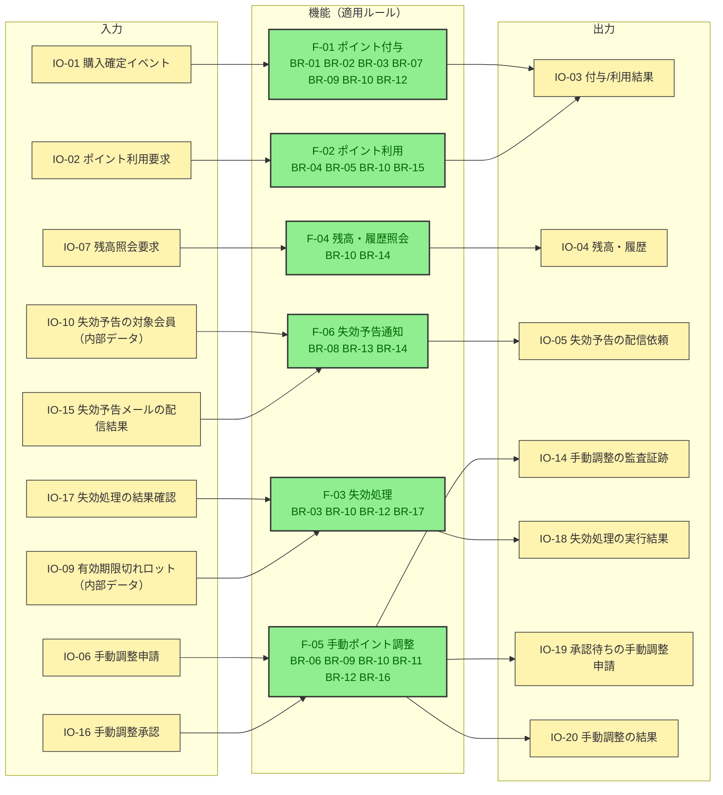
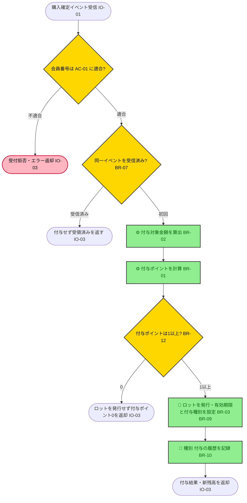
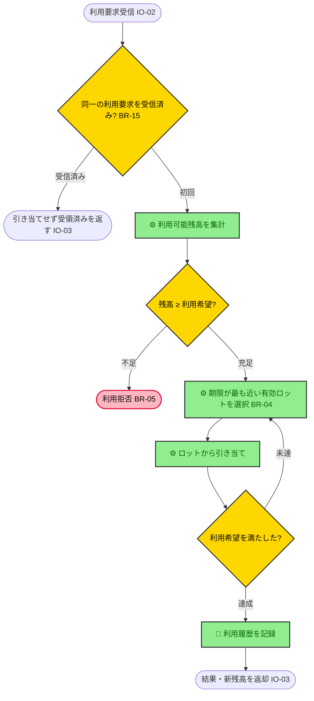
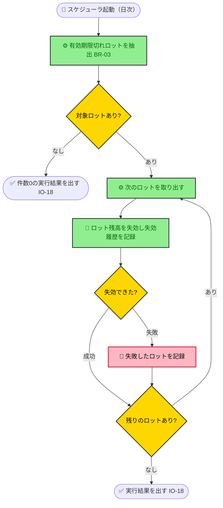
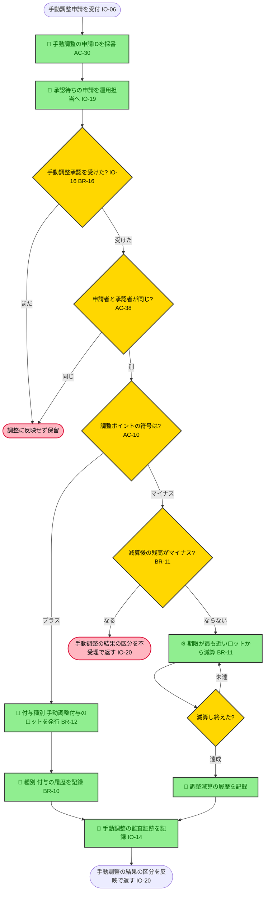
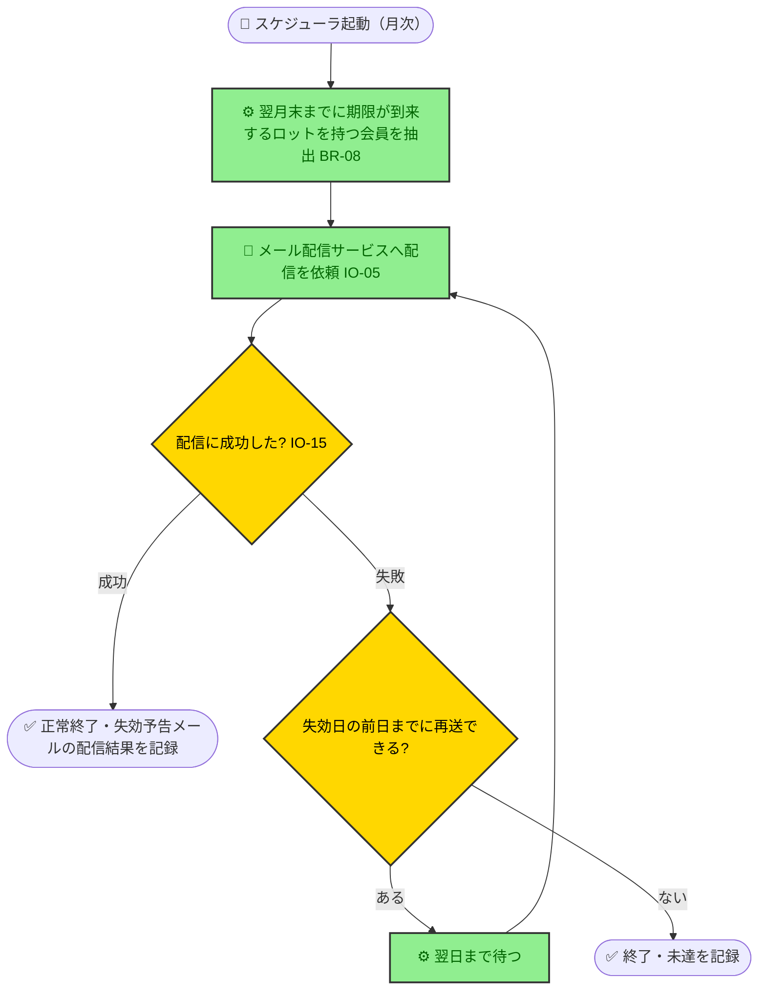
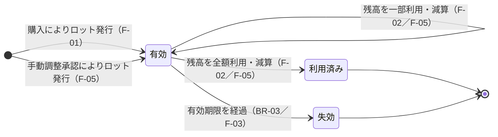

# 要件定義書（詳細）：会員ポイント管理システム <!-- omit from toc -->

設計者・実装者（AI を含む）が、入出力情報・属性の値制約・機能の振る舞いを正確に引きたいときに参照する。顧客も合意のために確認するが、重点的に読むのは `requirements.md` である。

## 目次 <!-- omit from toc -->

- [業務要件の詳細](#業務要件の詳細)
  - [属性の値制約一覧](#属性の値制約一覧)
  - [入出力情報一覧](#入出力情報一覧)
- [機能要件の詳細](#機能要件の詳細)
  - [機能仕様（ユースケース記述）](#機能仕様ユースケース記述)
  - [機能×入出力×ルール図](#機能入出力ルール図)
  - [機能ごとのアクティビティ図](#機能ごとのアクティビティ図)
  - [状態遷移](#状態遷移)

## 業務要件の詳細

### 属性の値制約一覧

| 型の語        | 取りうる値  | 桁             | 形式                         |
| ------------- | ----------- | -------------- | ---------------------------- |
| `0以上の整数` | 0以上の整数 | なし           | 半角数字のみ                 |
| `1以上の整数` | 1以上の整数 | なし           | 半角数字のみ                 |
| `日時`        | 日時        | 秒まで固定14桁 | `YYYY-MM-DDThh:mm:ss`（JST） |
| `日付`        | 日付        | 8桁            | `YYYY-MM-DD`（JST）          |

| ID    | 属性名                   | 取りうる値                                                                                                                                            | 桁                | 形式                         | 関連ルール          |
| ----- | ------------------------ | ----------------------------------------------------------------------------------------------------------------------------------------------------- | ----------------- | ---------------------------- | ------------------- |
| AC-01 | 会員番号                 | EC が発番する半角数字（先頭0を含む）。会員1人につき1つ                                                                                                | 10桁固定          | 半角数字のみ                 | —                   |
| AC-02 | 税抜金額                 | 0以上の整数（単位は円）。上限は999,999,999                                                                                                            | 最大9桁           | 半角数字のみ                 | BR-01               |
| AC-03 | 購入日時                 | 受信時点以前の日時                                                                                                                                    | 秒まで固定14桁    | `YYYY-MM-DDThh:mm:ss`（JST） | —                   |
| AC-05 | 付与ポイント             | 0以上の整数。付与/利用結果の区分が `付与` 以外では0                                                                                                   | なし              | 半角数字のみ                 | BR-01               |
| AC-07 | 利用可能残高             | 0以上の整数。有効期限内ロットのロット残高の合計に一致する。会員1人につき1つ                                                                           | なし              | 半角数字のみ                 | BR-03, BR-05        |
| AC-08 | 失効予定ポイント         | 0以上の整数。BR-14 が定める範囲のロット残高の合計に一致する。範囲にロットが無ければ0。会員1人につき1つ                                                | なし              | 半角数字のみ                 | BR-03, BR-14        |
| AC-09 | 失効予告の最も早い失効日 | 失効予告の対象ロットの有効期限日の翌日のうち、最も早い日                                                                                              | 8桁               | `YYYY-MM-DD`（JST）          | BR-03, BR-13        |
| AC-10 | 調整ポイント             | 0を除く整数。絶対値は99,999以下（マイナスは減算調整。扱いは BR-11 が定める）                                                                          | 符号を除き最大5桁 | 先頭の符号と半角数字         | BR-06, BR-11        |
| AC-11 | 調整の理由               | 自由記述                                                                                                                                              | 全角200文字以内   | 改行を含まない文字列         | BR-06               |
| AC-15 | 手動調整の申請者         | 社内 IdP の利用者ID。店舗スタッフか運用担当                                                                                                           | 8桁固定           | `U`＋半角数字7桁             | BR-16               |
| AC-16 | 手動調整の承認日時       | 受信時点以前の日時                                                                                                                                    | 秒まで固定14桁    | `YYYY-MM-DDThh:mm:ss`（JST） | BR-06               |
| AC-18 | 種別（履歴）             | `付与` ／ `利用` ／ `失効` ／ `調整減算` のいずれか1つ                                                                                                | なし              | 区分値                       | BR-10, BR-11        |
| AC-20 | ロットの有効期限         | BR-03 が定める有効期限日                                                                                                                              | 8桁               | `YYYY-MM-DD`（JST）          | BR-03, BR-12        |
| AC-21 | ロット残高               | 0以上の整数。発行時は、購入付与のロットでは付与ポイント（AC-05）、手動調整付与のロットでは調整ポイント（AC-10）、移行のロットでは移行元の残高に等しい | なし              | 半角数字のみ                 | BR-04, BR-12        |
| AC-22 | 利用ポイント             | 0以上の整数。付与/利用結果の区分が `利用` 以外では0                                                                                                   | なし              | 半角数字のみ                 | BR-04               |
| AC-23 | 購入確定ID               | `E`（EC）か `P`（POS）で始まる、EC/POS が購入確定ごとに付けるID                                                                                       | 20桁固定          | `E` か `P`＋半角英数字19桁   | BR-07               |
| AC-24 | ギフト券額               | 0以上の整数（単位は円・税抜）。3つの額の合計は税抜金額以下（EC/POS が保証する。BR-02）。無ければ0                                                     | 最大9桁           | 半角数字のみ                 | BR-02               |
| AC-25 | 送料                     | 0以上の整数（単位は円・税抜）。3つの額の合計は税抜金額以下（EC/POS が保証する。BR-02）。無ければ0                                                     | 最大9桁           | 半角数字のみ                 | BR-02               |
| AC-26 | ポイント利用充当額       | 0以上の整数（単位は円・税抜）。3つの額の合計は税抜金額以下（EC/POS が保証する。BR-02）。無ければ0                                                     | 最大9桁           | 半角数字のみ                 | BR-02               |
| AC-27 | 失効予告メールの配信成否 | `成功` ／ `失敗` のいずれか1つ                                                                                                                        | なし              | 区分値                       | BR-13               |
| AC-29 | 利用要求ID               | `E`（EC）か `P`（POS）で始まる、EC/POS が利用要求ごとに付けるID                                                                                       | 20桁固定          | `E` か `P`＋半角英数字19桁   | BR-15               |
| AC-30 | 手動調整の申請ID         | 本システムが手動調整申請の受付時に採番する、申請ごとに一意の値                                                                                        | なし              | 文字列                       | BR-16               |
| AC-31 | 失効処理結果の確認者     | 社内 IdP の利用者ID。運用担当                                                                                                                         | 8桁固定           | `U`＋半角数字7桁             | —                   |
| AC-32 | 失効処理結果の確認日時   | 受信時点以前の日時                                                                                                                                    | 秒まで固定14桁    | `YYYY-MM-DDThh:mm:ss`（JST） | —                   |
| AC-33 | 確認した失効処理の実行日 | 失効処理結果の確認日時の日付以前の日付                                                                                                                | 8桁               | `YYYY-MM-DD`（JST）          | BR-17               |
| AC-37 | 付与/利用結果の区分      | `付与` ／ `利用` ／ `受領済み` ／ `拒否` のいずれか1つ                                                                                                | なし              | 区分値                       | BR-05, BR-07, BR-15 |
| AC-38 | 手動調整の承認者         | 社内 IdP の利用者ID。運用担当。同じ申請の手動調整の申請者（AC-15）とは別の人                                                                          | 8桁固定           | `U`＋半角数字7桁             | BR-06, BR-16        |
| AC-39 | 手動調整の結果の区分     | `反映` ／ `不受理` のいずれか1つ                                                                                                                      | なし              | 区分値                       | BR-11               |
| AC-40 | 付与種別                 | BR-09 が定める値のいずれか1つ                                                                                                                         | なし              | 区分値                       | BR-09, BR-12        |

AC-01 会員番号

先頭0を含むため、先頭0を落とさず10桁のまま保持する必要がある。桁数は EC の発番仕様で、こちらでは動かせない。

AC-02 税抜金額

上限は、POS が1取引で扱える金額に合わせた。これを超える購入は POS 側で分割されるため、本システムに届かない。

AC-03 購入日時

未来日時を弾くのは、POS 端末の時刻ずれによる誤付与を防ぐため。ずれた日時でロットを発行すると、有効期限（BR-03）も連動してずれる。

AC-10 調整ポイント

絶対値の上限は、CS 部門長が1回の調整で決裁できる上限（サンプル物産の規程）。決裁が要る範囲は BR-06 が定める。

AC-11 調整の理由

上限は、サンプル物産の手動調整規程が、理由を200文字以内で書くと定めているため。

AC-15 手動調整の申請者

`U`＋7桁という形式は、社内 IdP が持つ利用者IDをそのまま借りたものである（本システムは採番しない）。

AC-23 購入確定ID

EC と POS が付ける識別子をそのまま借りる（本システムは採番しない）。同じ購入確定イベントを再送するときは同じ値で届く。先頭の `E`・`P` で発番元を区別するので、EC と POS で値が重ならない。

AC-29 利用要求ID

EC と POS が付ける識別子をそのまま借りる（本システムは採番しない）。同じ利用要求を再送するときは同じ値で届く。先頭の `E`・`P` で発番元を区別するので、EC と POS で値が重ならない。

AC-38 手動調整の承認者

手動調整の申請者（AC-15）と同一人物を許さないのは、職務を分けるため。同一人物を許すと、申請と別の人が承認する（BR-16）意味が無くなる。

承認者を運用担当に限るのは、上限を超える調整でも、CS 部門長の決裁（BR-06）を得たあとに運用担当が承認として記録するからである。

### 入出力情報一覧

| ID    | 情報名                   | 入出力区分   | 送り手                    | 受け手                         | 利用業務                 |
| ----- | ------------------------ | ------------ | ------------------------- | ------------------------------ | ------------------------ |
| IO-01 | 購入確定イベント         | 入力         | EC/POS                    | 本システム                     | 購入時付与               |
| IO-02 | ポイント利用要求         | 入力         | POS/EC                    | 本システム                     | 店舗/EC 利用             |
| IO-03 | 付与/利用結果            | 出力         | 本システム                | POS/EC                         | 購入時付与, 店舗/EC 利用 |
| IO-04 | 残高・履歴               | 出力         | 本システム                | 会員/店舗スタッフ/CS 部門      | 残高照会                 |
| IO-05 | 失効予告の配信依頼       | 出力         | 本システム                | 会員（メール配信サービス経由） | 期限失効                 |
| IO-06 | 手動調整申請             | 入力         | 店舗スタッフ/運用担当     | 本システム                     | 手動調整                 |
| IO-07 | 残高照会要求             | 入力         | 会員/店舗スタッフ/CS 部門 | 本システム                     | 残高照会                 |
| IO-09 | 有効期限切れロット       | 入力（内部） | 本システム                | 本システム                     | 期限失効                 |
| IO-10 | 失効予告の対象会員       | 入力（内部） | 本システム                | 本システム                     | 期限失効                 |
| IO-14 | 手動調整の監査証跡       | 出力         | 本システム                | 運用担当（監査時）             | 手動調整                 |
| IO-15 | 失効予告メールの配信結果 | 入力         | メール配信サービス        | 本システム                     | 期限失効                 |
| IO-16 | 手動調整承認             | 入力         | 運用担当                  | 本システム                     | 手動調整                 |
| IO-17 | 失効処理の結果確認       | 入力         | 運用担当                  | 本システム                     | 期限失効                 |
| IO-18 | 失効処理の実行結果       | 出力         | 本システム                | 運用担当                       | 期限失効                 |
| IO-19 | 承認待ちの手動調整申請   | 出力         | 本システム                | 運用担当                       | 手動調整                 |
| IO-20 | 手動調整の結果           | 出力         | 本システム                | 店舗スタッフ/運用担当          | 手動調整                 |

IO-01 購入確定イベント

| 属性名             | 必須・任意 | 型の語か AC-ID |
| ------------------ | ---------- | -------------- |
| 会員番号           | 必須       | AC-01          |
| 購入確定ID         | 必須       | AC-23          |
| 税抜金額           | 必須       | AC-02          |
| ギフト券額         | 必須       | AC-24          |
| 送料               | 必須       | AC-25          |
| ポイント利用充当額 | 必須       | AC-26          |
| 購入日時           | 必須       | AC-03          |

- **取扱量**：通常時50万件/日
- **頻度**：購入の都度
- **利用目的**：付与額の算出

IO-02 ポイント利用要求

| 属性名             | 必須・任意 | 型の語か AC-ID |
| ------------------ | ---------- | -------------- |
| 会員番号           | 必須       | AC-01          |
| 利用要求ID         | 必須       | AC-29          |
| 利用希望ポイント数 | 必須       | 1以上の整数    |

- **取扱量**：通常時10万件/日
- **頻度**：利用要求の都度
- **利用目的**：残高の引き当て

IO-03 付与/利用結果

| 属性名              | 必須・任意                                | 型の語か AC-ID |
| ------------------- | ----------------------------------------- | -------------- |
| 付与/利用結果の区分 | 必須                                      | AC-37          |
| 付与ポイント        | 必須                                      | AC-05          |
| 利用ポイント        | 必須                                      | AC-22          |
| 付与・利用後の残高  | 付与/利用結果の区分が `拒否` 以外なら必須 | 0以上の整数    |

- **取扱量**：通常時60万件/日
- **頻度**：付与・利用の都度
- **利用目的**：レシート・画面表示への反映

IO-04 残高・履歴

| 属性名             | 必須・任意        | 型の語か AC-ID |
| ------------------ | ----------------- | -------------- |
| 利用可能残高       | 必須              | AC-07          |
| 発生日時（履歴）   | 履歴1件につき必須 | 日時           |
| 種別（履歴）       | 履歴1件につき必須 | AC-18          |
| ポイント数（履歴） | 履歴1件につき必須 | 1以上の整数    |
| 失効予定ポイント   | 必須              | AC-08          |

- **取扱量**：想定5万件/日
- **頻度**：随時
- **利用目的**：会員のセルフ確認・店舗スタッフと CS 部門の即答

IO-05 失効予告の配信依頼

| 属性名                   | 必須・任意 | 型の語か AC-ID |
| ------------------------ | ---------- | -------------- |
| 会員番号                 | 必須       | AC-01          |
| 失効予定ポイント         | 必須       | AC-08          |
| 失効予告の最も早い失効日 | 必須       | AC-09          |

宛先のメールアドレスは、メール配信サービスが会員番号から引く。本システムは持たない。

- **取扱量**：初回の配信依頼は最大30万件/月。再送は、配信に失敗した分を失効日の前日まで1日1回足す
- **頻度**：初回は1回/月。再送は配信の失敗の都度
- **利用目的**：失効前の利用促進

IO-06 手動調整申請

| 属性名           | 必須・任意 | 型の語か AC-ID |
| ---------------- | ---------- | -------------- |
| 手動調整の申請者 | 必須       | AC-15          |
| 会員番号         | 必須       | AC-01          |
| 調整ポイント     | 必須       | AC-10          |
| 調整の理由       | 必須       | AC-11          |

- **取扱量**：最大50件/日
- **頻度**：随時
- **利用目的**：クレーム対応の記録と、ポイントの付与・減算

IO-07 残高照会要求

| 属性名   | 必須・任意 | 型の語か AC-ID |
| -------- | ---------- | -------------- |
| 会員番号 | 必須       | AC-01          |

- **取扱量**：想定5万件/日
- **頻度**：随時
- **利用目的**：照会対象の特定

IO-09 有効期限切れロット

| 属性名           | 必須・任意 | 型の語か AC-ID |
| ---------------- | ---------- | -------------- |
| 会員番号         | 必須       | AC-01          |
| ロットの有効期限 | 必須       | AC-20          |
| ロット残高       | 必須       | AC-21          |
| 付与種別         | 必須       | AC-40          |

- **取扱量**：通常時50万件/日。最大は、大型セール日に発行したロットが1年後にまとめて期限を迎える日で、最大250万件/日
- **頻度**：1回/日
- **利用目的**：失効対象の特定

IO-10 失効予告の対象会員

| 属性名                   | 必須・任意 | 型の語か AC-ID |
| ------------------------ | ---------- | -------------- |
| 会員番号                 | 必須       | AC-01          |
| 失効予定ポイント         | 必須       | AC-08          |
| 失効予告の最も早い失効日 | 必須       | AC-09          |

- **取扱量**：最大30万件/月
- **頻度**：1回/月
- **利用目的**：予告対象の抽出

IO-14 手動調整の監査証跡

| 属性名             | 必須・任意 | 型の語か AC-ID |
| ------------------ | ---------- | -------------- |
| 会員番号           | 必須       | AC-01          |
| 手動調整の申請者   | 必須       | AC-15          |
| 手動調整の承認者   | 必須       | AC-38          |
| 手動調整の承認日時 | 必須       | AC-16          |
| 調整ポイント       | 必須       | AC-10          |
| 調整の理由         | 必須       | AC-11          |

- **取扱量**：最大50件/日
- **頻度**：手動調整の都度
- **利用目的**：手動調整の妥当性の事後確認

IO-15 失効予告メールの配信結果

| 属性名                   | 必須・任意 | 型の語か AC-ID |
| ------------------------ | ---------- | -------------- |
| 会員番号                 | 必須       | AC-01          |
| 失効予告メールの配信成否 | 必須       | AC-27          |

- **取扱量**：初回の配信依頼に対して最大30万件/月。再送のたびに、その件数を足す
- **頻度**：失効予告の配信依頼（IO-05）の都度。再送のときも届く
- **利用目的**：未達の検知と再送の判断

IO-16 手動調整承認

| 属性名             | 必須・任意 | 型の語か AC-ID |
| ------------------ | ---------- | -------------- |
| 手動調整の申請ID   | 必須       | AC-30          |
| 手動調整の承認者   | 必須       | AC-38          |
| 手動調整の承認日時 | 必須       | AC-16          |

- **取扱量**：最大50件/日
- **頻度**：随時
- **利用目的**：承認のある申請だけを調整に反映する根拠（BR-16）と、事後確認（IO-14）の材料

IO-17 失効処理の結果確認

| 属性名                   | 必須・任意 | 型の語か AC-ID |
| ------------------------ | ---------- | -------------- |
| 失効処理結果の確認者     | 必須       | AC-31          |
| 失効処理結果の確認日時   | 必須       | AC-32          |
| 確認した失効処理の実行日 | 必須       | AC-33          |

- **取扱量**：平日は1件/日。連休明けは、連休の日数＋1件
- **頻度**：平日に1回。平日でない日の実行分は、翌平日に実行日ごとに確認する
- **利用目的**：失効処理の失敗や漏れを、運用担当が見たことを証跡として残す

IO-18 失効処理の実行結果

| 属性名                 | 必須・任意 | 型の語か AC-ID |
| ---------------------- | ---------- | -------------- |
| 失効処理の実行日       | 必須       | 日付           |
| 失効したロット数       | 必須       | 0以上の整数    |
| 失効に失敗したロット数 | 必須       | 0以上の整数    |

- **取扱量**：1件/日
- **頻度**：失効処理（F-03）の実行の都度、1回/日
- **利用目的**：運用担当が失効処理の結果を確かめる（結果確認 IO-17 の対象）

IO-19 承認待ちの手動調整申請

| 属性名           | 必須・任意 | 型の語か AC-ID |
| ---------------- | ---------- | -------------- |
| 手動調整の申請ID | 必須       | AC-30          |
| 手動調整の申請者 | 必須       | AC-15          |
| 会員番号         | 必須       | AC-01          |
| 調整ポイント     | 必須       | AC-10          |
| 調整の理由       | 必須       | AC-11          |

- **取扱量**：最大50件/日
- **頻度**：申請の受付の都度
- **利用目的**：承認者が手動調整の申請IDを知り、承認（IO-16）を出す

IO-20 手動調整の結果

| 属性名               | 必須・任意 | 型の語か AC-ID |
| -------------------- | ---------- | -------------- |
| 手動調整の申請ID     | 必須       | AC-30          |
| 手動調整の結果の区分 | 必須       | AC-39          |

- **取扱量**：最大50件/日
- **頻度**：承認を受けた申請を処理する都度
- **利用目的**：申請者が、調整が反映されたか受け付けられなかったかを知る

## 機能要件の詳細

### 機能仕様（ユースケース記述）

| 機能ID | アクター                                                     | トリガー                                                                   | 入力         | 出力                |
| ------ | ------------------------------------------------------------ | -------------------------------------------------------------------------- | ------------ | ------------------- |
| F-01   | EC/POS                                                       | 購入確定イベント受信                                                       | IO-01        | IO-03               |
| F-02   | POS/EC                                                       | 利用要求受信                                                               | IO-02        | IO-03               |
| F-03   | スケジューラ（失効）／運用担当（結果確認）                   | 日次起動（完了締切は B. 性能・拡張性／処理量・締切の目標）／結果確認の受信 | IO-09, IO-17 | IO-18               |
| F-04   | 会員／店舗スタッフ／CS 部門                                  | 照会要求受信                                                               | IO-07        | IO-04               |
| F-05   | 店舗スタッフ／運用担当（申請）、運用担当（承認）             | 手動調整申請の受信／手動調整承認の受信                                     | IO-06, IO-16 | IO-14, IO-19, IO-20 |
| F-06   | スケジューラ／メール配信サービス（失効予告メールの配信結果） | 月次起動／再送（1日1回）／失効予告メールの配信結果の受信                   | IO-10, IO-15 | IO-05               |

F-01 ポイント付与

- **適用ルール**：BR-01, BR-02, BR-03, BR-07, BR-09, BR-12, AC-01, AC-02, AC-03, AC-05, AC-23, AC-24, AC-25, AC-26, AC-37, BR-10, AC-18, AC-40
- **事後条件**：付与ポイントが1以上なら、ロットが1件発行され残高が増え、種別 `付与` の履歴（AC-18）が1件残る。0なら、ロットを発行せず付与履歴も残さない（BR-12）
- **主要な例外**：会員番号が AC-01 不適合→受付拒否・エラー返却／重複イベント→付与せず受領済みを返す（BR-07）

F-02 ポイント利用

- **適用ルール**：BR-04, BR-05, BR-15, AC-01, AC-22, AC-29, AC-37, BR-10, AC-18
- **事後条件**：残高が減り、利用履歴が残る
- **主要な例外**：残高不足（BR-05）→利用拒否／同一の利用要求（BR-15）→引き当てせず受領済みを返す

F-03 失効処理

- **適用ルール**：BR-03, BR-10, BR-12, BR-17, AC-01, AC-07, AC-18, AC-20, AC-21, AC-31, AC-32, AC-33
- **事後条件**：対象ロットの残高が0になり、失効履歴が残り、実行結果（IO-18）が運用担当に届く。運用担当から結果確認（IO-17）を受けると、失効処理結果の確認者・失効処理結果の確認日時・確認した失効処理の実行日を記録する
- **主要な例外**：一部ロットの処理失敗→失敗したロットを記録して残りを続ける

F-04 残高・履歴照会

- **適用ルール**：BR-10, BR-14, AC-01, AC-07, AC-08, AC-18
- **事後条件**：参照のみ（状態を変えない）
- **主要な例外**：会員番号不明→該当なしを返す

F-05 手動ポイント調整

- **適用ルール**：BR-06, BR-09, BR-10, BR-11, BR-12, BR-16, AC-01, AC-10, AC-11, AC-15, AC-16, AC-18, AC-30, AC-38, AC-39, AC-40
- **事後条件**：調整ポイントがプラスなら付与種別 `手動調整付与` のロットが発行され、マイナスならロット残高が減算され（BR-11）、履歴と証跡が残り、申請者に結果（IO-20）が届く
- **主要な例外**：手動調整承認（IO-16）の無い申請→調整に反映せず保留（BR-16）／申請者と承認者が同一（AC-38）→承認を受け付けず、申請は承認前のまま残す／減算後の残高がマイナス（BR-11）→手動調整の結果の区分を `不受理` にする

F-06 失効予告通知

- **適用ルール**：BR-08, BR-13, BR-14, AC-01, AC-08, AC-09, AC-27
- **事後条件**：対象会員への予告が配信依頼される
- **主要な例外**：配信失敗→失効日の前日まで1日1回再送し、なお届かなければ未達を記録して終える

### 機能×入出力×ルール図

**凡例：** 🟩 緑＝機能（下段にビジネスルール（BR）の ID を併記） ／ 🟨 黄＝入出力情報。矢印は情報の流れを表す。

### 機能ごとのアクティビティ図

F-01（ポイント付与）— 受付判定と付与

会員番号の適合判定と重複イベント判定という独立した2つの分岐があるため、アクティビティ図を併記する。

**凡例：** 🟩 緑＝処理 ／ 🟨 金＝分岐 ／ 🟥 桃＝例外時の処理。ノードに添えた ID は、従うルールと入出力情報を指す。

F-02（ポイント利用）— 先入れ先出しの引き当て

複数ロットを期限順に消費するループと残高不足の分岐があるため、アクティビティ図を併記する。

**凡例：** 🟩 緑＝処理 ／ 🟨 金＝分岐 ／ 🟥 桃＝例外時の処理。ノードに添えた ID は、従うルールと入出力情報を指す。

F-03（失効処理）— 抽出・失効・集計

分岐・ループを含むため、アクティビティ図を併記する。

**凡例：** 🟩 緑＝処理 ／ 🟨 金＝分岐 ／ 🟥 桃＝例外時の処理。ノードに添えた ID は、従うルールと入出力情報を指す。

F-05（手動ポイント調整）— 承認と付与／減算

承認の有無・申請者と承認者が同じか・調整ポイントの符号の分岐と、ロットごとに減算するループがあるため、アクティビティ図を併記する。

**凡例：** 🟩 緑＝処理 ／ 🟨 金＝分岐 ／ 🟥 桃＝例外時の処理。ノードに添えた ID は、従うルールと入出力情報を指す。

F-06（失効予告通知）— 配信と再送

配信失敗時に失効日まで再送を繰り返すループがあるため、アクティビティ図を併記する。

**凡例：** 🟩 緑＝処理 ／ 🟨 金＝分岐。ノードに添えた ID は、従うルールと入出力情報を指す。

### 状態遷移

**凡例：** `[*]`＝ロットの発生・終了。ラベル末尾の括弧は、遷移を起こす機能・ルールの ID。利用済み＝利用か減算でロット残高が0になった状態。
