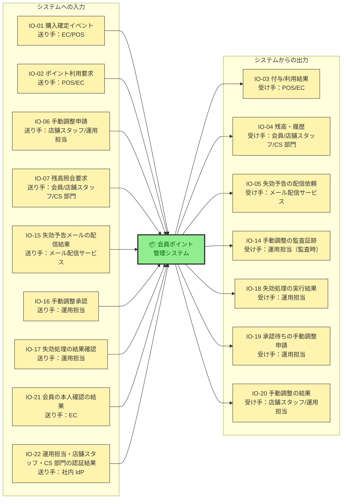
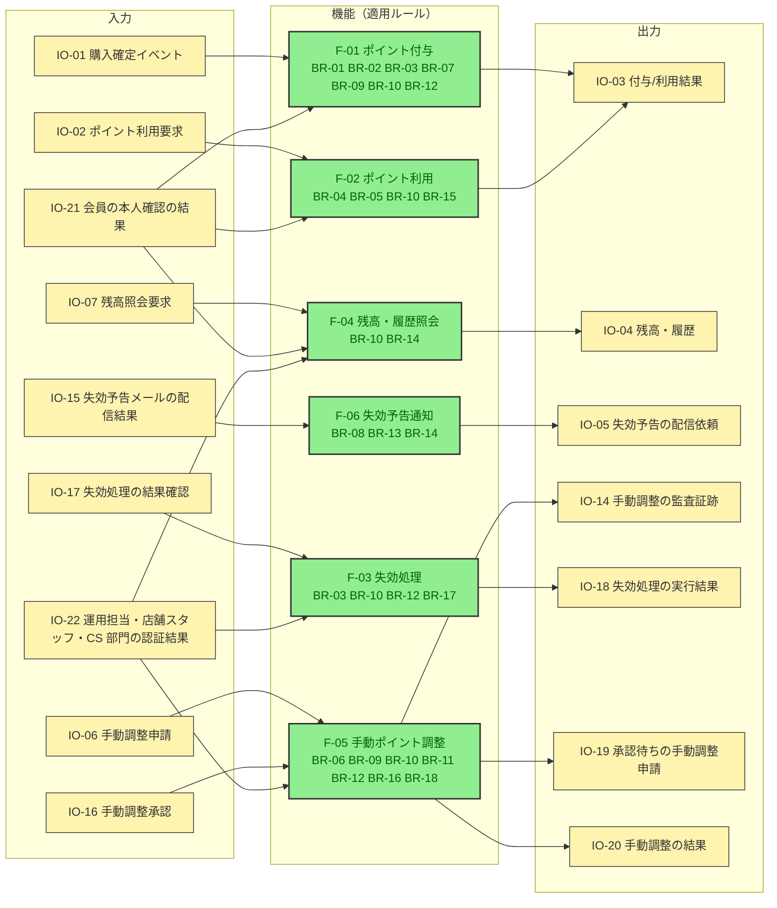
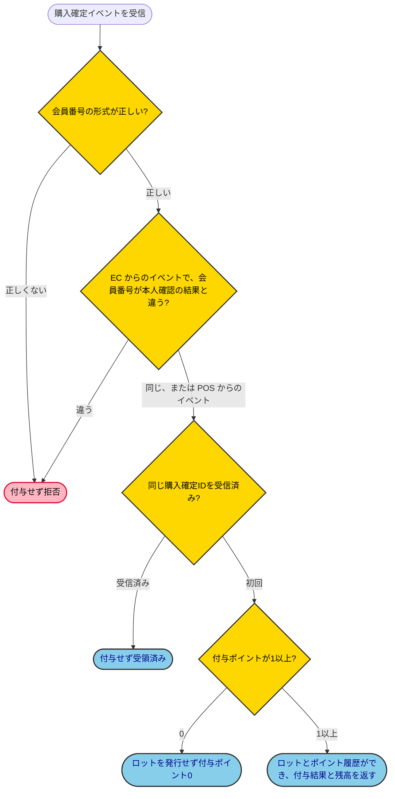
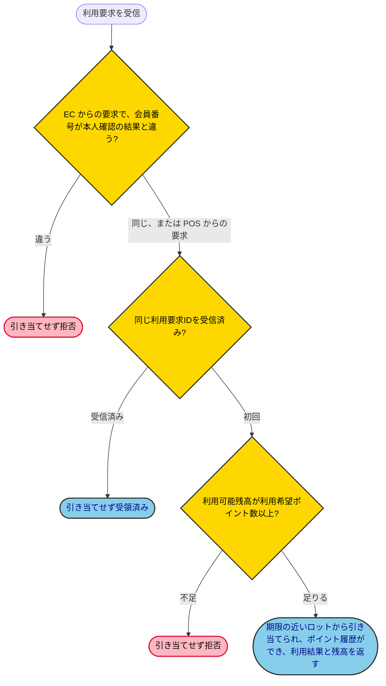
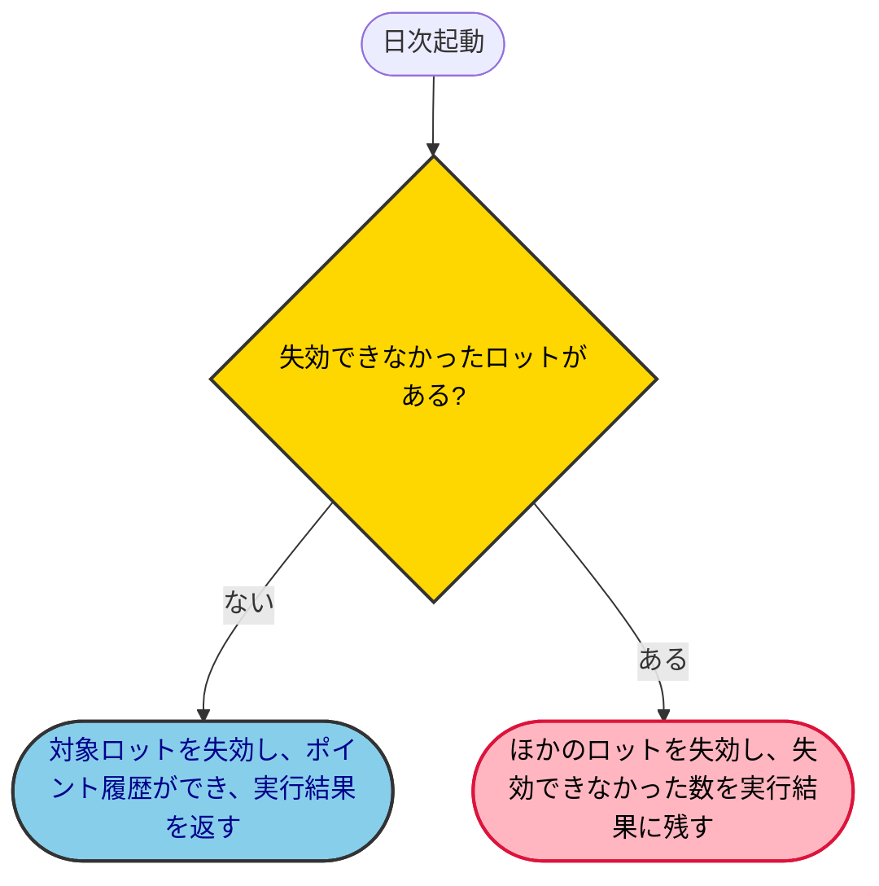
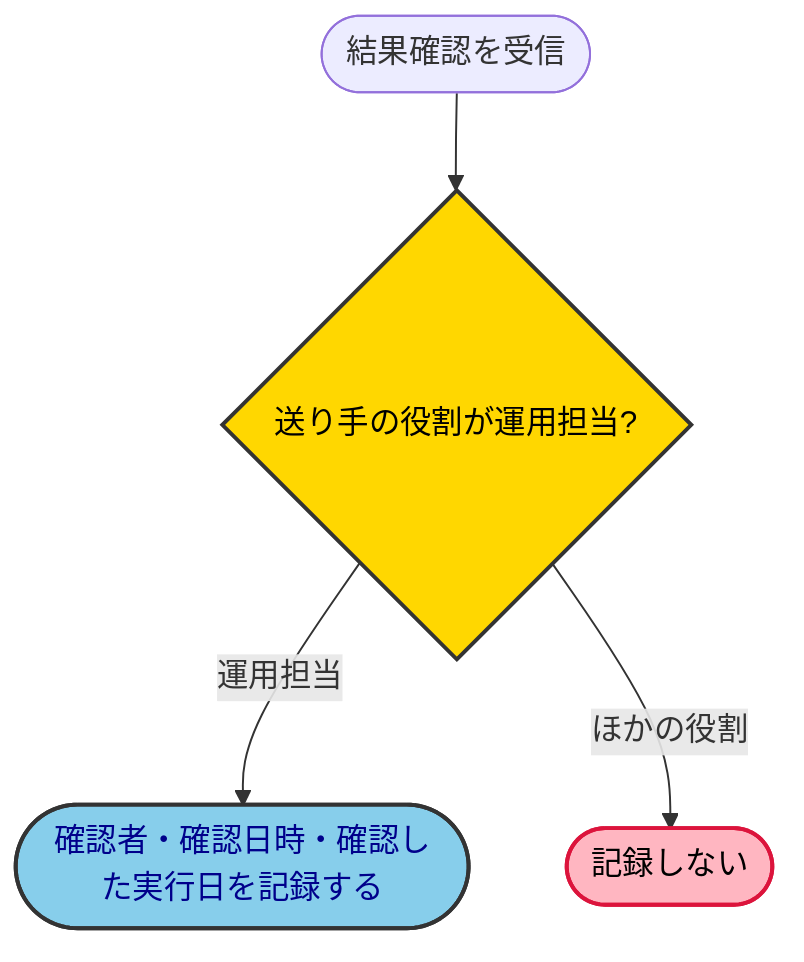
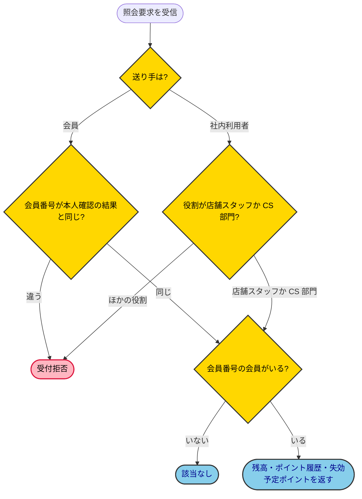
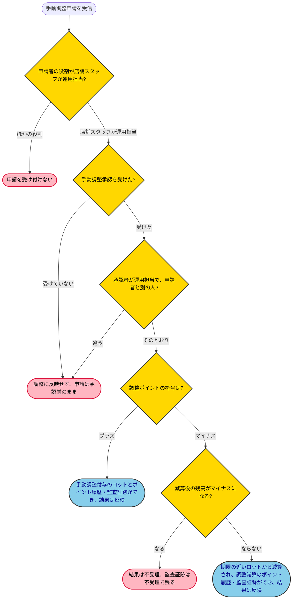
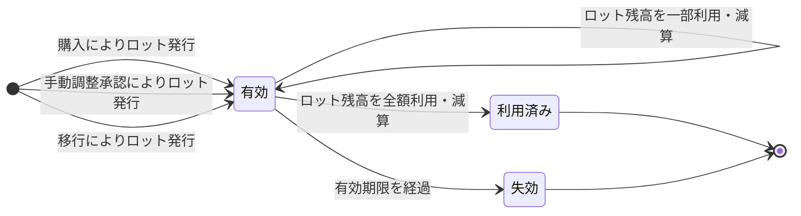

# 要件定義書（詳細）：会員ポイント管理システム <!-- omit from toc -->

設計者・実装者（AI を含む）が、入出力情報・属性の値制約・機能の振る舞いを正確に引きたいときに参照する。顧客も合意のために確認するが、重点的に読むのは `requirements.md` である。

## 目次 <!-- omit from toc -->

- [業務要件の詳細](#業務要件の詳細)
  - [属性の値制約一覧](#属性の値制約一覧)
  - [入出力情報一覧](#入出力情報一覧)
- [機能要件の詳細](#機能要件の詳細)
  - [機能仕様（ユースケース記述）](#機能仕様ユースケース記述)
  - [機能×入出力×ルール図](#機能入出力ルール図)
  - [機能ごとのアクティビティ図](#機能ごとのアクティビティ図)
  - [状態遷移](#状態遷移)

## 業務要件の詳細

### 属性の値制約一覧

入出力情報の属性が取りうる値・桁・形式を決める。値の決まりを設計の前に合意し、入力の検査とテストの境界値をここから作るためにある。既定どおりの属性はここに載らず、入出力情報一覧の各情報の `内容` の表が値の種類を持つ。

#### 共通の値制約

| 値の種類      | 取りうる値  | 桁             | 形式                         |
| ------------- | ----------- | -------------- | ---------------------------- |
| `0以上の整数` | 0以上の整数 | なし           | 半角数字のみ                 |
| `1以上の整数` | 1以上の整数 | なし           | 半角数字のみ                 |
| `日時`        | 日時        | 秒まで固定14桁 | `YYYY-MM-DDThh:mm:ss`（JST） |
| `日付`        | 日付        | 8桁            | `YYYY-MM-DD`（JST）          |

#### 個別の値制約

| ID    | 属性名                   | 取りうる値                                                                                                                                      | 桁                                               | 形式                         | 関連ルール          |
| ----- | ------------------------ | ----------------------------------------------------------------------------------------------------------------------------------------------- | ------------------------------------------------ | ---------------------------- | ------------------- |
| AC-01 | 会員番号                 | EC が発番する半角数字（先頭0を含む）。会員1人につき1つ                                                                                          | 10桁固定                                         | 半角数字のみ                 | —                   |
| AC-02 | 購入の税抜金額           | 0以上の整数（単位は円）。上限は999,999,999                                                                                                      | 最大9桁                                          | 半角数字のみ                 | BR-01, BR-02        |
| AC-03 | 購入日時                 | 受信時点以前の日時                                                                                                                              | 秒まで固定14桁                                   | `YYYY-MM-DDThh:mm:ss`（JST） | BR-03               |
| AC-05 | 付与ポイント             | 0以上の整数。付与/利用結果の区分が `付与` 以外では0                                                                                             | なし                                             | 半角数字のみ                 | BR-01, BR-12        |
| AC-07 | 利用可能残高             | 0以上の整数。有効期限内ロットのロット残高の合計に一致する。会員1人につき1つ                                                                     | なし                                             | 半角数字のみ                 | BR-03, BR-05        |
| AC-08 | 失効予定ポイント         | 0以上の整数。BR-14 が定める範囲のロット残高の合計に一致する。範囲にロットが無ければ0。会員1人につき1つ                                          | なし                                             | 半角数字のみ                 | BR-03, BR-13, BR-14 |
| AC-09 | 失効予告の最も早い失効日 | 失効予告の対象ロットの有効期限日の翌日のうち、最も早い日                                                                                        | 8桁                                              | `YYYY-MM-DD`（JST）          | BR-03, BR-13        |
| AC-10 | 調整ポイント             | 0を除く整数。絶対値は99,999以下（マイナスは調整減算。扱いは BR-11 が定める）                                                                    | 符号を除き最大5桁                                | 先頭の符号と半角数字         | BR-06, BR-11, BR-12 |
| AC-11 | 調整の理由               | 自由記述                                                                                                                                        | 200文字以内（全角・半角を区別せず1文字と数える） | 改行を含まない文字列         | BR-06               |
| AC-15 | 手動調整の申請者         | 社内 IdP の利用者ID。店舗スタッフか運用担当                                                                                                     | 8桁固定                                          | `U`＋半角数字7桁             | BR-16               |
| AC-16 | 手動調整の承認日時       | 受信時点以前の日時                                                                                                                              | 秒まで固定14桁                                   | `YYYY-MM-DDThh:mm:ss`（JST） | BR-03, BR-06        |
| AC-18 | 種別（ポイント履歴）     | `付与` ／ `利用` ／ `失効` ／ `調整減算` ／ `移行` のいずれか1つ                                                                                | なし                                             | 区分値                       | BR-10, BR-11        |
| AC-22 | 利用ポイント             | 0以上の整数。付与/利用結果の区分が `利用` 以外では0                                                                                             | なし                                             | 半角数字のみ                 | BR-04               |
| AC-23 | 購入確定ID               | `E`（EC）か `P`（POS）で始まる。EC/POS が発番する                                                                                               | 20桁固定                                         | `E` か `P`＋半角英数字19桁   | BR-07               |
| AC-24 | ギフト券額               | 0以上の整数（単位は円・税抜）。3つの額（ギフト券額・送料・ポイント利用充当額）の合計は購入の税抜金額以下（EC/POS が保証する。BR-02）。無ければ0 | 最大9桁                                          | 半角数字のみ                 | BR-02               |
| AC-25 | 送料                     | 0以上の整数（単位は円・税抜）。3つの額（ギフト券額・送料・ポイント利用充当額）の合計は購入の税抜金額以下（EC/POS が保証する。BR-02）。無ければ0 | 最大9桁                                          | 半角数字のみ                 | BR-02               |
| AC-26 | ポイント利用充当額       | 0以上の整数（単位は円・税抜）。3つの額（ギフト券額・送料・ポイント利用充当額）の合計は購入の税抜金額以下（EC/POS が保証する。BR-02）。無ければ0 | 最大9桁                                          | 半角数字のみ                 | BR-02               |
| AC-27 | 失効予告メールの配信成否 | `成功` ／ `失敗` のいずれか1つ                                                                                                                  | なし                                             | 区分値                       | BR-13               |
| AC-29 | 利用要求ID               | `E`（EC）か `P`（POS）で始まる。EC/POS が発番する                                                                                               | 20桁固定                                         | `E` か `P`＋半角英数字19桁   | BR-15               |
| AC-30 | 手動調整の申請ID         | 本システムが手動調整申請の受付時に採番する、一意の値                                                                                            | なし                                             | 文字列                       | BR-16, BR-18        |
| AC-32 | 失効処理結果の確認日時   | 受信時点以前の日時                                                                                                                              | 秒まで固定14桁                                   | `YYYY-MM-DDThh:mm:ss`（JST） | —                   |
| AC-33 | 確認した失効処理の実行日 | 失効処理結果の確認日時の日付以前の日付                                                                                                          | 8桁                                              | `YYYY-MM-DD`（JST）          | BR-17               |
| AC-37 | 付与/利用結果の区分      | `付与` ／ `利用` ／ `受領済み` ／ `拒否` のいずれか1つ                                                                                          | なし                                             | 区分値                       | BR-05, BR-07, BR-15 |
| AC-38 | 手動調整の承認者         | 社内 IdP の利用者ID。運用担当。同じ申請の手動調整の申請者（AC-15）とは別の人                                                                    | 8桁固定                                          | `U`＋半角数字7桁             | BR-06, BR-16        |
| AC-39 | 手動調整の結果の区分     | `反映` ／ `不受理` のいずれか1つ                                                                                                                | なし                                             | 区分値                       | BR-11               |
| AC-40 | 残高照会の結果の区分     | `該当あり` ／ `該当なし` ／ `受付拒否` のいずれか1つ                                                                                            | なし                                             | 区分値                       | —                   |
| AC-41 | 認証した社内利用者ID     | 社内 IdP の利用者ID。運用担当・店舗スタッフ・CS 部門のいずれか                                                                                  | 8桁固定                                          | `U`＋半角数字7桁             | —                   |
| AC-42 | 認証した社内利用者の役割 | `運用担当` ／ `店舗スタッフ` ／ `CS 部門` のいずれか1つ                                                                                         | なし                                             | 区分値                       | —                   |

AC-01 会員番号

先頭0を含むため、先頭0を落とさず10桁のまま保持する必要がある。桁数は EC の発番仕様で、こちらでは動かせない。

AC-02 購入の税抜金額

上限は、POS が1取引で扱える金額に合わせた。これを超える購入は POS 側で分割されるため、本システムに届かない。

AC-03 購入日時

未来日時を弾くのは、POS 端末の時刻ずれによる誤付与を防ぐため。ずれた日時でロットを発行すると、有効期限（BR-03）も連動してずれる。

AC-10 調整ポイント

絶対値の上限は、CS 部門長が1回の調整で決裁できる最大の値（サンプル物産の規程）。手動調整の決裁が要る範囲は、手動調整の決裁要否の境界（BR-06）が定める。

AC-11 調整の理由

200文字までとしたのは、サンプル物産の手動調整規程が、理由を200文字以内で書くと定めているため。規程は全角と半角を分けていないので、どちらも1文字と数える。

AC-15 手動調整の申請者

`U`＋7桁という形式は、社内 IdP が持つ利用者IDをそのまま借りたものである（本システムは採番しない）。

AC-23 購入確定ID

EC と POS が付ける識別子をそのまま借りる（本システムは採番しない）。同じ購入確定イベントを再送するときは同じ値で届く。先頭の `E`・`P` で発番元を区別するので、EC と POS で値が重ならない。

AC-29 利用要求ID

EC と POS が付ける識別子をそのまま借りる（本システムは採番しない）。同じ利用要求を再送するときは同じ値で届く。先頭の `E`・`P` で発番元を区別するので、EC と POS で値が重ならない。

AC-38 手動調整の承認者

手動調整の申請者（AC-15）と同一人物を許さないのは、職務を分けるため。同一人物を許すと、申請と別の人が承認する（BR-16）意味が無くなる。

承認者を運用担当に限るのは、手動調整の決裁要否の境界（BR-06）を超える調整でも、CS 部門長の手動調整の決裁を得たあとに運用担当が手動調整承認を送るからである。

### 入出力情報一覧

本システムが受け取る情報と出す情報を、送り手・受け手・属性まで並べる。扱う情報を属性まで決め、値の決まりやルールの抜けを見つけるためにある。

| ID    | 情報名                                    | 入出力区分 | 送り手                    | 受け手                    | 利用業務                           |
| ----- | ----------------------------------------- | ---------- | ------------------------- | ------------------------- | ---------------------------------- |
| IO-01 | 購入確定イベント                          | 入力       | EC/POS                    | 本システム                | 購入時付与                         |
| IO-02 | ポイント利用要求                          | 入力       | POS/EC                    | 本システム                | 店舗/EC 利用                       |
| IO-03 | 付与/利用結果                             | 出力       | 本システム                | POS/EC                    | 購入時付与, 店舗/EC 利用           |
| IO-04 | 残高・履歴                                | 出力       | 本システム                | 会員/店舗スタッフ/CS 部門 | 残高照会                           |
| IO-05 | 失効予告の配信依頼                        | 出力       | 本システム                | メール配信サービス        | 期限失効                           |
| IO-06 | 手動調整申請                              | 入力       | 店舗スタッフ/運用担当     | 本システム                | 手動調整                           |
| IO-07 | 残高照会要求                              | 入力       | 会員/店舗スタッフ/CS 部門 | 本システム                | 残高照会                           |
| IO-14 | 手動調整の監査証跡                        | 出力       | 本システム                | 運用担当（監査時）        | 手動調整                           |
| IO-15 | 失効予告メールの配信結果                  | 入力       | メール配信サービス        | 本システム                | 期限失効                           |
| IO-16 | 手動調整承認                              | 入力       | 運用担当                  | 本システム                | 手動調整                           |
| IO-17 | 失効処理の結果確認                        | 入力       | 運用担当                  | 本システム                | 期限失効                           |
| IO-18 | 失効処理の実行結果                        | 出力       | 本システム                | 運用担当                  | 期限失効                           |
| IO-19 | 承認待ちの手動調整申請                    | 出力       | 本システム                | 運用担当                  | 手動調整                           |
| IO-20 | 手動調整の結果                            | 出力       | 本システム                | 店舗スタッフ/運用担当     | 手動調整                           |
| IO-21 | 会員の本人確認の結果                      | 入力       | EC                        | 本システム                | 購入時付与, 残高照会, 店舗/EC 利用 |
| IO-22 | 運用担当・店舗スタッフ・CS 部門の認証結果 | 入力       | 社内 IdP                  | 本システム                | 残高照会, 手動調整, 期限失効       |

IO-01 購入確定イベント

| 属性名             | 必須・任意 | 値の種類か AC-ID |
| ------------------ | ---------- | ---------------- |
| 会員番号           | 必須       | AC-01            |
| 購入確定ID         | 必須       | AC-23            |
| 購入の税抜金額     | 必須       | AC-02            |
| ギフト券額         | 必須       | AC-24            |
| 送料               | 必須       | AC-25            |
| ポイント利用充当額 | 必須       | AC-26            |
| 購入日時           | 必須       | AC-03            |

- **取扱量**：通常時50万件/日
- **頻度**：購入の都度
- **利用目的**：付与額の算出

IO-02 ポイント利用要求

| 属性名             | 必須・任意 | 値の種類か AC-ID |
| ------------------ | ---------- | ---------------- |
| 会員番号           | 必須       | AC-01            |
| 利用要求ID         | 必須       | AC-29            |
| 利用希望ポイント数 | 必須       | 1以上の整数      |

- **取扱量**：通常時10万件/日
- **頻度**：利用要求の都度
- **利用目的**：残高の引き当て

IO-03 付与/利用結果

| 属性名              | 必須・任意                                | 値の種類か AC-ID |
| ------------------- | ----------------------------------------- | ---------------- |
| 付与/利用結果の区分 | 必須                                      | AC-37            |
| 付与ポイント        | 必須                                      | AC-05            |
| 利用ポイント        | 必須                                      | AC-22            |
| 付与・利用後の残高  | 付与/利用結果の区分が `拒否` 以外なら必須 | 0以上の整数      |

- **取扱量**：通常時60万件/日
- **頻度**：付与・利用の都度
- **利用目的**：レシート・画面への表示

IO-04 残高・履歴

| 属性名                     | 必須・任意                                 | 値の種類か AC-ID |
| -------------------------- | ------------------------------------------ | ---------------- |
| 残高照会の結果の区分       | 必須                                       | AC-40            |
| 利用可能残高               | 残高照会の結果の区分が `該当あり` なら必須 | AC-07            |
| 発生日時（ポイント履歴）   | ポイント履歴1件につき必須                  | 日時             |
| 種別（ポイント履歴）       | ポイント履歴1件につき必須                  | AC-18            |
| ポイント数（ポイント履歴） | ポイント履歴1件につき必須                  | 1以上の整数      |
| 失効予定ポイント           | 残高照会の結果の区分が `該当あり` なら必須 | AC-08            |

- **取扱量**：想定5万件/日
- **頻度**：随時
- **利用目的**：会員が自分で残高を見ることと、店舗スタッフと CS 部門の即答

IO-05 失効予告の配信依頼

| 属性名                   | 必須・任意 | 値の種類か AC-ID |
| ------------------------ | ---------- | ---------------- |
| 会員番号                 | 必須       | AC-01            |
| 失効予定ポイント         | 必須       | AC-08            |
| 失効予告の最も早い失効日 | 必須       | AC-09            |

受け手のメール配信サービスが、会員番号から宛先のメールアドレスを引き、会員へ失効予告のメールを配信する。本システムはメールアドレスを持たない。

- **取扱量**：失効予告で最大30万件/月
- **頻度**：1回/月。本番切替の日にも1回（BR-08）
- **利用目的**：失効前の利用促進

IO-06 手動調整申請

| 属性名       | 必須・任意 | 値の種類か AC-ID |
| ------------ | ---------- | ---------------- |
| 会員番号     | 必須       | AC-01            |
| 調整ポイント | 必須       | AC-10            |
| 調整の理由   | 必須       | AC-11            |

- **取扱量**：最大50件/日
- **頻度**：随時
- **利用目的**：クレーム対応の記録と、ポイントの付与・減算

IO-07 残高照会要求

| 属性名   | 必須・任意 | 値の種類か AC-ID |
| -------- | ---------- | ---------------- |
| 会員番号 | 必須       | AC-01            |

- **取扱量**：想定5万件/日
- **頻度**：随時
- **利用目的**：照会対象の特定

IO-14 手動調整の監査証跡

| 属性名               | 必須・任意 | 値の種類か AC-ID |
| -------------------- | ---------- | ---------------- |
| 会員番号             | 必須       | AC-01            |
| 手動調整の申請者     | 必須       | AC-15            |
| 手動調整の承認者     | 必須       | AC-38            |
| 手動調整の承認日時   | 必須       | AC-16            |
| 調整ポイント         | 必須       | AC-10            |
| 調整の理由           | 必須       | AC-11            |
| 手動調整の結果の区分 | 必須       | AC-39            |

- **取扱量**：最大50件/日
- **頻度**：手動調整の都度
- **利用目的**：手動調整が妥当だったかを、監査時に後から調べる

IO-15 失効予告メールの配信結果

| 属性名                   | 必須・任意 | 値の種類か AC-ID |
| ------------------------ | ---------- | ---------------- |
| 会員番号                 | 必須       | AC-01            |
| 失効予告メールの配信成否 | 必須       | AC-27            |

- **取扱量**：失効予告の配信依頼（IO-05）1件につき1件
- **頻度**：失効予告の配信依頼（IO-05）の都度
- **利用目的**：失効予告が会員へ届いたかの判定（BR-08）

IO-16 手動調整承認

| 属性名             | 必須・任意 | 値の種類か AC-ID |
| ------------------ | ---------- | ---------------- |
| 手動調整の申請ID   | 必須       | AC-30            |
| 手動調整の承認日時 | 必須       | AC-16            |

- **取扱量**：最大50件/日
- **頻度**：随時
- **利用目的**：承認のある申請だけを調整に反映する根拠（BR-16）と、監査証跡（IO-14）の材料

IO-17 失効処理の結果確認

| 属性名                   | 必須・任意 | 値の種類か AC-ID |
| ------------------------ | ---------- | ---------------- |
| 失効処理結果の確認日時   | 必須       | AC-32            |
| 確認した失効処理の実行日 | 必須       | AC-33            |

- **取扱量**：平日は1件/日。連休明けは、連休の日数＋1件
- **頻度**：平日に1回。平日でない日の実行分は、翌平日に実行日ごとに確認する
- **利用目的**：失効処理の失敗や漏れを、運用担当が見たことを証跡として残す

IO-18 失効処理の実行結果

| 属性名                 | 必須・任意 | 値の種類か AC-ID |
| ---------------------- | ---------- | ---------------- |
| 失効処理の実行日       | 必須       | 日付             |
| 失効したロット数       | 必須       | 0以上の整数      |
| 失効に失敗したロット数 | 必須       | 0以上の整数      |

- **取扱量**：1件/日
- **頻度**：失効処理（F-03）の実行の都度、1回/日
- **利用目的**：運用担当が失効処理の結果を確かめる（結果確認 IO-17 の対象）

IO-19 承認待ちの手動調整申請

| 属性名           | 必須・任意 | 値の種類か AC-ID |
| ---------------- | ---------- | ---------------- |
| 手動調整の申請ID | 必須       | AC-30            |
| 手動調整の申請者 | 必須       | AC-15            |
| 会員番号         | 必須       | AC-01            |
| 調整ポイント     | 必須       | AC-10            |
| 調整の理由       | 必須       | AC-11            |

- **取扱量**：最大50件/日
- **頻度**：申請の受付の都度
- **利用目的**：承認者が手動調整の申請IDを知り、承認（IO-16）を出す

IO-20 手動調整の結果

| 属性名               | 必須・任意 | 値の種類か AC-ID |
| -------------------- | ---------- | ---------------- |
| 手動調整の申請ID     | 必須       | AC-30            |
| 手動調整の結果の区分 | 必須       | AC-39            |
| 会員番号             | 必須       | AC-01            |
| 調整ポイント         | 必須       | AC-10            |

- **取扱量**：最大50件/日
- **頻度**：承認を受けた申請を処理する都度
- **利用目的**：申請者が、調整が反映されたか受け付けられなかったかを知る

IO-21 会員の本人確認の結果

| 属性名   | 必須・任意 | 値の種類か AC-ID |
| -------- | ---------- | ---------------- |
| 会員番号 | 必須       | AC-01            |

- **取扱量**：会員からの残高照会要求（IO-07）と、EC からのポイント利用要求（IO-02）・購入確定イベント（IO-01）1件につき1件
- **頻度**：会員からの残高照会要求と、EC からのポイント利用要求・購入確定イベントの都度
- **利用目的**：会員が照会・利用できる会員番号と、EC の購入で付与を受ける会員番号を、本人確認した会員自身のものに限る（E. セキュリティ／認証・認可の要求）

IO-22 運用担当・店舗スタッフ・CS 部門の認証結果

| 属性名                   | 必須・任意 | 値の種類か AC-ID |
| ------------------------ | ---------- | ---------------- |
| 認証した社内利用者ID     | 必須       | AC-41            |
| 認証した社内利用者の役割 | 必須       | AC-42            |

- **取扱量**：運用担当・店舗スタッフ・CS 部門からの要求（IO-06・IO-07・IO-16・IO-17）1件につき1件
- **頻度**：運用担当・店舗スタッフ・CS 部門からの要求の都度
- **利用目的**：要求を送った人と役割を特定し、役割ごとの権限で受け付ける（E. セキュリティ／認証・認可の要求）。手動調整の申請者（AC-15）・手動調整の承認者（AC-38）・失効処理結果の確認者は、この利用者ID（AC-41）で決まる

## 機能要件の詳細

### 機能仕様（ユースケース記述）

| 機能ID | アクター                                                     | トリガー                                                                   | 入力                | 出力                |
| ------ | ------------------------------------------------------------ | -------------------------------------------------------------------------- | ------------------- | ------------------- |
| F-01   | EC/POS                                                       | 購入確定イベント受信                                                       | IO-01, IO-21        | IO-03               |
| F-02   | POS/EC（店舗では店舗スタッフが POS を操作する）              | 利用要求受信                                                               | IO-02, IO-21        | IO-03               |
| F-03   | スケジューラ（失効）／運用担当（結果確認）                   | 日次起動（完了締切は B. 性能・拡張性／処理量・締切の目標）／結果確認の受信 | IO-17, IO-22        | IO-18               |
| F-04   | 会員／店舗スタッフ／CS 部門                                  | 照会要求受信                                                               | IO-07, IO-21, IO-22 | IO-04               |
| F-05   | 店舗スタッフ／運用担当（申請）、運用担当（承認）             | 手動調整申請の受信／手動調整承認の受信                                     | IO-06, IO-16, IO-22 | IO-14, IO-19, IO-20 |
| F-06   | スケジューラ／メール配信サービス（失効予告メールの配信結果） | 月次起動／本番切替の日の起動（BR-08）／失効予告メールの配信結果の受信      | IO-15               | IO-05               |

F-01 ポイント付与

- **適用ルール**：BR-01, BR-02, BR-03, BR-07, BR-09, BR-12, AC-01, AC-02, AC-03, AC-05, AC-23, AC-24, AC-25, AC-26, AC-37, BR-10, AC-18
- **事後条件**：
  - 付与ポイントが1以上なら、次のすべてが成り立つ
    - ロットが1件発行される
    - 残高が増える
    - 種別 `付与` のポイント履歴（AC-18）が1件残る
  - 0なら、ロットを発行せずポイント履歴も残さない（BR-12）
- **主要な例外**：会員番号が AC-01 不適合、または EC からの購入確定イベントの会員番号が本人確認の結果（IO-21）の会員番号と違う→付与せず、付与/利用結果の区分 `拒否` を返す／重複イベント→付与せず受領済みを返す（BR-07）。両方に当たるときは、`拒否` を優先する

F-02 ポイント利用

- **適用ルール**：BR-04, BR-05, BR-15, AC-01, AC-22, AC-29, AC-37, BR-10, AC-18
- **事後条件**：残高が減り、種別 `利用` のポイント履歴が残る
- **主要な例外**：EC からの利用要求の会員番号が、本人確認の結果（IO-21）の会員番号と違う→引き当てせず、付与/利用結果の区分 `拒否` を返す／残高不足（BR-05）→引き当てせず、付与/利用結果の区分 `拒否` を返す／同一の利用要求（BR-15）→引き当てせず受領済みを返す。本人確認の結果との食い違いは、ほかの例外より先に判定する。残高不足と同一の利用要求の両方に当たるときは、同一の利用要求の扱いを優先する

F-03 失効処理

- **適用ルール**：BR-03, BR-10, BR-12, BR-17, AC-01, AC-07, AC-18, AC-32, AC-33, AC-41, AC-42
- **事後条件**：
  - 失効を実行すると、次のすべてが成り立つ
    - 対象ロットのロット残高が0になる
    - 種別 `失効` のポイント履歴が残る
    - 実行結果（IO-18）が運用担当に届く（対象のロットが無い日も、件数0で届く）
  - 運用担当から結果確認（IO-17）を受けると、失効処理結果の確認者・失効処理結果の確認日時・確認した失効処理の実行日を記録する
- **主要な例外**：
  - 一部のロットを失効できなかった→ほかのロットは失効済みになり、失効できなかったロットの数が実行結果（IO-18）に残る
  - 結果確認の送り手の役割（IO-22）が運用担当でない（AC-42）→記録しない

F-04 残高・履歴照会

- **適用ルール**：BR-10, BR-14, AC-01, AC-07, AC-08, AC-18, AC-40, AC-41, AC-42
- **事後条件**：参照のみ（状態を変えない）
- **主要な例外**：
  - 会員からの照会要求の会員番号が、本人確認の結果（IO-21）の会員番号と違う、または社内利用者の役割（IO-22）が店舗スタッフでも CS 部門でもない→残高照会の結果の区分を `受付拒否` にして返す（AC-40）
  - 会員番号不明→残高照会の結果の区分を `該当なし` にして返す（AC-40）

F-05 手動ポイント調整

- **適用ルール**：BR-06, BR-09, BR-10, BR-11, BR-12, BR-16, BR-18, AC-01, AC-10, AC-11, AC-15, AC-16, AC-18, AC-30, AC-38, AC-39, AC-41, AC-42
- **事後条件**：
  - 調整ポイントがプラスなら、付与種別 `手動調整付与` のロットが発行される
  - マイナスなら、ロット残高が減算される（BR-11）
  - どちらでも、ポイント履歴と監査証跡（IO-14）が残り、申請者に結果（IO-20）が届く
- **主要な例外**：
  - 申請者の役割（IO-22）が店舗スタッフでも運用担当でもない（AC-15）→申請を受け付けず、承認待ちの手動調整申請（IO-19）も出さない
  - 手動調整承認（IO-16）の無い申請→調整に反映せず、申請は承認前のまま残す（BR-16）
  - 承認者の役割（IO-22）が運用担当でない、または承認者が申請者と同じ人（AC-38）→承認を受け付けず、申請は承認前のまま残す
  - 減算後の残高がマイナス（BR-11）→手動調整の結果の区分を `不受理` にし、監査証跡（IO-14）も結果の区分 `不受理` で残す

F-06 失効予告通知

- **適用ルール**：BR-08, BR-13, BR-14, AC-01, AC-08, AC-09, AC-27
- **事後条件**：BR-14 の範囲にロットを持つ会員ごとに失効予告が1件でき（BR-13）、BR-08 が定める配信依頼の期限までに配信依頼（IO-05）が出ている
- **主要な例外**：BR-08 が定める会員へ届ける期限までに届かなかった（IO-15）→未達として記録する

### 機能×入出力×ルール図

機能ごとに、受け取る情報・従うルール・出す情報を1枚で示す。機能・情報・ルールの繋がりを、ID を目で追わずに掴むためにある。

**凡例：** 🟩 緑＝機能（下段にビジネスルール（BR）の ID を併記） ／ 🟨 黄＝入出力情報。矢印は情報の流れを表す。

### 機能ごとのアクティビティ図

F-01（ポイント付与）— 受付の判定と付与の結果

**凡例：** 🟨 金＝結果が分かれる判定 ／ 🟦 青＝受け付けた結果 ／ 🟥 桃＝受け付けない結果。

F-02（ポイント利用）— 受付の判定と引き当ての結果

**凡例：** 🟨 金＝結果が分かれる判定 ／ 🟦 青＝受け付けた結果 ／ 🟥 桃＝受け付けない結果。

F-03（失効処理）— 失効の実行と結果確認の受付

**凡例：** 🟨 金＝結果が分かれる判定 ／ 🟦 青＝すべて失効した結果 ／ 🟥 桃＝一部を失効できなかった結果。

**凡例：** 🟨 金＝結果が分かれる判定 ／ 🟦 青＝受け付けた結果 ／ 🟥 桃＝受け付けない結果。

F-04（残高・履歴照会）— 受付の判定と照会の結果

**凡例：** 🟨 金＝結果が分かれる判定 ／ 🟦 青＝受け付けた結果 ／ 🟥 桃＝受け付けない結果。

F-05（手動ポイント調整）— 承認の判定と付与／減算の結果

**凡例：** 🟨 金＝結果が分かれる判定 ／ 🟦 青＝調整に反映した結果 ／ 🟥 桃＝調整に反映しない結果。

### 状態遷移

**凡例：** `[*]`＝ロットの発生・終了。利用済み＝利用か減算でロット残高が0になった状態。
