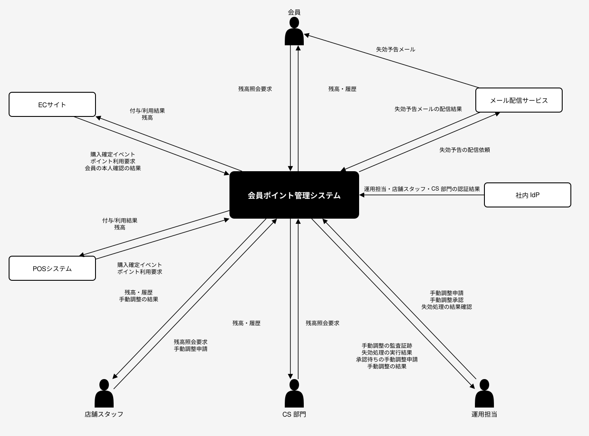
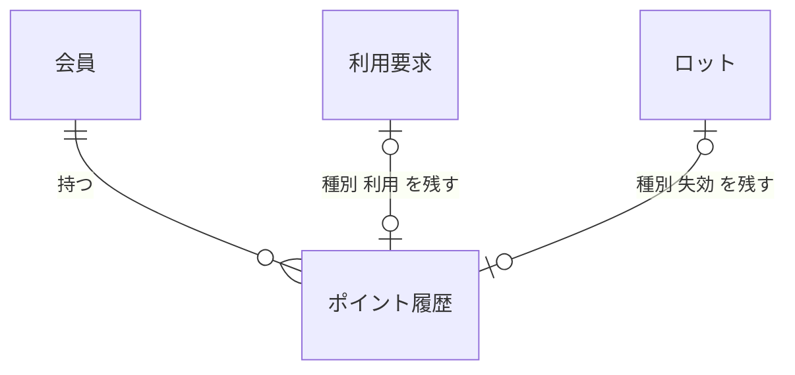
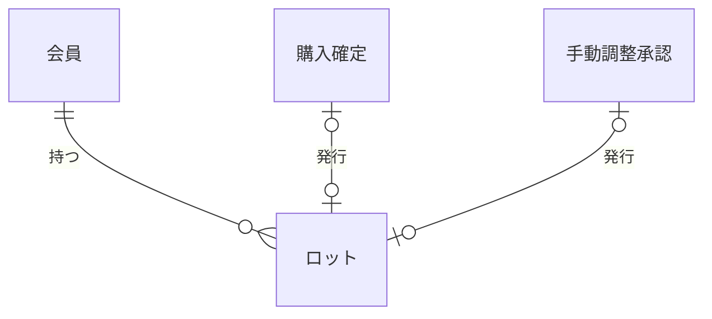
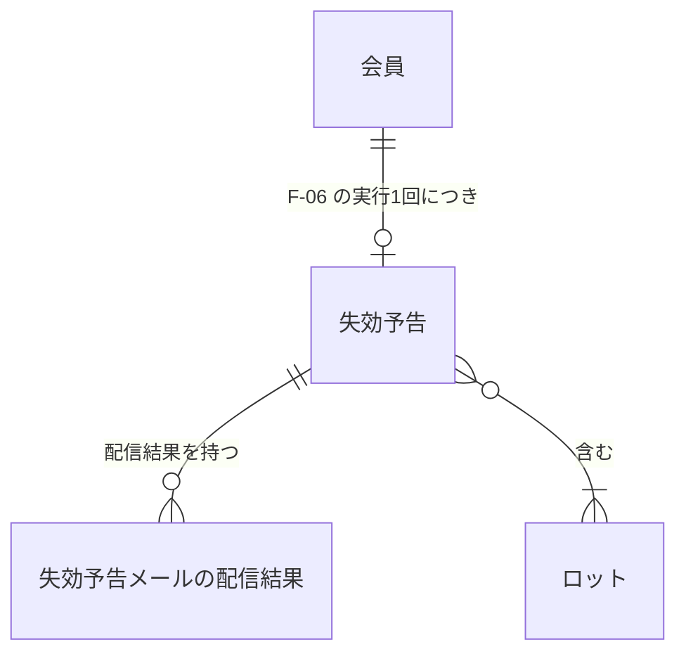
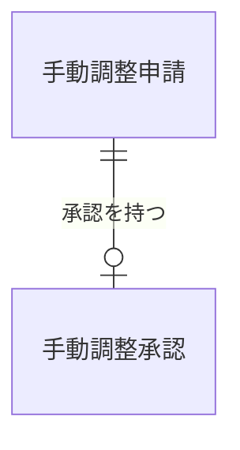
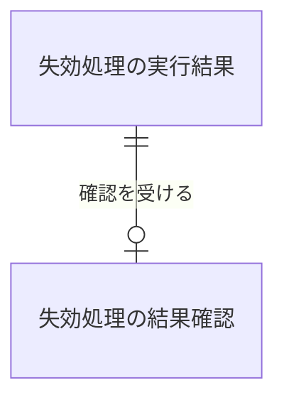
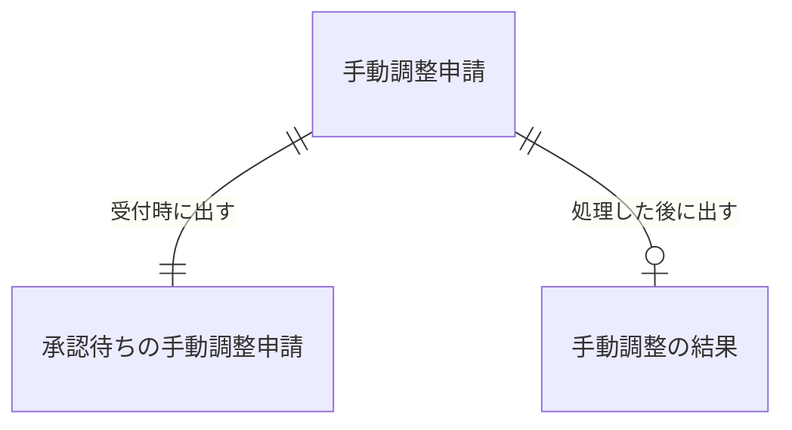
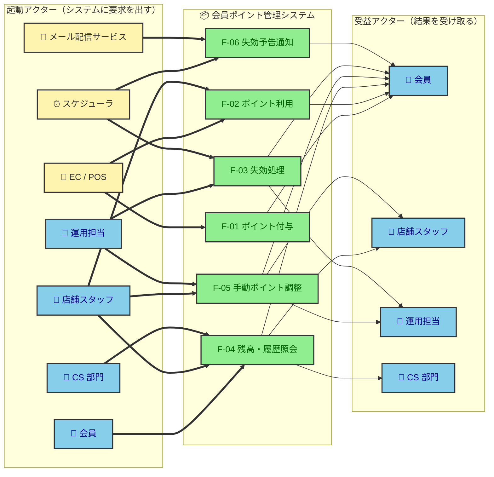

# 要件定義書：会員ポイント管理システム <!-- omit from toc -->

顧客がこのシステムに何が求められているかを確認して合意するとき、関係者が全体像を掴みたいときに参照する。重点的に読むのはこのファイルで、設計・実装向けの詳細は `requirements-detail.md` にある。

## 目次 <!-- omit from toc -->

- [概要](#概要)
- [目的](#目的)
- [背景・入力元](#背景入力元)
- [用語定義](#用語定義)
- [ターゲットユーザー](#ターゲットユーザー)
- [ステークホルダー／関係者](#ステークホルダー関係者)
- [エコシステムマップ](#エコシステムマップ)
- [解決する課題](#解決する課題)
- [業務要件](#業務要件)
  - [業務一覧](#業務一覧)
  - [ビジネスルール一覧](#ビジネスルール一覧)
- [機能要件](#機能要件)
  - [システム化機能一覧](#システム化機能一覧)
  - [アクター×機能図](#アクター機能図)
- [非機能要件](#非機能要件)
  - [A. 可用性](#a-可用性)
  - [B. 性能・拡張性](#b-性能拡張性)
  - [C. 運用・保守性](#c-運用保守性)
  - [D. 移行性](#d-移行性)
  - [E. セキュリティ](#e-セキュリティ)
  - [F. システム環境・エコロジー](#f-システム環境エコロジー)
  - [SLI（指標）](#sli指標)
  - [SLO（目標値＋評価期間）](#slo目標値評価期間)
  - [SLA（合意）](#sla合意)
- [優先順位](#優先順位)
- [制約と前提](#制約と前提)
- [スコープ外（Non-Goals）](#スコープ外non-goals)
- [受入基準](#受入基準)
- [リスクと対応](#リスクと対応)

## 概要

小売事業者「サンプル物産」向けに、会員が店舗（POS）と EC で貯めたポイントを一元管理するシステム。

購入に応じた付与、利用時の残高引き当て、有効期限切れの失効を扱う。

会員は残高・履歴を照会でき、運用担当は失効処理の結果確認と手動調整を扱う。

## 目的

店舗と EC を横断してポイントを正しく貯め・使え・期限管理できる状態にし、会員の再来店・再購入を促す。

## 背景・入力元

| 入力元                                | 内容                                                |
| ------------------------------------- | --------------------------------------------------- |
| RFC「ポイント統合基盤 要求メモ v1.2」 | 顧客提供の一次要求（統合・失効自動化・EC/POS 連携） |
| 現行運用ヒアリング議事録              | 店舗別 Excel 台帳の月次失効作業の課題               |
| 個人情報取扱規程（顧客社内）          | 会員情報の格付け・保持のルール                      |

## 用語定義

全社共通語は用語集（[../../docs/project-context/glossary.md](../../docs/project-context/glossary.md)）を参照。

| 用語                               | 定義                                                                                                                                                                                     |
| ---------------------------------- | ---------------------------------------------------------------------------------------------------------------------------------------------------------------------------------------- |
| ポイントロット（略称：ロット）     | 1回の付与で発生するポイントのかたまり。発行日と有効期限を持ち、失効判定・先入れ先出しの単位                                                                                              |
| ロット残高                         | ロット1件に残っている、まだ利用・失効していないポイント                                                                                                                                  |
| 失効                               | 有効期限を過ぎたロットのロット残高を利用不能にすること                                                                                                                                   |
| 残高                               | ある会員の、失効・利用済みを除いた利用可能ポイントの合計                                                                                                                                 |
| 付与種別                           | ロットがどの経路で付与されたかの区分（取りうる値は BR-09）                                                                                                                               |
| ポイント履歴                       | 会員のポイントの付与・利用・失効・調整減算・移行の1件ごとの記録。種別は AC-18                                                                                                            |
| 購入確定                           | EC/POS での1回の購入の確定。本システムには購入確定イベント（IO-01）として届く                                                                                                            |
| 失効予告                           | 失効が近いロットを持つ会員への1回の知らせ。本システムは失効予告の配信依頼（IO-05）を出す                                                                                                 |
| 手動調整の決裁                     | 手動調整の決裁要否の境界（BR-06）を超える手動調整を、CS 部門長が認めること。本システムの外で行い、本システムは記録しない（BR-06）。運用担当が本システムへ送る手動調整承認（IO-16）とは別 |
| CS 部門                            | カスタマーサポート部門。会員からの問い合わせ・苦情に応対する                                                                                                                             |
| 会員                               | EC アカウントを持ち、会員番号（AC-01）で識別される、店舗・EC の買い物客                                                                                                                  |
| 顧客                               | 本システムの発注元であるサンプル物産。会員とは別                                                                                                                                         |
| 発報                               | 監視が異常を検知して、運用担当へ知らせること（C. 運用・保守性／監視の要求）。会員への失効予告とは別                                                                                      |
| ポイント利用要求（略称：利用要求） | 会員が残高を使うために EC/POS が送る要求（IO-02）                                                                                                                                        |
| 残高照会要求（略称：照会要求）     | 残高・履歴を見るための要求（IO-07）                                                                                                                                                      |
| 平日                               | 土日・祝日・年末年始（12/29〜1/3）を除く日                                                                                                                                               |
| EC                                 | サンプル物産の通販サイト。会員の EC アカウントを持つ                                                                                                                                     |
| POS                                | 店舗のレジのシステム                                                                                                                                                                     |
| IdP（ID プロバイダ）               | 利用者を認証し、利用者IDを渡す仕組み。本書では顧客社内の社内 IdP を指す                                                                                                                  |

## ターゲットユーザー

| ユーザー     | 想定シーンと前提                                                                              |
| ------------ | --------------------------------------------------------------------------------------------- |
| 会員         | 店舗・EC で購入しポイントを貯める/使う買い物客。EC アカウントを持ち、スマホで残高を見たいとき |
| 店舗スタッフ | レジで会員のポイント利用を代行操作し、残高問い合わせに答えるとき                              |
| 運用担当     | 失効処理の結果確認や、クレーム対応での手動ポイント調整を行う社内オペレーター                  |
| CS 部門      | 会員からの電話の問い合わせに、残高・履歴を照会して即答するとき                                |

## ステークホルダー／関係者

| 役割               | 立場                                                                                                    |
| ------------------ | ------------------------------------------------------------------------------------------------------- |
| マーケティング部長 | 意思決定者（付与率・失効ルールを決める）                                                                |
| 情報システム部     | 合意者（セキュリティ・EC/POS 連携仕様の合意）                                                           |
| CS 部門長          | 利用部門責任者（問い合わせ対応フローの当事者。手動調整の決裁要否の境界（BR-06）を超える手動調整の決裁） |
| 個人情報保護管理者 | 合意者（会員情報の取扱い・保持の適法性）                                                                |

## エコシステムマップ

**凡例：** 黒塗りの角丸の箱＝開発範囲（内） ／ 白い箱と人型＝外部アクター・外部システム（外）。矢印は授受の向き（誰から誰へ渡るか）を表す。線種は1種類に統一（種別の区別はしない）。

## 解決する課題

| 誰の     | どんな困りごと                                                             |
| -------- | -------------------------------------------------------------------------- |
| 会員     | 店舗と EC でポイントが分断され合算して使えない。期限切れに気づけず失効する |
| 運用担当 | 失効処理が Excel 手作業で月末に数時間かかり、計算ミス・付与漏れが起きる    |
| CS 部門  | 残高問い合わせに即答できず、店舗台帳を都度調べている                       |

## 業務要件

### 業務一覧

| 大分類       | 中分類     | 小分類       | 概要                               | システム化区分 | 関連ルールID                                                                                                                 |
| ------------ | ---------- | ------------ | ---------------------------------- | -------------- | ---------------------------------------------------------------------------------------------------------------------------- |
| ポイント管理 | 付与       | 購入時付与   | 購入金額に応じ付与                 | システム化     | BR-01, BR-02, BR-03, BR-07, BR-09, BR-10, BR-12, AC-01〜AC-03, AC-05, AC-18, AC-23〜AC-26, AC-37                             |
| ポイント管理 | 調整       | 手動調整     | クレーム対応等で付与・減算         | 一部           | BR-06, BR-09, BR-10, BR-11, BR-12, BR-16, BR-18, AC-01, AC-10, AC-11, AC-15, AC-16, AC-18, AC-30, AC-38, AC-39, AC-41, AC-42 |
| ポイント管理 | 利用       | 店舗/EC 利用 | 残高を引き当て                     | システム化     | BR-04, BR-05, BR-10, BR-15, AC-01, AC-18, AC-22, AC-29, AC-37                                                                |
| ポイント管理 | 失効       | 期限失効     | 失効前の予告と期限切れロットの失効 | システム化     | BR-03, BR-08, BR-10, BR-12〜BR-14, BR-17, AC-01, AC-07〜AC-09, AC-18, AC-27, AC-31〜AC-33, AC-41, AC-42                      |
| 会員対応     | 照会       | 残高照会     | 残高・ポイント履歴を照会           | システム化     | BR-10, BR-14, AC-01, AC-07, AC-08, AC-18, AC-40〜AC-42                                                                       |
| 会員対応     | 問い合わせ | 苦情一次対応 | 会員の苦情を聞き取る               | 手動           | —                                                                                                                            |

購入時付与

**区分の理由**：大量・高頻度で人手では不可能。金額計算の正確性が必須。

手動調整

**区分の理由**：発生は稀で判断を伴うため、申請・承認は人が行う。承認を受けた申請のポイントの付与（BR-12）・減算（BR-11）と、その監査証跡は本システムが行う。

店舗/EC 利用

**区分の理由**：決済の場で、使えるかどうかと使った後の残高を会員に返す必要がある。

期限失効

**区分の理由**：日次・大量で正確性が要る。Excel 手作業の置換が本件の主目的。

残高照会

**区分の理由**：会員が自分で残高を見られるようにし、店舗スタッフ・CS 部門が即答できるようにする。

苦情一次対応

**区分の理由**：対話・共感を要する非定型業務で、システム化の価値が薄い。

### ビジネスルール一覧

| ID    | ルール名                                       | タイプ   | 関連ルール                 |
| ----- | ---------------------------------------------- | -------- | -------------------------- |
| BR-01 | 付与率                                         | 定義づけ | BR-02                      |
| BR-02 | 付与対象金額                                   | 定義づけ | BR-01                      |
| BR-03 | ロットの有効期限の算出                         | 定義づけ | BR-04, AC-03, AC-16        |
| BR-04 | ロットの引当順序                               | 行動     | BR-03                      |
| BR-05 | 残高下限                                       | 行動     | —                          |
| BR-06 | 手動調整の決裁要否の境界                       | 行動     | —                          |
| BR-07 | 重複付与の禁止                                 | 行動     | BR-01, AC-23               |
| BR-08 | 失効予告の時期                                 | 行動     | BR-03                      |
| BR-09 | 付与種別の区分                                 | 定義づけ | BR-01, BR-06               |
| BR-10 | ポイント履歴の多重度                           | 定義づけ | BR-03, BR-12, BR-15, AC-18 |
| BR-11 | 減算調整                                       | 行動     | BR-04, BR-05, BR-06, BR-10 |
| BR-12 | ロットの多重度                                 | 定義づけ | BR-03, BR-09, AC-05, AC-10 |
| BR-13 | 失効予告の多重度                               | 定義づけ | BR-08, BR-14, AC-08, AC-09 |
| BR-14 | 失効予定ポイントの集計範囲                     | 定義づけ | BR-03, BR-08, AC-08        |
| BR-15 | 重複利用の禁止                                 | 行動     | BR-04, BR-05, AC-29        |
| BR-16 | 手動調整承認の多重度                           | 定義づけ | BR-06, AC-15, AC-30, AC-38 |
| BR-17 | 失効処理の結果確認の多重度                     | 定義づけ | AC-33                      |
| BR-18 | 承認待ちの手動調整申請と手動調整の結果の多重度 | 定義づけ | BR-16, AC-30               |

BR-01 付与率

付与ポイント＝付与対象金額（BR-02）÷ 100 の整数部。端数は切り捨てる。境界値は、付与対象金額99円以下が0ポイント、100円が1ポイントである。

BR-02 付与対象金額

付与対象金額は、購入の税抜金額からギフト券額・送料・ポイント利用充当額を引いた額である。4つの額はすべて税抜で、購入の税抜金額は送料を含む（EC/POS が税抜に換算して送る）。端数処理は生じない。境界値は、3つの額（ギフト券額・送料・ポイント利用充当額）の合計が購入の税抜金額と等しいとき、付与対象金額が0円になる点である（合計が購入の税抜金額以下であることは、AC-24〜AC-26 のとおり EC/POS が保証する）。

BR-03 ロットの有効期限の算出

ロットの有効期限日＝発行日を1日目と数えて365日目（＝発行日の364日後）。発行日は、購入付与のロットでは購入日時（AC-03）の日付、手動調整付与のロットでは手動調整の承認日時（AC-16）の日付とする（どちらも JST）。移行のロットは、移行元の有効期限日をそのまま持つ（D. 移行性）。日単位で扱うため端数処理は生じない。境界値は、期限日の当日中は利用でき、その翌日から失効対象になる点である。

BR-04 ロットの引当順序

本システムは、ポイント利用を処理するとき、有効期限が近いロットから順に引き当てなければならない（先入れ先出し）。

BR-05 残高下限

本システムは、常に、引き当て後の残高がマイナスになる利用要求を受け付けてはならない。

BR-06 手動調整の決裁要否の境界

運用担当は、1回の手動調整の調整ポイントが、プラスでもマイナスでも絶対値で10,000ポイントを超えるとき、CS 部門長の手動調整の決裁を得ずに調整してはならない。手動調整の決裁は本システムの外で得て、その後に運用担当が手動調整承認（IO-16）を本システムへ送る。本システムは、手動調整の決裁そのものは記録しない。

BR-07 重複付与の禁止

本システムは、同一の購入確定イベントを2回目以降に受信したとき、付与を行ってはならない。同一かどうかは、購入確定ID（AC-23）が受信済みかどうかで判定する。

BR-08 失効予告の時期

本システムは、毎月、BR-14 の範囲にロットを持つ会員へ、失効予告を出さなければならない。BR-14 の範囲のどのロットについても、その有効期限日（BR-03）の翌日の14日前までに、そのロットを含む失効予告の配信依頼（IO-05）を出さなければならない。ただし、付与種別 `移行` のロットのうち、有効期限日の翌日の14日前が本番切替の日（D. 移行性）より前になるものは、本番切替の日に最初の配信依頼を出す。そのため F-06 失効予告通知は、毎月の実行に加えて、本番切替の日にも1回実行する。本番切替の日の実行も、毎月の実行と同じく BR-14 の範囲にロットを持つ会員へ失効予告を出す。

失効予告は、その失効予告の最も早い失効日（AC-09）の前日までに会員へ届けなければならない。同じ会員に新しい失効予告を出した後は、前の失効予告の代わりに新しい失効予告を届ける（前の失効予告のロットのうち、新しい失効予告の BR-14 の範囲にあるものは、新しい失効予告に入る）。

BR-09 付与種別の区分

付与種別の取りうる値は `購入付与`・`手動調整付与`・`移行` で、ロットはこのうち1つだけを持つ（排他）。

BR-10 ポイント履歴の多重度

**凡例：** 縦線2本＝ちょうど1件 ／ 丸と縦線＝0件か1件 ／ 丸と三つ又＝0件以上。

ポイント履歴は、種別（AC-18）を問わず、会員1人につき0件以上（上限なし）。逆向きに見ると、ポイント履歴1件は必ず会員1人に属する。

- **利用要求と種別 `利用` のポイント履歴**：引き当てた利用要求1件につき、種別 `利用` のポイント履歴を1件残す。利用拒否した利用要求と、受領済みを返した利用要求（BR-15）には残さない。逆向きに見ると、種別 `利用` のポイント履歴1件は、利用要求ちょうど1件から残る。
- **ロットと種別 `失効` のポイント履歴**：失効したロット1件につき、種別 `失効` のポイント履歴を1件残す（ロット残高0のロットは作らない。BR-12）。逆向きに見ると、種別 `失効` のポイント履歴1件は、ロットちょうど1件の失効から残る。

残高・履歴（IO-04）1件は、照会した会員の直近1年分のポイント履歴を含む。直近1年分は、発生日時の日付が、照会した日の1年前の同じ日（照会した日が2月29日なら、1年前の2月28日）以後のものを指す。境界値は、1年前の同じ日のポイント履歴を含み、その前日のポイント履歴を含まない点である。ポイント履歴1件は発生日時・種別・ポイント数をそれぞれ1つずつ必ず持つ。

BR-11 減算調整

本システムは、調整ポイントがマイナスの手動調整を処理するとき、有効期限が近いロットから順に減算しなければならない（BR-04 と同じ順）。減算後の残高がマイナスになる調整を受け付けてはならない（BR-05 と同じ下限）。決裁が要る範囲は BR-06 が定める。減算のポイント履歴は、種別 `調整減算` で1件残す。

BR-12 ロットの多重度

**凡例：** 縦線2本＝ちょうど1件 ／ 丸と縦線＝0件か1件 ／ 丸と三つ又＝0件以上。

- **会員とロット**：会員1人は、ロットを0件以上（上限なし）持つ。逆向きに見ると、ロット1件は必ず会員1人に属する。
- **ロットが持つ値**：ロット1件は、有効期限・ロット残高・付与種別をそれぞれ1つずつ必ず持つ。
- **発行時のロット残高**：購入付与では付与ポイント（AC-05）、手動調整付与では調整ポイント（AC-10）、移行では移行元の残高に等しい。
- **購入確定から発行するロット**：購入確定1件から発行するロットは、付与ポイントが1以上のとき1件、0のとき0件。付与ポイントが0のときは、ポイント履歴も残さない。
- **手動調整承認から発行するロット**：手動調整承認1件から発行するロットは、調整ポイントがプラスのとき1件、マイナスのとき0件。プラスのときは、種別 `付与` のポイント履歴を1件残す。
- **ロットの発行元**：逆向きに見ると、ロット1件は、付与種別が `購入付与` なら購入確定1件から、`手動調整付与` なら手動調整承認1件から発行され、ほかからは発行されない。`移行` のロットは、移行で1回だけ発行し、そのとき種別 `移行` のポイント履歴を1件残す。
- **ロット残高が0のロット**：種別 `失効` のポイント履歴を作らず、失効予告の範囲（BR-14）にも入れない。

BR-13 失効予告の多重度

**凡例：** 縦線2本＝ちょうど1件 ／ 丸と縦線＝0件か1件 ／ 丸と三つ又＝0件以上 ／ 縦線と三つ又＝1件以上。

失効予告は、会員1人につき、F-06 失効予告通知の実行1回（毎月の実行と、本番切替の日の実行。BR-08）あたり0件または1件。BR-14 の範囲にロットを持つ会員には1件、持たない会員には0件。逆向きに見ると、失効予告1件は必ず会員1人に属する。失効予告1件は、失効予定ポイントと失効予告の最も早い失効日をそれぞれ1つずつ必ず持つ。会員が失効日の異なる複数のロットを持つときも1件にまとめ、そのうち最も早い日を失効予告の最も早い失効日（AC-09）とする。失効予告1件は、BR-14 の範囲のロットを1件以上含む。逆向きに見ると、ロット1件は失効予告に0件以上含まれる（月をまたいで BR-14 の範囲にあれば、毎月の失効予告に入る）。失効予告メールの配信結果1件は、失効予告ちょうど1件に属する。失効予告1件は、失効予告メールの配信結果を0件以上持つ。失効予告メールの配信結果は、会員番号で、その会員の最新の失効予告に結ぶ（BR-08 により、新しい月の失効予告を出した後は、前の月の失効予告を届けないため）。

BR-14 失効予定ポイントの集計範囲

失効予定ポイントは、集計日の時点で、有効期限日が集計日以後かつ集計日の翌月の末日以前にあり、ロット残高が1以上のロットについて、ロット残高を合計した値である。集計日は、失効予告では F-06 失効予告通知の実行（毎月の実行と、本番切替の日の実行。BR-08）の起動日、残高照会では照会した日とする。端数処理は生じない。境界値は、有効期限日が集計日と同じロットと、翌月の末日のロットを数え、翌月の末日の翌日が有効期限日のロットは数えない点である。

BR-15 重複利用の禁止

本システムは、同一の利用要求を2回目以降に受信したとき、引き当てを行ってはならない。同一かどうかは、利用要求ID（AC-29）が受信済みかどうかで判定する。

BR-16 手動調整承認の多重度

**凡例：** 縦線2本＝ちょうど1件 ／ 丸と縦線＝0件か1件。

手動調整承認は、申請1件につき0件または1件（承認前は0件）。逆向きに見ると、承認1件は必ず申請1件に属し、手動調整の申請ID（AC-30）で結ぶ。承認の無い申請は、調整に反映しない。却下・取り下げは置かず、承認されない申請は承認前のまま残る。

BR-17 失効処理の結果確認の多重度

**凡例：** 縦線2本＝ちょうど1件 ／ 丸と縦線＝0件か1件。

失効処理の実行結果は、失効処理の実行1回につき1件。実行結果1件は、結果確認を0件か1件受ける（確認前は0件）。逆向きに見ると、結果確認1件は、確認した失効処理の実行日（AC-33）が失効処理の実行日と同じ実行結果1件だけを指す。

BR-18 承認待ちの手動調整申請と手動調整の結果の多重度

**凡例：** 縦線2本＝ちょうど1件 ／ 丸と縦線＝0件か1件。

承認待ちの手動調整申請（IO-19）は、手動調整申請1件につきちょうど1件で、申請を受け付けたときに出す。逆向きに見ると、IO-19 1件は必ず申請1件だけを指す。手動調整の結果（IO-20）は、申請1件につき0件か1件（承認を受けて処理するまでは0件、処理した後は1件）。逆向きに見ると、IO-20 1件は必ず申請1件に属する。どちらも手動調整の申請ID（AC-30）で申請に結ぶ。

## 機能要件

### システム化機能一覧

基盤機能は立てない・理由：EC/POS・メール配信サービス・社内 IdP との授受は、すべて業務の機能がそれぞれの業務の中で担い（EC の本人確認の結果 IO-21 は F-02・F-04 が、社内 IdP の認証結果 IO-22 は F-03・F-04・F-05 が受ける）、業務に1対1で紐づかない機能が無い。監視・バックアップは C. 運用・保守性に書く。

| 機能ID | 機能名           | 対象業務     | 優先度 |
| ------ | ---------------- | ------------ | ------ |
| F-01   | ポイント付与     | 購入時付与   | Must   |
| F-02   | ポイント利用     | 店舗/EC 利用 | Must   |
| F-03   | 失効処理         | 期限失効     | Must   |
| F-04   | 残高・履歴照会   | 残高照会     | Must   |
| F-05   | 手動ポイント調整 | 手動調整     | Must   |
| F-06   | 失効予告通知     | 期限失効     | Should |

F-01 ポイント付与

**優先度の理由**：ポイントが貯まらなければサービスが成立しない。金額計算の正確性が金銭的信頼に直結する。

F-02 ポイント利用

**優先度の理由**：貯めたポイントを使えることがサービスの根幹。残高引当の誤りは金銭事故になる。

F-03 失効処理

**優先度の理由**：Excel 手作業の置換が本件の主目的。誤失効は会員資産の毀損になる。

F-04 残高・履歴照会

**優先度の理由**：残高を知る手段が無ければ、会員は使えるポイントが分からず、使えること（F-02）が成り立たない。店舗スタッフと CS 部門が問い合わせに即答するのも、この機能による。

F-05 手動ポイント調整

**優先度の理由**：発生頻度は低いが、不正な水増しへの対応（申請と承認を分ける）と、購入取消で残った付与の減算（スコープ外「購入取消に合わせた付与の自動取消」の代わり）がこの機能を前提にする。金銭の毀損を防ぐので Must とする。

F-06 失効予告通知

**優先度の理由**：失効前に使う機会を与え会員の不満を防ぐが、失効処理自体は予告がなくても成立する。

（Won't（今回のスコープ外）：会員ランク制度・ランク別付与率。理由は「スコープ外」節参照）

### アクター×機能図

**凡例：** 🟦 青＝人のアクター ／ 🟨 黄＝外部システム・自動起動 ／ 🟩 緑＝本システムの機能。太線＝起動（システムに要求を出す）、細線＝受益（結果を受け取る）。

## 非機能要件

### A. 可用性

| 項目                | 要求                                                                                          |
| ------------------- | --------------------------------------------------------------------------------------------- |
| サービス提供時間    | 付与・利用・残高照会は24時間365日（失効処理の完了締切は B. 性能・拡張性／処理量・締切の目標） |
| 稼働率の目標        | SLO（可用性）で定量化。計画停止は稼働率から除外                                               |
| 目標復旧時間（RTO） | 障害発生から4時間以内に復旧                                                                   |
| 目標復旧時点（RPO） | データ損失は直近1時間まで許容（ポイント残高の消失は重大なため短め）                           |
| 縮退運転の許容      | 付与・利用が障害でも、残高照会は読み取り専用で継続できること                                  |
| 大規模災害時の目標  | データセンター全域の被災時も復旧を目指す。災害時の目標復旧時間は24時間以内                    |

### B. 性能・拡張性

| 項目               | 要求                                                                                                                                                                                             |
| ------------------ | ------------------------------------------------------------------------------------------------------------------------------------------------------------------------------------------------ |
| 通常時の業務量     | 会員200万人・ピーク同時接続5,000（取引件数は入出力情報一覧の取扱量を正とする）                                                                                                                   |
| ピーク時の業務量   | 大型セール時に付与・利用が平常の5倍、同時接続の上限は25,000。年4回以内・1回あたり連続7日以内                                                                                                     |
| 将来の増加見込み   | 3年で会員数2倍を見込む（容量計画の前提）                                                                                                                                                         |
| 応答時間の目標     | SLO（レイテンシ）で定量化                                                                                                                                                                        |
| 処理量・締切の目標 | 日次の失効処理は毎朝5:00までに完了する（実行時間帯は制約と前提で保留）。失効対象のロットは通常時50万件/日。最大は、大型セール日に発行したロットが1年後にまとめて期限を迎える日で、最大250万件/日 |

### C. 運用・保守性

| 項目                   | 要求                                                                                                                                                             |
| ---------------------- | ---------------------------------------------------------------------------------------------------------------------------------------------------------------- |
| 運用時間・体制         | 運用担当は平日9–18時。夜間障害はオンコールで一次対応                                                                                                             |
| 監視の要求             | SLI 逸脱・連携断・失効処理の失敗・失効予告の未達・バックアップの失敗を検知し運用担当へ発報する。発報の手段そのものの障害も検知する（指標は SLI、詳細は監視設計） |
| 保守・サポート契約     | 保守窓口は平日9–18時以上の対応時間を持つこと。障害時の一次窓口は運用担当                                                                                         |
| バックアップの要求     | ポイント残高（ロットごと）とポイント履歴を、A. 可用性／目標復旧時点（RPO）を満たして復旧できるよう保全し、14日分保持する                                         |
| 計画停止の許容         | 定期メンテのための停止を月1回・0:00〜5:00 のうち連続2時間まで許容                                                                                                |
| 更新（パッチ/EOL）方針 | 基盤の脆弱性のうち CVSS v3 基本値7.0以上のものは1か月以内に対処。EOL 品を残さない                                                                                |
| ログ保持の要求         | 操作ログは1年、アクセスログは90日保持                                                                                                                            |
| 教育・手順書の要求     | 運用担当向けに失効処理・手動調整の手順書を提供                                                                                                                   |

### D. 移行性

| 項目                   | 要求                                                                                                                                                                                                                                                         |
| ---------------------- | ------------------------------------------------------------------------------------------------------------------------------------------------------------------------------------------------------------------------------------------------------------ |
| 移行の要否・対象       | 現行 Excel 台帳の会員残高を初期データとして移行する                                                                                                                                                                                                          |
| 移行データ量           | 全会員分の残高・有効期限。移行元の会員×有効期限ごとに付与種別 `移行` のロットを1件とし、移行元の有効期限をそのまま持つ（会員数は B. 性能・拡張性／通常時の業務量）。移行元の付与・利用の記録は移さない（ロットごとに残す種別 `移行` のポイント履歴は BR-12） |
| 移行時期・許容停止     | 本番切替は1回。切替に許される停止は4時間以内。移行の基準日は切替の開始時点                                                                                                                                                                                   |
| 移行方式の制約         | 一括移行。EC/POS 連携の切替と同日に実施                                                                                                                                                                                                                      |
| 移行の受入基準         | 移行後の総残高が移行元と一致し、抽出10万ロットの突合で差異ゼロ                                                                                                                                                                                               |
| リハーサル・切戻し要求 | 本番前にリハーサルを1回以上。異常時は旧運用へ切り戻せること                                                                                                                                                                                                  |

### E. セキュリティ

| 項目                   | 要求                                                                                                                                                                                                                                                                                                                                                                                                                                                                                                                                                                                                                                                                                                                                                                                                    |
| ---------------------- | ------------------------------------------------------------------------------------------------------------------------------------------------------------------------------------------------------------------------------------------------------------------------------------------------------------------------------------------------------------------------------------------------------------------------------------------------------------------------------------------------------------------------------------------------------------------------------------------------------------------------------------------------------------------------------------------------------------------------------------------------------------------------------------------------------- |
| 準拠すべき規程・法令   | 個人情報保護法、顧客の個人情報取扱規程                                                                                                                                                                                                                                                                                                                                                                                                                                                                                                                                                                                                                                                                                                                                                                  |
| 情報の格付け           | 会員番号・残高は、顧客の個人情報取扱規程の区分「機密（個人情報）」に当たる。求める保護策は、この表のアクセス制限・データ保護・認証・認可の行が定める                                                                                                                                                                                                                                                                                                                                                                                                                                                                                                                                                                                                                                                    |
| 認証・認可の要求       | 会員の本人確認は EC サイトの認証に依存し、その結果（IO-21）を受け取る（本システム独自の会員認証は持たない）。運用担当は社内 IdP＋多要素認証。店舗スタッフと CS 部門は社内 IdP で認証する。運用担当・店舗スタッフ・CS 部門の認証の結果は、社内 IdP から IO-22 で受け取る。付与・利用・失効・手動調整・照会で権限を区分。EC・POS・メール配信サービス・社内 IdP から届く要求と結果は、送り手が正規の相手であることと、中身が書き換えられていないことを確かめてから受け付ける。会員が照会・利用できるのは、EC サイトで本人確認した会員自身の会員番号の残高・履歴・ポイントだけとする（EC から届くポイント利用要求（IO-02）と購入確定イベント（IO-01）の会員番号も、本人確認した会員のものに限る）。手動調整の申請者・承認者と失効処理結果の確認者は、その申請・承認・結果確認を送った認証済みの利用者とする |
| アクセス制限の要求     | 運用担当が使う機能（F-03 の結果確認と、F-05 の手動調整申請・手動調整承認）は社内ネットワークからのみ利用可                                                                                                                                                                                                                                                                                                                                                                                                                                                                                                                                                                                                                                                                                              |
| データ保護の要求       | 会員個人情報・残高は保存時・通信時とも暗号化する                                                                                                                                                                                                                                                                                                                                                                                                                                                                                                                                                                                                                                                                                                                                                        |
| 追跡・監査ログの要求   | 手動調整（誰が・いつ・なぜ・いくら）を証跡として残し、1年保持する                                                                                                                                                                                                                                                                                                                                                                                                                                                                                                                                                                                                                                                                                                                                       |
| 攻撃対策の要求         | 外部公開 API は、IPA「安全なウェブサイトの作り方」改訂第7版の全項目に対応する                                                                                                                                                                                                                                                                                                                                                                                                                                                                                                                                                                                                                                                                                                                           |
| インシデント対応の要求 | 漏えい検知時は規程に従い対応・当局届出。目標検知48時間以内                                                                                                                                                                                                                                                                                                                                                                                                                                                                                                                                                                                                                                                                                                                                              |
| セキュリティ診断の要求 | 本番リリース前および年次で脆弱性診断を実施                                                                                                                                                                                                                                                                                                                                                                                                                                                                                                                                                                                                                                                                                                                                                              |

### F. システム環境・エコロジー

| 項目                     | 要求                                                             |
| ------------------------ | ---------------------------------------------------------------- |
| データの所在に関する制約 | 会員個人情報・残高は国内に保持する                               |
| 機材設置環境の要求       | 該当なし・理由：顧客から電源・空調・耐震の要求が示されていない   |
| 環境負荷の要求           | 該当なし・理由：顧客から消費電力・CO2 排出の目標が示されていない |

### SLI（指標）

| 指標                    | 計算式                                                                     | ソース                                                 |
| ----------------------- | -------------------------------------------------------------------------- | ------------------------------------------------------ |
| 可用性                  | (エラーを返さなかった正常なリクエスト数) ÷ (全リクエスト数) × 100（%）     | 本システムが受けたリクエストの記録（応答の成否を含む） |
| レイテンシ（付与/利用） | 付与・利用リクエスト処理時間の95パーセンタイル値（ms）                     | アプリメトリクス                                       |
| レイテンシ（照会）      | 照会リクエスト処理時間の95パーセンタイル値（ms）                           | アプリメトリクス                                       |
| 付与正確性              | (正しい付与額のトランザクション数) ÷ (全付与トランザクション数) × 100（%） | 付与トランザクションログ                               |
| 失効処理完遂率          | (完了締切内に正常完了した実行日数) ÷ (実行予定日数) × 100（%）             | 失効処理の実行ログ                                     |

### SLO（目標値＋評価期間）

| 対象SLI                 | 目標値        | 評価期間      | ウィンドウ型   |
| ----------------------- | ------------- | ------------- | -------------- |
| 可用性                  | 99.9% 以上    | 直近30日      | ローリング     |
| レイテンシ（付与/利用） | p95 < 300ms   | 暦月          | 固定カレンダー |
| レイテンシ（照会）      | p95 < 500ms   | 暦月          | 固定カレンダー |
| 付与正確性              | 未確定（#42） | 未確定（#42） | 未確定（#42）  |
| 失効処理完遂率          | 99% 以上      | 直近365日     | ローリング     |

### SLA（合意）

対外的な稼働率合意（SLA）は、どの相手とも結ばない。

## 優先順位

- **Must**：ポイントが「貯まる・使える・期限管理される」というサービスの根幹を成す要件と、金銭・個人情報の毀損を防ぐ要件。金銭的信頼に直結するため妥協しない。
- **Should**：会員価値は高いが、無くても根幹が成立し代替・後退の余地がある要件（例：失効予告は、無くても失効処理が成り立つ）。
- **Could**：発生頻度が低く、当面は人手の運用で凌げる要件。
- **Won't（今回のスコープ外）**：やらないことと除外理由は「スコープ外（Non-Goals）」に一本化する。

| 業務         | 優先度 | 理由                                                                         |
| ------------ | ------ | ---------------------------------------------------------------------------- |
| 購入時付与   | Must   | 貯まらなければサービスが成立しない                                           |
| 手動調整     | Must   | 頻度は低いが、不正な水増しへの対応と、購入取消で残った付与の減算が前提にする |
| 店舗/EC 利用 | Must   | 使えることがサービスの根幹                                                   |
| 期限失効     | Must   | Excel 手作業の置換が本件の主目的                                             |
| 残高照会     | Must   | 残高を知れなければ、使えることが成り立たない                                 |
| 苦情一次対応 | Could  | 手動のまま続け、本システムでは扱わない                                       |

非機能要件は、次の3項目を Should とする。3項目は、無くても根幹が成立し、後から足せる。ほかは、付与・利用・失効を止めないか、金銭・個人情報の毀損を防ぐ要件なので Must とする。

- A. 可用性／縮退運転の許容
- A. 可用性／大規模災害時の目標
- C. 運用・保守性／教育・手順書の要求

## 制約と前提

| 制約内容                              | 判定       | 判定理由                                                                                                                     |
| ------------------------------------- | ---------- | ---------------------------------------------------------------------------------------------------------------------------- |
| 会員番号は EC が発番する10桁（AC-01） | 真の制約   | 外部システム仕様であり変更不能                                                                                               |
| 会員個人情報・残高は国内に保持        | 真の制約   | 顧客規程・データ主権上の要請で動かせない                                                                                     |
| 既存 Excel 台帳を初期データとして移行 | 見直し可能 | 精度に懸念があるため、移行前に突合して差異を補正する。移行対象・基準日は D. 移行性／移行データ量・移行時期・許容停止が定める |
| 失効処理の実行時間帯                  | 保留       | POS 日次締め時刻との整合が未確認（#41）                                                                                      |

## スコープ外（Non-Goals）

| 項目                             | 除外理由                                                                               | 区分     |
| -------------------------------- | -------------------------------------------------------------------------------------- | -------- |
| ポイントを使ったキャンペーン抽選 | 目的（統合・失効自動化）に直結せず、別施策として切り出す                               | 非対応   |
| 会員ランク制度・ランク別付与率   | 付与ロジックが複雑化する。ランクを設ける効果を、統合した購買データで確かめられていない | 延期候補 |
| 他社ポイントとの相互交換         | 提携先未定で要件が固まらない                                                           | 非対応   |
| 購入取消に合わせた付与の自動取消 | 取消の連携・ルール・機能が増える。購入取消は手動ポイント調整（F-05）で減算する         | 延期候補 |

## 受入基準

| 受入基準                                                                                                         | 検証対象        |
| ---------------------------------------------------------------------------------------------------------------- | --------------- |
| IO-01 を受けて F-01 の事後条件が成り立ち、付与ポイントが BR-01・BR-02 に従う                                     | F-01            |
| 同一の購入確定イベントを重複受信しても付与が1回に保たれる（BR-07）                                               | F-01            |
| 残高不足時に利用が拒否される（BR-05）                                                                            | F-02            |
| 複数ロットが期限の近い順（BR-04）に引き当てられる                                                                | F-02            |
| F-03 の事後条件が日次で成り立ち、その結果が照会の結果（IO-04）に出る                                             | F-03            |
| 会員・店舗スタッフ・CS 部門が残高とポイント履歴（IO-04）を照会でき、付与・利用・失効の結果が照会の結果に出ている | F-04            |
| F-06 の事後条件が成り立つ                                                                                        | F-06            |
| 手動調整申請は、手動調整承認（IO-16）を受けるまで調整に反映されない（BR-16）                                     | F-05            |
| 手動調整承認（IO-16）を受けた申請で、F-05 の事後条件が成り立つ                                                   | F-05            |
| 申請者と同じ人の手動調整承認は受け付けない（AC-38）                                                              | F-05            |
| 監視対象の異常（C. 運用・保守性／監視の要求）が運用担当へ発報される                                              | C. 運用・保守性 |
| 障害を想定した復旧で A. 可用性／目標復旧時間（RTO）・目標復旧時点（RPO）を満たす                                 | A. 可用性       |
| 可用性・レイテンシ・失効処理完遂率が SLO を満たす                                                                | SLO             |
| 移行の受入基準（D. 移行性）を満たす                                                                              | D. 移行性       |

## リスクと対応

| リスク                                                                                                                                       | 対応                                                                                                                                                                                                                                                                                                                                                         |
| -------------------------------------------------------------------------------------------------------------------------------------------- | ------------------------------------------------------------------------------------------------------------------------------------------------------------------------------------------------------------------------------------------------------------------------------------------------------------------------------------------------------------ |
| EC/POS からのイベント欠損・重複で付与漏れ・二重付与が起きる                                                                                  | 重複受信でも付与を1回に保つ（BR-07）。欠損は、発生の翌日までに検知して運用担当へ発報する（C. 運用・保守性／監視の要求）                                                                                                                                                                                                                                      |
| 失効処理が完了締切（B. 性能・拡張性／処理量・締切の目標）に間に合わない                                                                      | 想定データ量（B. 性能・拡張性／処理量・締切の目標）で締切を満たせるかを、設計段階で検証する                                                                                                                                                                                                                                                                  |
| 顧客（店舗別 Excel 台帳の保有者）の移行元データに残高の不整合があるか、提供・補正が遅れ、D. 移行性を満たせない                               | 顧客が移行元データを提供し、移行前に突合する。差異は顧客が補正し、運用担当が補正後を突合し直す                                                                                                                                                                                                                                                               |
| EC サイトの連携仕様（IO-01・IO-02・IO-03・IO-21）の確定が遅れ、F-01・F-02・F-04 に着手できない                                               | 連携仕様は、IO-01・IO-02・IO-03・IO-21 の `内容` を満たすように情報システム部と合意する（ステークホルダー／関係者）                                                                                                                                                                                                                                          |
| 顧客（社内 IdP の管理者）の、認証結果（IO-22）の受け渡しの用意が遅れ、F-03・F-04・F-05 を始められない                                        | IO-22 の `内容` を満たす受け渡しを情報システム部と合意し、その用意ができていることを本番切替の前提にする                                                                                                                                                                                                                                                     |
| POS システムの改修が遅れ、店舗での付与・利用（F-01・F-02）を始められない                                                                     | POS の改修完了を本番切替の前提にする                                                                                                                                                                                                                                                                                                                         |
| メール配信サービスの送信上限超過で失効予告が届かない                                                                                         | 予告時期に余裕を持たせ、届かなかった失効予告も最も早い失効日の前日までに届ける（BR-08）。それでも届かなかったものは未達として運用担当へ発報する（C. 運用・保守性／監視の要求）                                                                                                                                                                               |
| 店舗スタッフが POS から他人の会員番号でポイント利用要求（IO-02）を出し、他人のポイントを使う                                                 | レジで会員本人かを確かめるのは店舗の業務とし、本システムでは確かめない。会員から申し出があれば、手動ポイント調整（F-05）で戻す。戻すまでの間に使われたポイントは、受け入れるリスクとする                                                                                                                                                                     |
| 店舗スタッフが POS から、購入した会員と違う会員番号で購入確定イベント（IO-01）を出し、他人にポイントを付与させる                             | レジで会員本人かを確かめるのは店舗の業務とし、本システムでは確かめない。申し出があれば、手動ポイント調整（F-05）で減算する。減算しきれない分は、受け入れるリスクとする                                                                                                                                                                                       |
| ポイントが金銭価値を持つため、不正な付与で水増しを狙われる（手動調整の濫用・購入取消後も付与が残る・付与直後に使い切ってから購入を取り消す） | 申請者と承認者を分け（AC-38）、承認の無い申請は反映せず（BR-16）、手動調整の決裁要否の境界（BR-06）を超える調整は手動調整の決裁を要する。誰が・いつ・なぜ・いくらを証跡に残す（E. セキュリティ／追跡・監査ログの要求）。購入取消で残った付与は、運用担当が手動ポイント調整（F-05）で減算する。使い切られて減算しきれない分は回収せず、受け入れるリスクとする |
